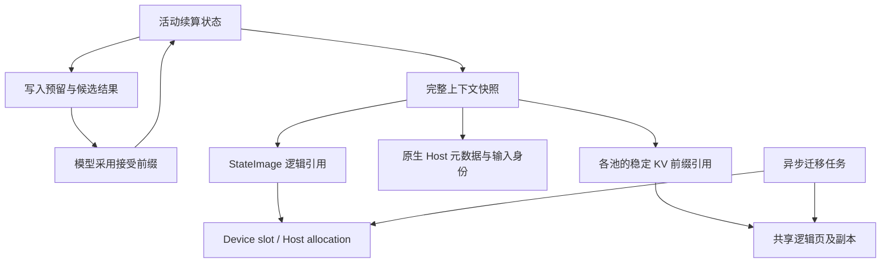

# 续算状态与上下文快照重构设计

状态：S1 已完成，S2–S4 待实施。固定状态、续算 metadata 与实际消费者已迁移；
KV 前缀引用和统一迁移任务继续按后续步骤推进，再进入 Qwen4Exp 的加载与执行资源阶段。
本文描述目标设计和实施顺序；当前已实现合同以
[Engine 架构](engine-architecture.md)、[上下文缓存](resource-scheduling-and-context-cache.md)
和 [Paged KV](paged-kv-cache.md) 为准。

## 1. 目标与范围

新增一种固定状态时，模型只声明其布局、消费视图和数学推进方式；保存、分支、Host offload、
恢复和释放使用公共机制。完整恢复点必须包含同一实际执行历史中相容的续算状态与分页历史。

本轮包括：

- 固定状态的物理布局、算子状态视图、逻辑身份、写入权和 Device/Host 副本。
- 活动续算状态、候选提交、checkpoint 的 Host 元数据归属。
- KV 活动历史、稳定前缀引用、保护范围及 COW。
- 异步迁移所有权、资源需求与实际传输工作量。
- Qwen3_5 的 ordinary、MTP、DFlash/DFlash2、prefix reuse、暂停恢复及取消路径迁移。

允许修改必要的 Core、Op 接口、Program 和 Runtime 资源合同。旧的类划分、命名、存储顺序、
模板和参数形式均不构成兼容要求。数学计算及原生模型调用关系保持明确；Qwen4Exp 的实际加载、
层执行和状态推进随后续集成实施。

## 2. 需要替换的现有结构

| 现有结构 | 问题 | 目标 |
|---|---|---|
| StateImage 由 linear pool 提供 slot 数，逐组件维护 Host 布局和复制 | 通用状态依赖 GDN，布局与搬运清单重复 | 独立 image 布局和公共物理存储 |
| 算子根据单份状态尺寸推导 slot stride | 将整个 pool 的排列固化进算子 | 单份状态连续，外层 stride 显式 |
| `HostStatePool` 再包装 `HostContextAllocation` | 重复的 slots、generation、free list，以及预留后重新申请 | 逻辑副本或迁移任务直接持有 allocation |
| `HostToFork`、`reserve_reset()`、提前标记的 `ActiveMutable` | 混合搬运、分支、空间预留和数学初始化 | 写入与副本物化分开，目的状态成立时间明确 |
| checkpoint 共享 `KVHistory`，模型扫描记录维护保护前沿 | 前缀保留意图没有成为明确的资源引用 | 稳定 KV 前缀引用，由 history 层维护保护 |
| 原生 metadata 分散在 sequence、pending 和 checkpoint | 容易漏掉一起提交或恢复的字段 | 统一的类型化续算状态 |
| 公共资源固定为 Main/Backend，`units` 混用 slots 和 bytes | 模型角色进入存储机制，数量单位不明确 | 启动固定的 pool 身份和明确资源量 |
| 一个大 `ContextTransaction` 组合请求流程与 DMA 寿命 | 回收依赖多个布尔状态组合 | 迁移任务直接持有预留、来源及完成依赖 |

固定状态与分页历史的分离、源/目的 selector、唯一持有时的原位写入、Program 所有权以及
模型原生数学提交继续保留。

## 3. 逻辑对象与所有权

### 3.1 三种内容

| 内容 | 生命周期与职责 |
|---|---|
| StateImage | 大小固定的张量状态；布局在 Program 启动时确定 |
| 续算状态 `Continuation<Metadata>` | 一个执行位置的 StateImage 逻辑引用与原生 Host 元数据 |
| 上下文快照 `ContextSnapshot<Metadata>` | 续算状态、稳定 KV 前缀引用和精确输入身份证明 |

Checkpoint 为完整快照增加保留用途和管理身份。InputReplay、LongAnchor、SharedPrefix、
Continuation 等用途属于保留管理，不决定张量的存储方式。同一内容可被多个用途共同持有。



Program 拥有 backing、stores、活动状态和未完成任务。Core 提供物理布局、视图和原始传输；
`models/common/context` 提供逻辑身份、引用、写入和迁移生命周期；模型提供类型化字段及推进；
Runtime 选择执行成员、缓存来源和回收动作。

Lane、StateImage slot、KV execution row、compact batch row 继续是独立身份。暂停可以释放
lane，恢复可以使用不同 slot 和 execution row。Host metadata 不以其中任何物理编号为归属。

### 3.2 续算状态与候选提交

续算状态中的 metadata 是具体 C++ 类型，按值保存必要的小字段，对较大的不可变身份证明使用
共享只读引用。Qwen3_5 的位置与末端特征有效性、Qwen4Exp 的 PLE raw-ID tail 等均由原生类型
表达。公共层持有并传递 metadata，不解释其中的数学含义。

活动执行、候选提交、checkpoint 使用相同的续算状态结构。原生 Program 从实际记录和接受前缀
产生新张量状态与 metadata，然后一起采用。用于采样或已经发布的输出 token 数不能代替
实际执行输入前沿。

区分三类位置：已采用的输入前沿、候选执行范围、各分页历史自身的有效前沿。Main 与 MTP 等
历史的对应关系由模型计算并随快照保存。公共层不能从一个数统一推导全部后端位置。

零接受保留基准续算状态；独立目的是否需要填充由原生 Op 合同和后续消费者决定。外层提交仍
可能截断时，基准状态、实际 records 和候选特征继续存活。完整快照只在所有必要组成部分
符合该恢复点时发布；能够截取 KV 前缀不代表同位置的 recurrent state 已存在。

### 3.3 内容身份

逻辑 handle 的 generation 保护描述符复用；内容版本标识实际状态内容。取得引用、保存快照
和复制到 Host 不产生新的数学内容。唯一写入者推进内容时，旧版本的观察者必须已经退出，
或仍由独立状态/副本保留。

输入 digest 仅用于候选筛选，采用前继续执行精确输入身份匹配。相同 token 的独立重算结果
不能任意拼成一个快照。StateImage、页前缀和 metadata 必须沿用相容的实际执行身份。

## 4. 固定状态布局与消费者接口

### 4.1 固定布局：按 slot 连续

采用一份 image 包含该 slot 的全部固定状态，多个 image 在 Device backing 中排列：

```text
slot 0: GDN conv / recurrent，其他固定状态，末端特征
slot 1: GDN conv / recurrent，其他固定状态，末端特征
...
```

每个字段的单份数据仍连续；同构层可采用恒定 layer stride。通用寻址形式为：

```text
address = backing + slot * image_stride + field_offset
          + layer * field_layer_stride + dense_inner_offset
```

`StateImageLayout` 统一给出 slot 数、image stride、字段类型/形状/偏移及必要的字段组。
模型通过同一布局建立类型化 views，容量规划和实际绑定不再分别维护公式。Host snapshot
使用相同的 image 内部布局，完整复制可使用连续跨度；DFlash local 等字段组仍可独立复制。

该布局已确定。S1 适配实际消费者并检查正确性和推理性能，不再比较其他存储排列。

### 4.2 Op 接口改动

状态视图表达局部连续数据与明确的 slot/layer stride。模型级逻辑 handle 在绑定边界解析为
这些视图和 Device selectors；Op 不接收 checkpoint、迁移任务或逻辑 store。

检查 GDN input/conv、recurrence、record/fold、循环 KV、末端 hidden 的 gather/scatter，以及
QSA/PLE 状态消费者。将按尺寸硬推导的外层 stride 改为视图中的真实值；仍然要求连续的内部
维度保留该要求。实际表示 state slot 的 `lane` 字段一并纠正命名。

校验覆盖实际寻址跨度、对齐、slot/layer 范围及读写重叠。不能只移除 `is_contiguous()` 检查，
也不能用包含间隙的整个包围区间误判不同字段必然重叠。所有受影响 launcher、Graph 参数、
调用方和独立数学/状态参考一起适配。

张量数值类型、运算顺序、公开舍入边界与原始状态 words 保持原合同。稳定 backing 在启动时
建立，Graph 消费的地址与 stride 在其生命周期内有效。

### 4.3 Host 副本与容量

取消独立 `HostStatePool`。逻辑状态副本直接持有 `HostContextAllocation`；传输目的由迁移任务
持有，完成后移交。一次预留取得的 allocation 直接用于复制和发布，不先归还再重新申请。

Host StateImage 与 KV extent 继续共用既有 pinned arena，实际 allocation 从预留时计入容量。
KV extent 仍保留批量页归属与拆分能力。Device slot 和 Host 空间的数量不要求一一对应。

容量使用实际 image stride 和 arena 分配大小。传输工作量使用实际复制跨度：复制 image 内的
对齐间隙也计入字节数，未复制的 arena 额外取整不计入传输。逻辑张量 payload、物理占用和
复制字节数分别表达。

## 5. 写入权与副本物化

公共状态机制分开提供读取引用、写入预留和副本物化。原生模型调用顺序明确表达以下动作：

| 动作 | 资源效果与成立条件 |
|---|---|
| 取得读取引用 | 保留对应内容；实际执行/传输读取时保护所用副本 |
| 预留写入 | 保留基准和可写目的，尚未宣告目的数学状态有效 |
| 初始化 | 模型写入初始张量和 metadata；例如零历史、EOS、无效末端特征 |
| 完成写入并采用 | 模型确定完整结果、metadata 及生产完成依赖，采用新的续算状态 |
| 建立副本 | 为同一内容预留另一位置并复制，完成后发布 |
| 保存快照 | 持有已采用内容与其稳定 KV 前缀，不自动整份复制 |

写入预留提供明确的 source/destination selectors。旧状态仍被 checkpoint、并发读者或回滚
消费者使用时，必须保留其可读内容，新结果取得独立的逻辑内容身份；Device 槽能否复用由
实际读者及下述副本交接条件决定。唯一持有且旧值已无消费者时允许直接原位推进。普通 token
推进不因该抽象增加整份 state copy、Host 同步或动态分配。

Fork 保留“后续计算直接生成目的状态”的能力。完整复制、只复制必需字段组和数学上重新生成
目的字段由原生调用明确选择；公共层不推断哪些字段将在 forward 中被覆盖。

旧内容已有 Host 副本且 Device 槽无读者时，可保留旧 Host 内容，将 Device 槽交给新写入者。
只有 Device 副本且仍需保留旧内容时，先完成必要的备份。Host 恢复可直接写入最终目的 slot，
不因为分解了接口而增加中间副本。

普通推进沿既有 stream 顺序建立依赖，逻辑采用不要求逐 token 在 Host 等待 GPU。跨 stream
消费或快照迁移必须继承实际生产完成依赖，不能把“已安排写入”等同于“任意消费者均可读取”。

## 6. 活动历史与稳定 KV 前缀

### 6.1 显式前缀引用

活动 history 拥有可追加的逻辑目录、当前有效范围，以及执行绑定需要的 row 和增长预留。
稳定前缀引用持有某一 pool 的逻辑前缀及其有效长度，保证该范围内的映射和内容继续可恢复；
它本身不需要 execution row，也不长期 pin 所有 Device 副本。

Checkpoint 使用前缀引用。其创建与释放直接更新 history 层的保留需求，移除模型代码中的
`refresh_history_requirements()` 扫描及 `KVHistory` 析构对 Program 的反向调用。
前缀目录与物理页继续共享；引用变化只更新受影响 history、目录节点和页范围，不重建全部
地址空间的保护信息。

### 6.2 共享与写入规则

- 同一历史的内部锚点保留明确前缀，不复制整套页表或 KV，也不因未对齐页边界就必然复制尾页。
- 追加未触及受保护内容，且页的写入权、迁移依赖和副本版本允许时，可以使用现有尾页。
- 分支产生独立写入或覆盖与已有前缀冲突时，对需要修改的尾页/目录执行 COW。
- 截短活动历史只解除其不再需要的引用；仍由其他前缀保留的内容继续存在。
- 仅保存快照、仅释放一个别名、以及移除最后一个内容所有者具有不同的资源效果，查询必须去重。

Replica 的内容身份、有效范围和 readiness 必须相容。追加或改写会影响副本有效性时，显式
更新副本或执行 COW；不能仅根据物理字节已经存在就宣布该前缀可用。实际传输读者继续保护
其读取范围，尾页共享规则与迁移规则一起执行。

### 6.3 QSA 的页组与固定 tail

QSA 的 K/V、scales、compressed index keys 共用一个逻辑页组。主 plane 一行对应一个 token，
index plane 一行对应四个 token；页内原 token 有效数为 `c` 时，index 有效行数为 `floor(c/4)`。
COW、迁移和发布覆盖该页组全部 planes。

未完成块最多三个 raw keys 及块首坐标属于 StateImage。例如从 `F=6` 执行候选 6、7，最终只
采用 token 6：新前沿为 7，tail 为 raw 4/5/6，候选已经写好的块 4..7 仍无效。
前缀引用与固定状态必须共同表达这个结果。

## 7. 公共 pool 身份与资源接口

模型启动时建立固定的 pool 集合，每个 pool 有明确身份、几何和容量。模型侧保留 Main、MTP、
Draft Full 等类型化字段；公共 history、checkpoint、迁移和资源核算消费 pool 引用/ID，
不解释模型角色，也不推导后端前沿。

资源接口分别表达：

- Device StateImage slot 数。
- 各 KV pool 的 page-group 数，按稳定 pool ID 索引。
- 共用 Host arena 的实际 bytes。
- 传输方向、来源归属、实际复制 bytes 和 copy operations。

删除 `units` 随资源种类切换单位的约定，迁移工作量由执行同一复制计划的描述产生。
缺口、预留、释放量和物理占用使用同一资源几何；Runtime 不维护另一份物理占用账本。
不同 pool 的页不能互相抵消，不同大小的页数不能直接作为跨池等价成本。

Runtime 的来源选择、回收权限、保留优先级和恢复许可继续沿现有策略工作，改用明确资源接口。
实际副本或布局改变时，按新的真实需求报价。模型提供各历史的覆盖需求和启动容量关系；本轮
不增加新的容量策略、配置项或 pool 动态扩容。

## 8. 异步迁移与请求事务

迁移任务直接持有来源读取保护、目的 reservation/allocation、复制计划及完成依赖。它负责
StateImage 和 KV 副本的物化；bind、capture、pause 等请求流程由模型 Program 组合这些任务。

| 任务阶段 | 所有权与取消行为 |
|---|---|
| 已预留，未提交 | 持有真实目的空间；取消可立即归还 |
| 已提交，未完成 | 来源和目的继续保留；取消停止后续发布意图，等待完成后回收 |
| 已完成 | 发布有效副本或回收目的，解除本任务读取保护 |
| 已发布 | 根据现存内容所有者和执行读者决定能否释放来源 |

普通取消通过 Program 的有界任务退役机制处理在途复制，不在析构中隐式同步 GPU 或提前归还
目的内存。提交异常可能已经发出部分 CUDA 操作而尚无完成事件；错误路径必须结束相关设备
访问后再清理，Program 销毁同样先结束在途工作。

区分三个时机：原生数学结果成立、物理副本可用、请求完成恢复绑定。迁移成功不会自动完成
MTP bridge、DFlash context append 或模型末端特征绑定。

未发布的写入不能破坏仍有独立所有者的基准。已明确消费或授权退休的可选 checkpoint 按现有
请求合同处理，不因取消自动复活；其他 checkpoint 和在途读者持有的内容继续有效。

原生请求流程用各自需要的 continuation、前缀引用和迁移任务表达操作，替换大事务中分散的
`borrow_*`、`adopted` 等资源所有权标记。每个子对象负责其实际持有的资源，整个请求何时
对 Runtime 发布仍由 Program 决定。

## 9. 模型对应关系与代码组织

| 架构内容 | 固定张量状态 | Host metadata / 分页历史 |
|---|---|---|
| Qwen3_5 Main | GDN conv/recurrent、continuation hidden | 原生位置和有效性；Main KV 前缀 |
| Qwen3_5 speculative | 所选后端需要的 local cyclic state | 原生后端位置；实际存在的 growing pool 前缀 |
| Qwen4Exp Main | GDN、QSA raw tail/坐标、PLE history、sample hidden、可选 MTP conditioning | PLE raw-ID tail、原生位置和有效性；Main KV/index 页组前缀 |
| Qwen4Exp MTP | 自身 QSA raw tail/坐标 | bridge 确定的自身位置；MTP KV/index 页组前缀 |

QSA selection、GDN/PLE 实际 records、候选特征窗口和 I/O ticket 是执行期数据。
不可变 expert 缓存与 PLE row cache 是权重资源。它们不进入请求 checkpoint。
具体数学与字段尺寸继续由 [Qwen4Exp 执行与状态](qwen4_exp-execution.md)等原生合同维护。

目标组织按职责集中，不为每个辅助类型单独建文件：

| 位置 | 内容 |
|---|---|
| `core/state_image.{h,cpp}` | 固定 image 布局、物理存储和复制视图；复用已有 arena/transfer |
| `models/common/context` | 状态引用和写入、history 前缀、完整快照持有、迁移生命周期 |
| `models/common/qwen/prefix_identity.*` | 共享 Qwen 输入身份证明和前缀匹配 |
| 原生 `state` / `program` | 类型化 metadata/views、数学推进、模型前沿关系与请求流程 |
| `runtime/contract` 与 context cache | 明确的资源量、来源和回收策略的接口迁移 |

公共实现以实际能力为边界。模型差异通过字段声明和具体 metadata 类型表达，不通过运行时
字符串字段、模型继承体系或通用计算图表达。旧模板若只用于包装旧池类型，随实现替换移除。

## 10. 实施步骤

按 **S1 → S2 → S3 → S4** 推进；各步骤完成受影响调用方迁移后再收尾，避免长期保留两套
产品路径。下列步骤是本轮唯一的实施进度清单。

### S1：固定状态、续算状态与算子视图

- [x] 建立独立 StateImage layout，落实 slot/layer stride 与类型化视图。
- [x] 适配所有实际状态消费者，验证固定 slot 连续布局的数学、状态及推理行为。
- [x] 重写状态写入/副本接口，直接持有 Host allocation，移除旧 HostStatePool 和混合语义。
- [x] 统一 Qwen3_5 活动/候选续算 metadata，迁移 planner、state bindings 和 Graph 引用。
- [x] 保留原位写入、下一次计算生成 fork、局部字段复制和紧张容量下的副本交接。

产出：Qwen3_5 使用新的固定状态基础；旧 checkpoint 流程暂时消费新的状态引用，固定状态
数学与副本寿命已明确。状态初始化、复制、实际 Op 路线与现有推理能够通过检查。

### S2：KV 前缀引用与完整快照

- [ ] 区分活动 history 与稳定前缀引用，完成前缀目录共享、局部保护维护和 COW。
- [ ] 建立包含续算状态、前缀引用和输入身份的完整快照；集中管理 checkpoint 引用与 pin。
- [ ] 迁移 Qwen3_5 的内部锚点、公共分支、capture、截断、释放和来源完整性检查。
- [ ] 移除模型扫描保护前沿、依赖 `shared_ptr::use_count()` 判断资源寿命及反向析构回调。
- [ ] 用小型混合状态与 `tokens_per_row=4` 页组验证 Qwen4Exp 需要的组合和非对齐前沿。

产出：checkpoint 通过明确引用保留完整恢复点，保护与释放由公共层兑现；内部锚点不因新
接口无条件增加尾页复制，现存共享内容在分支、截断和释放后仍正确。

### S3：异步迁移与 Runtime 资源合同

- [ ] 建立直接持有预留、读者和完成依赖的迁移任务，完成发布、取消及延迟回收。
- [ ] 迁移各 pool 的资源需求、物理占用、释放查询和真实传输报价，清理混合单位字段。
- [ ] 迁移 bind、pause、restore、demote 和 capture 的物理操作，保留原生 bridge/接续。
- [ ] 完成 source planning、reclaim、恢复许可、cost 消费端及相关工具的接口更新。
- [ ] 移除大事务中被资源持有对象替代的标记和手工清理分支。

产出：公共层完成 State/KV 副本迁移和物理资源结算；原生流程只组合明确资源动作与模型动作，
Runtime 根据真实 pool 需求运行既有策略。并发引用和在途取消有完整的所有权闭环。

### S4：完整迁移验收与收尾

- [ ] 用现有 35B、27B 产物检查受影响的 ordinary、MTP、DFlash/DFlash2、Vision 续接、
  prefix reuse、Snapshot/Replay、取消及 eager/Graph 路线。
- [ ] 对照实施前固定的负载，检查计算、保存/恢复延迟、传输与资源占用；处理实际退化。
- [ ] 清理旧实现、适配残留、重复测试与过时命名，核对文件组织及销毁顺序。
- [ ] 将已完成的稳定约定写回 Engine、上下文缓存、Paged KV 与受影响 Op 合同，完成完整编译。

产出：Qwen3_5 全部受影响路线完成迁移；Qwen4Exp 后续直接声明状态组成和原生推进，无需
再次实现保存、前缀保护、Host 搬运及释放机制。再继续原集成计划的第二阶段。

## 11. 验证与性能证据

沿用现有测试和 benchmark，按步骤增加实际改变的合同样本：

- 固定状态：混合 dtype、不同 slot/layer stride、完整/局部复制、Host 往返和相邻 slot 隔离。
- 写入与快照：独立读者、共享 fork、零接受、部分接受、最后引用释放和 Host metadata 一致性。
- KV 前缀：内部锚点、独立分支、尾页 COW、截断、页边界及四 token 行跨度的 coverage。
- 迁移：已预留与在途取消、源持有者退出、成功副本发布、预算紧张下恢复和跨 lane 重新绑定。

搬运对实际输入 words 做精确检查；改变寻址的 Op 按
[Op 开发合同](op-development.md)对独立数学 oracle 或指定的 exact state/record reference
验证。真实模型输出用于集成行为检查，不能代替数学和状态正确性。

整模检查使用 `out/qwen3_6_35b_a3b.ninfer` 和 `out/qwen3_8_27b_nvfp4.ninfer`，按各自产物
支持的后端覆盖受影响路线。

实施前固定当前生产路径、产物、负载和测量条件。性能覆盖实际改变的状态消费者（单路及多路）、
完整/局部 image 搬运、checkpoint 保存/恢复与代表性整模执行，不展开无关的全参数测试。
记录绝对延迟及分布、实际 bytes/copy operations、带宽与对应传输 roofline、Device/Host
占用，并明确单 Op 与整模结果的范围。性能对比固定使用修改前的实现和相同负载，不重新选择存储布局。

实现步骤使用 `cmake --build build -j` 完整编译。恢复与分支语义由小型测试直接覆盖，真实模型
测试串行执行并复用充分证据。文档在相应能力实现后才更新当前合同；尤其 `paged-kv-cache.md`
继续只记录已实现的稳定内容。
