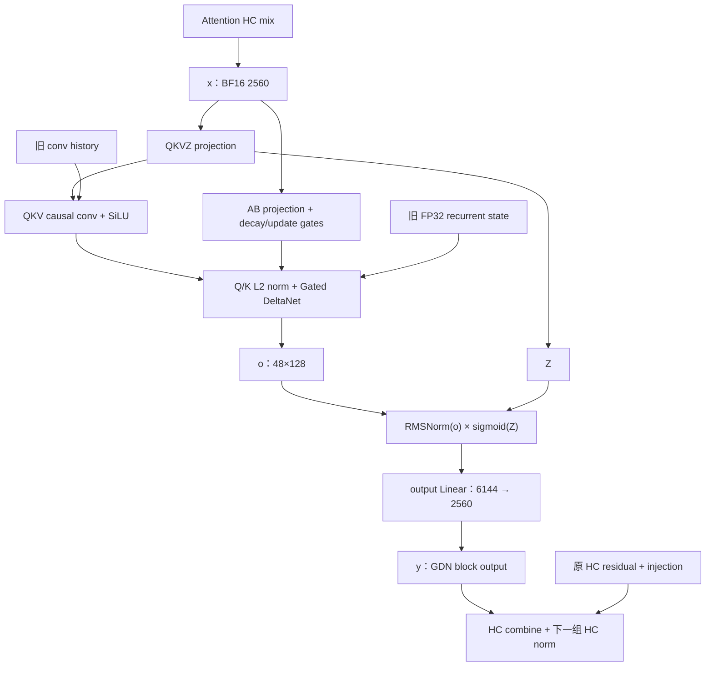

# Qwen3.8-Flash-Next：GDN 计算流程与实现要求

更新日期：2026-10-08。**A1 输出 norm 与 A2 控制投影已实现并通过独立数学资格验证；Qwen4Exp 的完整 GDN 层待实现。**

本文定义 Qwen4Exp GDN 从 HC 输入到输出回注的计算流程、Op 组合、状态与记录，以及
实现进度与剩余工作。层级编排位于新的 `src/models/qwen4_exp/execution/`，复用适用的中央
Ops 和 kernel。现有 recurrence、卷积和 ReplaySSM 是实现基础。

[支持总览](qwen3_8-flash-next-model.md)维护量化、矩阵合并、卷积持久布局与整体进度；
[HC](qwen3_8-flash-next-hc.md)维护前后残差计算；[ReplaySSM](replayssm-gdn.md)维护
已有 record/fold 的精确执行合同。本文采用总览的 T、B、M=T*B、F、S 约定。

阅读入口：[参数与张量](#1-参数与张量)、[完整流程](#2-完整计算流程)、
[Op 边界](#3-op-边界与数值表示)、[各执行路径](#4-各执行路径)、
[状态与记录](#5-状态记录与生命周期)、[实现进度](#6-实现进度与剩余工作)、[验收](#7-验收)。

## 1. 参数与张量

### 1.1 实例几何

| 项目 | 本实例 |
|---|---|
| GDN 层 | Main 中零基层号 l%4!=3，共 36 层；原生 MTP 无 GDN |
| block 输入/输出宽度 H | 2560 |
| Q/K heads / V heads | 16 / 48，每组 Q/K 服务连续三个 V heads |
| key/value head dimension | 128 / 128 |
| Q/K/V/Z 宽度 | 2048 / 2048 / 6144 / 6144 |
| QKV 总通道 Cg | 10240 |
| causal depthwise conv | 4 taps、dilation=1、无 bias，之后为 SiLU |
| 输出 gated norm | 每个 V head 做 128 维 RMSNorm，再乘 sigmoid(Z) |
| epsilon / query scale | 1e-6 / 1/sqrt(128) |
| recurrent state | 每 V head 一份 FP32 [128,128] |

GDN block 接收 HC 混合后的一个 2560 维输入。HC 的四条 residual streams 留在层外，
不增加 GDN 的 head 数或状态份数。Q/K 按 head 索引复用，不物化三份重复向量。
GDN 没有 RoPE 或 KV 页表输入。

### 1.2 权重与原生参数

下表的矩阵 shape 为逻辑 `[N,K]`；向量与卷积 view 为第 0 维连续的原生 Tensor。
精度与持久行序以[核心权重目录](qwen3_8-flash-next-model.md#52-textmtp-的物理投影目录)为准。

| 参数 | 表示 / shape | 内容 |
|---|---|---|
| QKVZ parent | Q8 G32/FP16 scale [16384,2560]，A16Only | Q、K、V、Z 依次占 2048、2048、6144、6144 行 |
| AB parent | BF16 [96,2560]，A16Only | A 在 [0,48)，B 在 [48,96) |
| output parent | Q8 G32/FP16 scale [2560,6144]，A16Only | 输出独立的 GDN block value |
| A_log / dt_bias | 各 FP32 [48] | converter 从 BF16 源值精确展开，control Op 直接读取 |
| output norm weight | BF16 [128] | 直接乘数 gamma，所有 V heads 共用，无 unit offset |
| conv weight | BF16 原生 [10240,4] | channel 连续，weight[c,j] 对应源 source[c,0,j] |

卷积由 converter 离线置换为 artifact/Binding `[4,10240]`，再零拷贝绑定为上述原生
view；完整映射见[卷积存储约定](qwen3_8-flash-next-model.md#54-vision-与其他非矩阵参数)。
A_log/dt_bias 保留原始数值含义，不预计算 exp；norm/conv 与 AB 保留 BF16。
参数存储类型与 FP32 控制计算分开规定，依据见[总览 §4.2](qwen3_8-flash-next-model.md#42-q8直接参数与-norm)。
三个投影的纯 Linear 几何已完成支持与调优。

### 1.3 激活布局

| 值 | dtype / shape | 消费者 |
|---|---|---|
| block 输入 x | BF16 [2560,T,B]，展平 [2560,M] | QKVZ、AB 两个投影分支 |
| 独立投影的 QKV | BF16 [10240,M]，连续 | 分开的卷积路径 |
| 卷积后 q / k | 各 BF16 [128,16,T,B]，连续 | recurrence；k 还进入 verify record |
| 卷积后 v / 输出门控 z | 各 BF16 [128,48,T,B]，连续 | recurrence / sigmoid-gated norm |
| g / beta | 各 FP32 [48,T,B]，展平 [48,M] | recurrence 与 verify record |
| recurrent output o / gated output r | 各 BF16 [128,48,T,B] | gated norm / output Linear |
| GDN block 输出 y | BF16 [2560,T,B]，展平 [2560,M] | HC combine |
| 层外 residual / injection | BF16 [2560,4,M] / FP32 [4,M] | HC combine，跨整个 GDN 存活 |

投影和逐列运算可以使用 M 轴；卷积与 recurrence 按原 T/B 分隔序列。QKVZ parent 的
Linear 输出 `[16384,M]` 与上面的独立连续 QKV/Z 输出是两种激活组织。采用现有
`gdn_input_proj` 家族直接输出下游所需的连续分路，权重仍只保存一份合并 parent。
调用投影/卷积家族时，Q/K 按 `[2048,T,B]`、V/Z 按 `[6144,T,B]` 绑定，再零拷贝展开为
上表的 head 轴。r 展平为 `[6144,M]` 输入 output Linear，y 按 `[2560,M]` 交给 HC。

## 2. 完整计算流程

### 2.1 层级数据流



输入 x 已由 attention HC 产生，GDN 直接消费它。输出 y 交给 HC，后者将其注入四条
residual streams。零基第 1 层的 PLE 位于本层 attention HC 之前，不改变 GDN 的调用。

以下公式描述一个序列的有效输入，省略 batch 下标；权重按其已存表示解释。

### 2.2 QKVZ 与控制投影

```text
[p_q, p_k, p_v, z] = W_qkvz * x
[a, b]             = W_ab * x

g[h,t]    = -exp(A_log[h]) * softplus(a[h,t] + dt_bias[h])
beta[h,t] = sigmoid(b[h,t])
```

g/beta 为每个 V head、每个 token 一对标量。A_log/dt_bias 已在 artifact 中精确展开为
FP32，控制向量与 g/beta 出口均直接采用 FP32。AB 投影和非线性组成 `gdn_control_proj` 的
完整数学；a/b 可以是内部中间值，不要求模型持有两个额外 BF16 buffers。

QKVZ 与 AB 消费同一份实际 BF16 x，两分支在 recurrence 处汇合；执行编排明确它们的
顺序或 stream 依赖。Z 绕过卷积，保留给后面的输出门控。

### 2.3 因果卷积与 SiLU

令 p 为连接后的 10240 维 QKV 投影，旧 history 保存当前窗口之前三个位置的投影值。
对通道 c：

```text
u[c,t] = SiLU(
    w[c,0]*p[c,t-3] + w[c,1]*p[c,t-2]
  + w[c,2]*p[c,t-1] + w[c,3]*p[c,t])

[q, k, v] = split(u, widths=[2048,2048,6144])
```

窗口开始前的三个 p 从 history 读取；新序列的 history 为零。状态保存的是卷积前的
投影值，不是 u。Conv 后仍为 SiLU；输出端的 sigmoid 是另一个门控。
卷积与状态发布可以融合在投影后处理里，具体数值边界见第 3 节。

### 2.4 L2 normalization 与 recurrent update

对 V head h，Q/K head 为 qh=floor(h/3)。先在 128 维内归一化：

```text
qhat = q[:,qh,t] / sqrt(sum_d q[d,qh,t]^2 + 1e-6)
khat = k[:,qh,t] / sqrt(sum_d k[d,qh,t]^2 + 1e-6)
alpha = exp(g[h,t])
```

沿用 NInfer 的 state 轴顺序 S[value_dim,key_dim]：

```text
Sbar  = alpha * S_previous
delta = beta[h,t] * (v[:,h,t] - Sbar @ khat)
S_new = Sbar + outer(delta, khat)
o[:,h,t] = (S_new @ qhat) / sqrt(128)
```

当前 token 的 readout 使用更新后的 S_new。Query scale 只应用一次；调用已有
`gated_delta_net` 时传入原 q/k、`normalize_qk=true` 和 `scale=1/sqrt(128)`。
状态保持 FP32，o 为 BF16。现有 16/48 heads、128 维的 recurrent/chunked 路线适用。

### 2.5 输出 norm、sigmoid gate 与投影

对每个 V head 的 128 维 o 独立计算：

```text
r[d,h,t] = gamma[d] * o[d,h,t]
           / sqrt(sum_i o[i,h,t]^2 / 128 + epsilon)
           * sigmoid(z[d,h,t])

y[:,t] = W_out * flatten(r[:,:,t])
```

gamma 是直接乘数，不使用 HC 的 offset gain。Norm 和 sigmoid multiplication 构成
一个完整 Op，r 为其 BF16 出口；norm 与乘 gate 之间没有额外的公开 BF16 边界。
W_out 消费实际 r，产生 BF16 y。z=0 时 r=0.5*RMSNorm(o)，区别于现有 SiLU gate。

### 2.6 HC 回注

```text
h_next[s,d,t] = h[s,d,t] + injection[s,t] * y[d,t]
```

典型调用是 `hc_combine_norm`，同时得到 BF16 h_next 和下一组 MoE HC 的 normalized
streams。Injection 是 attention HC 已产生的 FP32 系数。HC 的 residual/norm 表示边界
按其专题执行；GDN block 本身只输出 y。

## 3. Op 边界与数值表示

### 3.1 调用分工

| 计算 | 采用的入口 | 本实例状态 / 所需工作 |
|---|---|---|
| AB → g/beta | `gdn_control_proj`，合并 parent 形式 | BF16 [96,2560] 已实现并通过数学资格验证，沿用 FP32 A_log/dt_bias |
| 独立 QKVZ 投影 | `gdn_input_proj`，single-parent 形式 | 增加 Q8 [16384,2560]、A16Only |
| 独立卷积 | `causal_conv1d_silu_split` | 复用既有 2048/2048/6144 分路与 [10240,4] 权重合同 |
| 投影＋卷积＋snapshot | `gdn_input_proj_conv_snapshot` | 增加上述 Q8 parent，输出连续 Q/K/V/Z 与 conv snapshot |
| 投影＋卷积＋record | `gdn_input_proj_conv_record` | 增加上述 Q8 parent，保持与 snapshot 的精确执行关系 |
| recurrence | `gated_delta_net` / `gated_delta_net_batch_update` | 复用 16/48/128 几何 |
| verify recurrence | `gated_delta_net_replay_record` | 复用逐层 record 入口与实际输入记录 |
| output norm＋sigmoid | `sigmoid_gated_rmsnorm` | 已实现并通过完整 norm/gate 公式的数学资格验证 |
| output projection | `linear`，Q8 [2560,6144] | 已有纯 Linear 支持 |
| accepted-prefix fold | `GdnReplayFoldPlan` | 增加 36 层、16/48 heads、10240 conv channels 的全层几何 |
| residual 回注 | `hc_combine_norm` | 按 HC 专题实现和调用 |

上述复合入口的实现可复用现有 kernel 与调优结果；模型通过公共 Op 合同调用。
已实现的控制家族以 [gdn_control.h](../../include/ninfer/ops/gdn_control.h) 为接口权威：
`gdn_control` 处理已有 a/b，`gdn_control_proj` 包含投影，`gdn_norm_control_proj` 另外包含
offset input RMSNorm 并产生显式 BF16 normalized 输出。后两者采用 `DeviceExecutionView`
与 caller-owned workspace，输出分别由 `GdnControlOutputs`、`GdnNormControlOutputs` 组织。
本实例使用不带 input norm 的入口；带 norm 形式仅支持既有 K=5120/2048 几何。

[prepare_gdn_control_proj_weights](../../include/ninfer/ops/weight_input.h) 从 A/B `WeightInput`
得到非 owning 的 [ProjectionWeights](../../include/ninfer/ops/projection_weights.h)，由执行与容量
查询共同消费。合并 parent 的 row views 零拷贝，backing 由调用者持有，不增加运行时权重重排。

### 3.2 Sigmoid-gated RMSNorm

`sigmoid_gated_rmsnorm` 与对称命名的 `silu_gated_rmsnorm` 已统一实现于 RMSNorm 家族，
公共声明与支持域由 [rmsnorm.h](../../include/ninfer/ops/rmsnorm.h) 维护。

沿最快轴 D=ne[0] 计算第 2.5 节的复合公式。本实例 x/z/out 为连续 BF16
`[128,48,T,B]`，weight 为 BF16 `[128]`；通用 shape 规则沿用同家族：x/z/out 同形、
D 和其余 extents 为正、weight 为 `[D]`、eps 正且有限。只读输入可以共享 backing，
输出不与任何输入重叠，输入保持不变，输出完整覆盖。
无 workspace、状态读写或持久中间量；执行参数提供 stream 与正的物理 SM 数。
数学 oracle 使用 represented inputs 的完整 FP64 norm/gate 公式，不复制实现中的私有 casts。

### 3.3 可观察表示与 record 的区别

| 边界 | 合同 |
|---|---|
| HC → GDN | 两个投影分支消费同一份 BF16 x |
| 独立 projection → 独立 conv | 公开连续 BF16 QKV；Z 为独立 BF16 输出 |
| fused projection/conv 内部 | 投影中间值可保留私有精度；不强制经过独立 Linear 的 BF16 写回 |
| conv → recurrence | 实际 BF16 q/k/v；L2 normalization 属于 recurrence |
| control → recurrence | 实际 FP32 g/beta |
| recurrence → output gated norm | 实际 BF16 o，与实际 BF16 Z 一起计算 |
| gated norm → output Linear → HC | BF16 r → BF16 y |
| history / replay records | 保存所对应执行发布的 BF16/FP32 words，提取或 fold 不重跑投影 |

数学入口按独立高精度 oracle 资格化。Snapshot/record 两种形式则必须在相同输入、初始
状态、完整物理 T/B 和 policy 下共享算术选择，保证有效 Q/K/V/Z 和历史记录对应同一次
snapshot 执行。分开的 projection+conv 是一种实现组合，不是所有融合路线的逐 bit 标准。

## 4. 各执行路径

以下为模型调用顺序，省略参数绑定和 workspace 实参。所有路径先调用 HC 得到 x 与
injection，再用 `gdn_control_proj` 产生 g/beta；末端均执行 sigmoid-gated norm、output
Linear 和 HC combine。Program 显式提供旧状态与目标状态槽。

### 4.1 Prefill、Replay 与 CausalScoring

当前 prefill/Replay/scoring 按 B=1 的连续窗口执行，T 可为任意合法正值：

```text
gdn_input_proj(x, qkvz_parent) → qkv、z
causal_conv1d_silu_split(qkv, conv_weight, conv_before, conv_after) → q、k、v
gated_delta_net(q,k,v,g,beta, state_before,state_after) → o
sigmoid_gated_rmsnorm(o,gamma,z) → r
linear(r, output_parent) → y
hc_combine_norm(h,y,injection,next_hc_norm) → h_next、z_next
```

大 T 由已有 recurrence Op 选择 chunked 路线。1024/2048/4096 的 prefill chunk 仍沿此
路径规划，不为每个 token 保存完整 recurrent snapshot。需要保存的 checkpoint 对齐
其实际执行边界；调用输入/输出 state 是否可同址由 Program 的基准状态寿命决定。

### 4.2 Ordinary decode 与单列 control

使用 T=1、B=1..8 的实际紧凑批次：

```text
gdn_input_proj_conv_snapshot(x, source_slots, destination_slots) → q、k、v、z
gated_delta_net_batch_update(q,k,v,g,beta, source_slots,destination_slots) → o
共同末端：sigmoid_gated_rmsnorm → output Linear → HC combine
```

T=1 时每行只产生一个 conv snapshot。Conv 与 recurrent 两个结果写入同一候选 state slot
的对应层。需要保留 unit 基准以供 abort 时，source 保留到事务结算；单层完成不发布请求状态。

### 4.3 Target verify

复用既有短窗口 record 域 T=2..16、B=1..8；有效输入可以短于物理 T：

```text
gdn_input_proj_conv_record(x, conv_before) → q、k、v、z、conv_record
gated_delta_net_replay_record(q,k,v,g,beta,state_before) → o、k/v/gate records
共同末端：sigmoid_gated_rmsnorm → output Linear → HC combine
接受长度确定后：GdnReplayFoldPlan → candidate conv/recurrent state
```

两个 record 调用均只读基准 state。Q/K/V 和 recurrent output 的无效尾列为零；Z 和
g/beta 可以对全部安全物理列计算，无效 record 后缀不读取、不提交。

现有 GDN 调用的有效行要求 1≤n[b]≤T。Main forward 组批时排除 n=0 的请求，整个 forward
使用同一紧凑成员集合，不在中间某个 GDN 层重新排列 batch。已经执行但最终 a=0 的行仍有
合法 records，按第 5 节处理。QSA/PLE 独立 Op 接口允许 n=0，不改变这个组批约定。

短窗口容量属于现有 ReplaySSM 接口，不限制 prefill T。将来扩大 verify 物理窗口时，
同步扩展或分段调用相应 record/fold 合同，不通过修改投影的 M 冒充更宽的序列支持。

## 5. 状态、记录与生命周期

### 5.1 规范状态

Program 以 Main 的输入前沿 F 标识全部 36 个 GDN 层的状态。每层包含：

| 状态 | 单层池 view | 前沿含义 |
|---|---|---|
| conv history | BF16 [10240,3,S] | 对应执行在 F 保存的最后三个卷积输入，时间从旧到新 |
| recurrent state | FP32 [128,128,48,S] | 已消费输入区间 [0,F) 的 S |

F=0 时两者为零。使用既有 `LinearAttentionStatePool`，36 个 compact GDN layer indices
映射到 Main 的实际层号。HC residual/injection 是 forward 激活，不加入此状态池；MTP
使用 QSA，不增加另一组 GDN 状态。

Host checkpoint、clone 与 restore 按原 words 搬运这些字段，并与同一 Main 恢复点的
QSA、PLE、HC 末端特征共同生效。Snapshot 恢复不重新运行投影来替换已保存状态。

### 5.2 候选记录

每个未决 verify 物理窗口使用既有四个 record planes：

| 单层 view | 表示 | 保存内容 |
|---|---|---|
| conv_record [10240,T,B] | BF16 | snapshot 执行发布的最新 conv history 列，位于卷积之前 |
| key_record [128,16,T,B] | BF16 | 实际卷积＋SiLU 后、L2 normalization 前的 k |
| value_record [128,48,T,B] | BF16 | 实际卷积＋SiLU 后的 v |
| gate_record [2,48,T,B] | FP32 | 本次 recurrence 消费的 g、beta |

恢复 state 不需要 q、Z 或 GDN block output。Conv records 用来恢复三列 history；recurrent
fold 使用独立保存的 k/v/g/beta。它不从 conv_record 重新计算 k/v，也不重新计算控制投影。

`GdnReplayRecords` 的物理外轴为 `layer*record_capacity+row`。Program 保留窗口的原始
T、batch row 身份、F0、有效长度及初始 state slot；这些 metadata 不由 record Op 更新。
`GdnReplayFoldPlan` 的 rows[b] 始终对应物理 record row b，不能只压缩一侧的 selectors。

### 5.3 接受前缀与回退

对同一个物理窗口，Program 把最终采用的输入列数 a 传给 fold 的 `commit_columns`，
满足 0≤a[b]≤n[b]≤T，新前沿为 F1=F0+a。对 a>0，fold 从产生该记录的基准 state 出发，
按顺序重放 [0,a)，同时得到：

```text
recurrent_after = 消费前 a 列（最后一列索引为 a-1）后的实际 recurrent state
conv_after      = tail_3(conv_before || conv_record[0:a])
```

结果要求与同一完整 verify block 的对应 snapshot 逐 bit 相同。被拒绝后缀不参与 fold，
不按接受宽度重跑 Linear，也不以另一个浮点 recurrence 近似恢复。

现有 fold 的 a=0 是严格 no-op。Program 可以继续采用基准槽；若需要一个独立完整的
candidate StateImage，则先精确复制所需基准字段，不能期待零长度 fold 填充新槽。
同槽 fold 按既有 alias 合同使用，且只在该基准已无其他恢复消费者时覆盖。

外层 PendingBatch 仍可能被 Frontend 截断或取消时，保留其所需状态锚点与记录。
多个物理调用的记录按原窗口分段保存，必要时以中间锚点逐段 fold；不将它们重解释为
一个不同 T/row layout 的物理记录。GDN、QSA、PLE 与 HC 特征采用同一个 Main 输入前缀，
最终发布由 Program 完成。

### 5.4 容量与最后消费者

| 数据 | Payload |
|---|---:|
| 单层 recurrent state | 3145728 B = 3 MiB |
| 单层 conv history | 61440 B = 60 KiB |
| 36 层完整 GDN 状态副本 | 115458048 B = 110.109375 MiB |
| 单层每个 record 列的四类数据 | 37248 B |
| 36 层、T=16、B=8 的 record payload | 171638784 B = 163.6875 MiB |

Record 容量按物理 T 与启动时的 record_capacity 分配，不因当前 n[b] 较小而缩小 backing。
这些数字不含状态副本数、对齐、激活、HC buffers、workspace 或 Graph。

x 在两个投影分支完成后可复用；q/k/v 和 g/beta 在 recurrence 及记录写入完成后可复用；
Z 保留到 gated norm，r 保留到 output Linear，y 与层外 injection 保留到 HC combine。
Replay records 的寿命延续至所有相关接受/恢复决定结束，不随本层临时激活一起释放。

## 6. 实现进度与剩余工作

| 所属 | 实现内容 | 当前状态 / 结果 |
|---|---|---|
| Converter / binder | 按总览生成 QKVZ、AB、output parents；GDN conv 离线转置；绑定 FP32 控制向量与 BF16 norm | Converter 已完成；原生 binder 接入待实现 |
| Weight preparation | 为新 Q8 QKVZ、BF16 AB 增加对应几何与 A16 许可检查 | BF16 AB 已完成；Q8 QKVZ 的复合入口准备待扩展 |
| GDN input projection 家族 | 扩展独立 projection、snapshot、record 三种已有语义及其公开容量查询 | 待扩展新 Q8 [16384,2560] |
| GDN control 家族 | 不带 input norm 的合并 AB [96,2560] 入口、权重准备与容量查询，控制向量沿用 FP32 | 已实现并通过数学资格验证，产生 FP32 g/beta |
| RMSNorm 家族 | `sigmoid_gated_rmsnorm` 与 `silu_gated_rmsnorm` 的完整数学资格验证 | 已完成，sigmoid 形式输出 r 供 output Linear 使用 |
| Replay fold | 增加 36/16/48/10240 几何的校验、launch 支持和精确验证 | 待实现全部 36 层的前缀恢复 |
| Qwen4Exp execution | 按第 4 节实现各路径，组合 HC 与中央 Ops | 完整 GDN 层待实现 |
| Program / planner | 状态、records、显式 workspace、Graph、候选基准及提交恢复 | 容量、数据寿命与完整模型事务待接入 |

### 6.1 容量查询与支持域

使用已有公开 queries，并为本实例补齐同一规划事实：

- `gdn_input_proj_workspace_capacity_bytes`：传入准备后的 `ProjectionWeights` 与 M 区间；
  本实例为 `SingleProjectionWeight{Q8 [16384,2560], A16Only}`。
- snapshot/record 的 query 消费同一份 `ProjectionWeights`，另传实际 B 和 T 区间。
  执行入口使用 `GdnProjectionOutputs` / `GdnConvOutputs` 分组输出视图，以及
  `GdnConvSnapshotState` / `GdnConvSourceState` 分组状态池与设备选择器；这些视图均不拥有存储。
- `gdn_control_proj_workspace_capacity_bytes`：消费 prepared `ProjectionWeights` 与闭区间
  `[first,last]`；已覆盖 BF16 [96,2560]。Query 只检查权重 metadata，不要求已上传 backing。
  `gdn_norm_control_proj_workspace_capacity_bytes` 使用相同参数形式，但不支持 K=2560。
- `gated_delta_net_workspace_capacity_bytes`：qk_heads=16、value_heads=48、T 区间。

`sigmoid_gated_rmsnorm` 无 workspace，无需容量查询。

复合 query 包含其内部路线的峰值临时空间，公开输出、states 和 records 由 Program
另行规划。Query 与实际调用选择同一条路线；顺序执行的临时空间可以复用。

### 6.2 实现与现有能力的关系

GDN 核心 recurrence、head 分组、L2 normalization、conv 数学和 record/fold 规则沿用
已有合同。新增层内数学为输出端 sigmoid-gated RMSNorm；新增支持包括投影几何、控制
参数 dtype 和全层 fold 的层数。已有纯 Linear 结果作为计算基础，不再派生一轮拆分矩阵任务。

Qwen4Exp execution 直接取得 HC 产生的 x，并向 HC 交付独立 y。其原生参数和层调用由
本架构实现；Op 的选择依据显式几何、表示和状态形式。通用 Op 头文件在实现时更新支持域，
本文继续维护整层组合与交接。已完成的实现按 `src/ops/rmsnorm/` 与 `src/ops/gdn_control/`
两个家族组织，各自维护构建清单；公共校验、规划/容量与执行分工明确，私有 CUDA 文件按数值
几何组织。测试与 bench 使用相同家族目录，模型通过 prepared operands 和公共输出结构调用。

## 7. 验收

沿用 [Op 开发](op-development.md)和 [Linear 调优](linear-tuning.md)的既有方法，只补充
本实例的计算、表示和状态覆盖：

- Converter：卷积置换逐 word 正确；QKVZ/AB 行序、norm direct gain、控制参数 BF16→FP32 精确展开。
- 投影与控制：新增公开入口直接对独立完整数学 oracle；覆盖分路、头边界、完整输出，
  g/beta 验证完整 projection＋非线性，不只比较另一条 kernel 路线。
- Sigmoid-gated norm：每头 128 维、共享 gamma、epsilon、z=0 与正负饱和、无 offset，
  对完整复合公式验证，不插入私有 BF16 舍入步骤。
- Snapshot/record：从同一基准和完整物理 T/B 出发，比较有效输出、历史与 raw records；
  新 Q8 路线的融合和分阶段实现分别按其合同资格化。
- Fold：36 层，a=0..n，短前缀与超过三列、B=1..8、混合有效长度、同槽/异槽；与同一
  verify block 的 snapshot 精确比较，检查拒绝后缀和不应修改的状态。
- 层集成：prefill/Replay/scoring、ordinary、verify、eager/Graph，HC 的 BF16 x、独立 y
  和 FP32 injection，以及 PendingBatch 截断后的完整 Main 恢复点。

完整层数学另对独立 reference 验证，覆盖表示输入、控制、卷积、递推、sigmoid norm 和
output projection。数值计算与 exact state restoration 使用各自判据。性能测量针对实际
复合 Op 或明确的完整层范围；本文件不规定 kernel 数、tile 或调优阈值。

A1/A2 及本次涉及的既有 RMSNorm/GDN control 入口已通过独立 FP64 oracle 与公共合同检查，
包括 eager、改变输入后的 Graph replay、完整输出、输入保留与输出 guards。执行命令和判据
入口见 [Tests](../../tests/README.md)；实际 Op 测量范围见 [Benchmarks](../../bench/README.md)。
完整 GDN 层、Program/Engine 接入的进度见
[支持总览 §11.1](qwen3_8-flash-next-model.md#111-当前状态)。

## 8. 来源与实现入口

- [固定 Transformers 实现](https://github.com/huggingface/transformers/blob/8073e6dcaea9aa4b42acf2d92ec72148786bbaeb/src/transformers/models/qwen4_exp/modeling_qwen4_exp.py)：GatedDeltaNet、RMSNormGated 与 decoder HC 调用。
- [Input projection 合同](../../include/ninfer/ops/gdn_input_proj.h)、[卷积](../../include/ninfer/ops/causal_conv1d_silu.h)：已有数学与需要扩展的入口。
- [GDN control 合同](../../include/ninfer/ops/gdn_control.h)：已实现的逐元素控制、控制投影、norm/control 投影与容量查询。
- [Recurrence](../../include/ninfer/ops/gated_delta_net.h)、[fold](../../include/ninfer/ops/gdn_replay.h)：逐层执行与精确前缀恢复。
- [RMSNorm](../../include/ninfer/ops/rmsnorm.h)：普通/offset norm 及已实现的 SiLU/sigmoid gated 形式。
- [State pool](../../src/core/linear_attention_state.h)、[record layout](../../src/core/gdn_replay_records.h)：Program 所用的既有存储容器。
