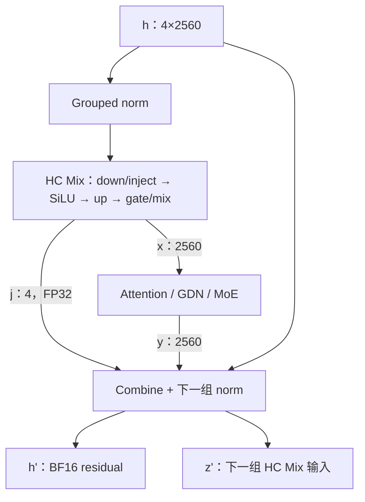

# Qwen3.8-Flash-Next：HC 计算、接口与特征状态

更新日期：2026-10-09。**A3/A4 的七种 HC 计算形式及 Mix 容量查询已实现并通过独立数学资格验证；模型/状态接入待完成。**

本文拥有 Qwen4Exp 的 HC 完整数学、融合边界、Op 接口和 Main/MTP 特征寿命。
共同轴、执行与提交约定见[支持总览 §1.3](qwen3_8-flash-next-model.md#13-统一执行约定)；
权重/矩阵与当前进度分别见总览第 5、11 节。本文不为 HC 增加独立 KV 或逐层历史状态。

阅读入口：[数学](#3-完整数学)、[调用与融合](#4-模型调用与融合边界)、
[接口](#6-op-接口)、[特征与恢复](#7-激活寿命与可恢复特征)、
[实现方法](#8-实现方法与优化自由度)、[验收](#9-实现验收)。

## 1. 已定决策

1. 四条残差 stream，每条 2560 维；每条 stream 独立 RMSNorm，并有自己的 affine。
   HC 本身不沿 token 轴递推，也不保存每层的历史 residual 或 injection。
2. 保留已经确定的 BF16 parents：普通 down/injection [324,10240]、final down
   [320,10240]、up [10240,320]。普通 down 的最后四行属于 injection。
3. HC Mix 是一个完整 Op：normalized streams → 两次投影与门控 → block 输入及
   injection。320 维低秩激活和 10240 维 mixing logits 是私有中间值。
4. 对外 injection 为 **FP32 的已激活系数 j=2*sigmoid(logit/4)**，形状 [4,M]。
   Combine 消费 j，不再次除四、乘二或做 sigmoid。
5. 稳态路径融合上一 block 的 combine 与下一组 HC 的 norm；同时输出 BF16 residual
   和 BF16 normalized streams。后者必须从前者的 BF16 表示计算。
6. 首次 embedding 展开、独立 norm、独立 combine、final mixer，以及 MTP 的 unit-weight
   broadcast-add＋norm 均有显式语义入口，不以层号或 backend 字符串改变 Op 公式。
7. Main final mixer 前的 10240 维特征与后的 2560 维特征分别表达。启用 MTP 时，二者都
   纳入相应 Main continuation/checkpoint，不从其中一个近似重建另一个。
8. Op 不管理请求、checkpoint 或接受长度。Program 管理跨 block buffers、候选特征、
   state slots、Graph 和发布；一个 Op 可以包含多个 kernel。

## 2. 几何、权重与布局

### 2.1 实例与 token 轴

| 符号 | 值/含义 |
|---|---|
| H | 2560，block 输入/输出维度 |
| C | 4，HC stream 数 |
| D | C*H=10240，完整 residual 维度 |
| Rhc | 320，低秩中间维度 |
| M | 一次调用的物理 token 列数，任意正值，受 Tensor 表达范围与可用存储约束 |
| epsilon | 模型使用 1e-6，接口接收正且有限的参数 |

M=T*B，column=t+T*b，与 QSA/PLE 的 [T,B] 使用同一列序。HC 只接收展平 M 轴；
四条 streams 是 feature 轴。MTP fc_hidden 共享 H→H 权重时临时使用 4M 个 Linear 列，
输出再恢复为 [2560,4,M]。Rhc 是低秩维度，区别于候选记录容量 R。

Tensor 第 0 维连续。公共 HC 激活采用：

| Tensor | dtype | Shape |
|---|---|---|
| residual h、normalized z | BF16 | [2560,4,M]，可零复制 view 为 [10240,M] |
| block input x、block output y、sample hidden | BF16 | [2560,M] |
| injection j | FP32 | [4,M] |
| norm weight | BF16 | [2560,4]，第 s 条 stream 的独立 offset affine |

计算 Op 使用连续、非重叠的 token 列，不接收序列位置、KV table rows 或 state slots。
Padding 列按普通有限输入计算；Program 提供安全值，并由有状态的 block 和发布逻辑使用
自己的有效列 metadata。HC 无跨列访问，padding 不影响其他列；不承诺任意 padding
输入都会输出零。

### 2.2 持久权重

全部 HC 权重为 BF16、无 bias；两次投影使用 A16 计算，不引入 A8/A4 activation quantization。

| 角色 | Parent [N,K] | Main / MTP 数量 | 行语义 |
|---|---:|---:|---|
| Block down/injection | [324,10240] | 96 / 2 | [0,320) down；[320,324) injection logits |
| Final down | [320,10240] | 1 / 1 | 全部为 down |
| Up | [10240,320] | 97 / 3 | row=s*2560+d |
| Norm | [10240] 源向量 | 97 / 3 | 同一 stream-major 展开顺序 |

主模型每层 Attention/GDN 与 MoE 各一组 block HC；最后一个 mixer 独立。
MTP 有自己的两组 block HC 和一个 final mixer，参数不与 Main 共享。
具体 Binding/Use 仍按[核心权重目录](qwen3_8-flash-next-model.md#52-textmtp-的物理投影目录)。

N=324 不变成持久 N=336；本 recipe 不预先把 /4 折入源权重，norm 保存原 BF16 offset。
不将 1+w 重新舍入为 BF16 gain；FP32 gain 是需要另行明确语义与收益的表示，本方案不引入。
源精度、计算精度和容量依据由[总览 §4.2](qwen3_8-flash-next-model.md#42-q8直接参数与-norm)维护。
内部 tile 对齐由 kernel 处理，不变更已确定的 artifact bytes 或物理矩阵目录。

## 3. 完整数学

以下公式逐 token 独立，省略 token 下标。理想连续计算使用实数/高精度解释；
明确的表示边界见 §5。

### 3.1 Grouped offset RMSNorm

```text
inv[s] = 1 / sqrt(sum_d h[s,d]^2 / H + epsilon)
z[s,d] = h[s,d] * inv[s] * (1 + norm_weight[s,d])
```

每个 inv 只统计该 stream 的 2560 维；四条 stream 的 affine 不共享。
Norm 权重的 offset 加法不先转换成一个 BF16 gain 表。z 的公共输出为 BF16。

### 3.2 Mixing 与 injection

```text
[a, b] = W_down_inject * flatten(z)      // a:320，b:4
u      = SiLU(a/4)
g      = W_up * u                       // 10240
m[s,d] = sigmoid(g[s,d])
x[d]   = sum_s (m[s,d] * z[s,d]) / 4
j[s]   = 2 * sigmoid(b[s]/4)
```

SiLU(v)=v*sigmoid(v)。a 的 /4 在 SiLU 前，b 的 /4 在 sigmoid 前；up 输出不另除四。
最后对 streams 取均值是另一个 /4。Mixing gate 每 feature 一个，四条 stream 的 gates
不要求和为一。Injection 每 stream 一个标量；其数学范围为 (0,2)，FP32 饱和表示允许
端点 0、2。

Down 与 injection 读取同一个完整 z，使用一个合并 GEMM。Up 依赖 u，不能与 down
当成同输入投影拼接。u、g、m 没有模型侧消费者，作为 HC Mix 私有中间值。

### 3.3 Block 与 residual combine

```text
y       = Block(x)                       // H
h'[s,d] = h[s,d] + j[s] * y[d]           // C*H
```

四条 stream 保留自己的原 residual，再注入同一个 block output 的不同标量倍数。
Combine 使用原 h，不使用 z；也不采用 mixing gate m 代替 j。

### 3.4 Final mixer

Final mixer 先做 §3.1，再执行：

```text
a      = W_final_down * flatten(z)       // 320
u      = SiLU(a/4)
g      = W_final_up * u                  // 10240
sample = sum_s sigmoid(g[s,:]) * z[s,:] / 4
```

没有 injection 行或输出，没有 block/combine。sample 为 BF16 [2560,M]，直接交给
LM head，不再增加 Qwen3.5 风格的独立 final RMSNorm。
完整 h_final 在 final norm/mixing 之前保留为 MTP conditioning。

### 3.5 初始化与 MTP 特例

Main 的初始 residual 为 h[s,:]=embedding[:]。展开为四条 stream 是 BF16 word-preserving
复制；四条初始 RMS 相同，但各自 affine 不同，normalized 结果不能直接复制一份。

MTP 初始 residual 的公式为：

```text
e       = W_fc_embedding * OffsetNorm_H(token_embedding)
v       = OffsetNorm_10240(main_or_previous_mtp_multistream)
h0[s,:] = W_fc_hidden * v[s,:]
h1[s,:] = BF16(h0[s,:] + e[:])
z1      = HC_GroupedNorm(h1, first_mtp_hc_norm)
```

pre_fc_norm_hidden 对整个 10240 维做一次 norm，不是 HC 的四组 norm。
fc_hidden 在四条 stream 共享参数；加 e 是 unit-weight broadcast-add，适合显式的
CombineNorm 无 injection 重载。它不是 j=2 或重新生成一个 sigmoid gate。

## 4. 模型调用与融合边界

### 4.1 首次、稳态和末端

以下为数据流伪代码，省略 epsilon、workspace、execution 和输出引用；C++ 声明见 §6。

```text
Main 初始化：
    (h0,z0) = hc_expand_norm(embedding, gamma_attn_0)

一个普通 decoder layer：
    (x_attn,j_attn) = hc_mix(z0, HcMixWeights{attn_down_inject,attn_up})
    y_attn = Attention_or_GDN(x_attn)
    (h1,z1) = hc_combine_norm(h0,y_attn,j_attn,gamma_moe)
    (x_moe,j_moe) = hc_mix(z1,HcMixWeights{moe_down_inject,moe_up})
    y_moe = MoE(x_moe)

下一层无外部 residual 消费者：
    (h2,z2) = hc_combine_norm(h1,y_moe,j_moe,gamma_next_attn)

最后一层：
    (h_final,z_final) = hc_combine_norm(h1,y_moe,j_moe,gamma_final)
    sample_hidden = hc_mix(z_final,HcFinalMixWeights{final_down,final_up})
    logits = LMHead(sample_hidden)
```

下一组 HC 的 norm 权重与上一组 HC 产生的 j 同时参与 CombineNorm，但属于不同参数。
不能延用上一组的 norm 权重。只读 h_final 可直接成为 conditioning view，或由最后一次
CombineNorm 写入 Program 规划的稳定输出区域，避免额外 materialization。
其中 GDN(x_attn) 的投影、卷积、递推、输出门控与状态调用见
[GDN 计算流程](qwen3_8-flash-next-gdn.md#2-完整计算流程)。



### 4.2 Pending combine 与必须物化的边界

模型可以将 (h,y,j) 暂留到下一组 HC 开始，但这只是 forward 内的三个 borrowed views。
它们不拥有 state slot，不自动成为可恢复 checkpoint，也不能在 block 完成后立即释放。

| 边界 | 调用方式 |
|---|---|
| Main 首次 HC | `hc_expand_norm`，同时产生完整 residual 与 normalized 输出 |
| 已物化 residual 后进入 HC | 独立 `hc_grouped_rmsnorm` |
| 普通 block 接下一组 HC | `hc_combine_norm` |
| PLE 之前/之后 | 先 `hc_combine` 得到完整 residual；`ple_conv_add_norm` 输出更新后的 BF16 residual 和下一 HC 的 z，再进入 `hc_mix` |
| 最后一个 block 接 final mixer | `hc_combine_norm`，保留 h_final；然后 `hc_mix` 的 final 重载 |
| MTP 的 embedding broadcast-add | 无 injection 的 `hc_combine_norm` 重载 |
| checkpoint/feature 交接需要完整 residual | 交付物化后的对应边界值，不能保存未解释的 pending tuple |

PLE 读取完整 residual 来计算自己的门控，不能把上一 block 的 combine 穿过 PLE。
PLE 后的 norm 可与其卷积/残差相加融合，但必须消费实际 BF16 residual words；完整边界
见 [PLE 计算与接口](qwen3_8-flash-next-ple.md#8-gpu-ops-与融合边界)。独立 ConvAdd 加
hc_grouped_rmsnorm 是相同语义的分开执行方式。
本实例没有 deepstack；不为其他模型的额外 residual 路径增加公共 mode。

### 4.3 一个 Op 与多个 kernel

HC Mix 的完整语义封闭，不要求两次有依赖的 GEMM 在一次 launch 内完成。
当前实现复用 BF16 Linear 的 contraction 设施，在 Down 最终归约处融合 activation/injection，
并按完整 Op 测量选择原生四 stripe 的 Up/mix 融合分工；这些选择不增加模型调用分支。

CombineNorm 合并上一 block 的残差更新与下一次 norm，仍输出并保存 h'。它省去的是
一次独立 combine 调用以及 norm 对已写 h' 的重新读取，不省略下一 block 所需的 residual。

## 5. 数值表示与资格化含义

### 5.1 公共边界

| 值 | 公共表示 |
|---|---|
| 输入 residual、block output、normalized streams | BF16 |
| norm / down / up 权重 | 原 BF16 words，norm 使用 offset 解释 |
| HC Mix 输出 x / final sample | BF16 |
| HC Mix 输出 injection j | FP32，已经是 2*sigmoid(b/4) |
| Combine 的 h' | BF16 |
| checkpoint / MTP 选中的边界特征 | 原执行产生的 BF16 words |

HC Mix 内的 a、b、u、g 和 m 不设额外公共 BF16 seam。实现可以采用 BF16 operands 和
内部 staging，但不为匹配某个分立框架的结果而将私有舍入顺序固化为合同。
内部不采用 A8/A4 activation quantization；资格 oracle 计算完整高精度复合公式。

### 5.2 CombineNorm 的可观察 residual seam

```text
h_ideal = FP64(h) + FP64(j) * FP64(y)
h_repr  = BF16_RNE(h_ideal)
z_ideal = GroupedOffsetNorm_FP64(h_repr, norm_weight_next)
```

h' 是公开的 BF16 residual；z 对这个表示做 norm，不使用一个未写回的高精度 residual。
这个 seam 与仅存在于 HC Mix 内的 a/u/g 不同。核函数可以先在寄存器中得到 BF16 h'，
再转成 FP32 归约，无需真正写回后重新读取。

独立 oracle 按上式验证完整路径；h' 与 h_ideal、z 与 z_ideal 使用各自数值判据。
另外，以实际 h' 的 BF16 words 为输入独立计算 grouped norm，检查 z 确实消费该表示，
与 PLE 的 residual/norm 边界一致。实际 h' 不能充当完整路径的唯一 oracle。
独立 Combine 与 CombineNorm 都遵循同一 residual 表示规则。

hc_expand_norm 的 residual 输出必须与 embedding 按映射逐 word 相同；边界特征的选择、
复制和恢复也要求 word-preserving。重新跑一个不同 M 的 HC Mix 不是恢复旧特征的精确方法。

## 6. Op 接口

全部已实现接口、权重 views、支持域和效果由
[gated_residual.h](../../include/ninfer/ops/gated_residual.h) 统一维护。使用既有 Tensor、Weight、
WorkspaceArena 和 DeviceExecutionView；入口位于 `ninfer::ops`，数学几何固定为 H/C/Rhc。

### 6.1 权重 views 与公共约束

`HcMixWeights` 绑定普通 down/injection 与 up；`HcFinalMixWeights` 绑定 final down 与 up。
两组原生 compact BF16 矩阵的几何和行语义见 §2.2；不创建持久 padding 或重排副本。

模型 binder 使用既有 weight preparation 机制解析 parent，再检查这里的配对几何与
A16Only 许可。Op 只读取原生 Weight views，不读取 artifact 路径、checkpoint 名称或 Use ID。
容量查询只消费 host-visible weight metadata，不读取 Device payload。

所有计算输入/输出是连续 Tensor，基地址至少 16-byte 对齐；Weight 遵守既有 BF16
Contiguous 对齐与 encoded-size 合同。Tensor dtype/shape 必须与 §2 一致，M>0，
各参数的 M 相同。epsilon 正且有限，injection 为有限 FP32 且在 [0,2] 内。
有效数值域与资格数据遵循 Op 开发规范，不把 finite BF16 全范围的任意对抗输入视作
已测模型数值范围。DeviceExecutionView 提供 stream 与正的物理 SM 数。

除显式允许的 residual exact-alias 外，所有可写输出与仍需读取的输入、权重及有效 scratch
不重叠；多个输出相互不重叠。只读输入可以共享 backing。Op 不持有 view，不分配隐藏
Device 内存，也不决定 buffer 或 state slot 的寿命。

### 6.2 初始展开与独立 grouped norm

已实现的 `hc_expand_norm` 与 `hc_grouped_rmsnorm` 使用第 2 节的连续 BF16 views、
独立 per-stream offset affine、正且有限的 epsilon 和 `DeviceExecutionView`。
声明、完整效果与 alias 规则以生产头文件为准。

hc_expand_norm 按 §3.5 精确复制 embedding 到四条 residual streams，再按 §3.1 产生
normalized。两个输出完整覆盖，互不重叠且不与输入重叠。输入 embedding 已完成相应
媒体特征替换；该 Op 不做 lookup、输入获取或图像处理。

独立 grouped norm 只输出 z，不更新原 residual。z 不能与 residual alias，因为后续
combine 仍需要未经 norm 替换的 residual。

二者都不需要 caller-owned global workspace，不提供容量查询。初始广播和 norm 可以
在同一 kernel 实现，避免为展开再单独安排一个模型侧 Device transformation。

### 6.3 HC Mix 与 final 重载

已实现两个 `hc_mix` 重载与对应的 `hc_mix_workspace_capacity_bytes` 查询。
公共声明与完整资源合同以生产头文件为准。

普通形式完整计算 §3.2，final 形式完整计算 §3.4；二者不做 norm 或 residual combine。
调用者传入 normalized 的语义值，Op 不检查它是否来自某个指定前序 kernel。
所有输入和权重不变，输出完整覆盖，无 persistent state mutation。

Injection 与 block_input 都在调用后可用；不得把 raw BF16 logits 写入 injection 参数，
也不能因内部实现沿用 vLLM 的命名而在 Combine 再次 sigmoid。FP32 输出表示不等于
承诺逐位等于全 FP32 GEMM；完整 projection/nonlinearity 仍按独立数学判据资格化。

Capacity query 覆盖同一权重几何、设备事实下 [min_tokens,max_tokens] 的全部合法 M。
它计算 256-byte 对齐局部 cursor 起点上的最小 high-water，包含实际使用的私有 u、
Down partials 及内部对齐，不含末尾 padding 和公开 x/j/z。容量是完整闭区间的最大值，
不能只查询区间右端；不同分段的容量可能下降。无效形状或区间应抛错；只有合法且确实不需要 global scratch
的路线才返回零。实际调用与 query 使用同一规划，Program 不复制私有路线阈值。

当前分段实现见 §8.2。共享 contraction 设施不改变 HC Mix 的完整数学 oracle，
模型也不接收私有中间 buffer。

### 6.4 独立 Combine 与融合 CombineNorm

已实现 `hc_combine`，以及带 injection 和 unit-weight broadcast-add 两个
`hc_combine_norm` 重载。公共声明统一由生产头文件维护。

独立 Combine 执行 §3.3；CombineNorm 执行同一更新和 §5.2 的 norm。无 injection
重载固定为 j=1，不需要 caller 创建一个全一 gate tensor，不读取或产生 injection。
三者都不需要 global scratch；局部 reduction/storage 是内部实现资源。

updated_residual 可以与 residual **完全同一 view**，也可以完全不重叠；禁止部分重叠。
In-place 时，block_output、injection、norm_weight 不得与 residual 重叠。
normalized 必须与全部仍被读取的输入及 updated_residual 分离。
非 alias 情况下所有输入保持不变。

每个 stream 的 norm 需要完整 2560 维统计。允许 in-place 不代表可以在其他线程读完
该 stream 前覆盖其输入；实现须在自身合法的归约/写回组织内满足这一数据依赖。
跨 token 无依赖，不存在跨调用隐藏的 residual cursor。

### 6.5 完整覆盖与 Graph

固定 M、views、权重、epsilon 及 workspace 的 Graph replay 不依赖请求身份、token 位置
或 KV 页表。不同 stream 的依赖由 Program 明确安排；默认同 stream 顺序执行。
host workspace scope 结束后，复用仍必须尊重最后一个已提交 Device consumer 的顺序。

## 7. 激活寿命与可恢复特征

### 7.1 HC 没有独立历史状态

每个新 token 从自己的输入进入四条 streams。HC 不读取上一 token 的每层 residual；
跨 token 的模型记忆由 GDN、QSA、PLE 等 block 的各自状态提供。
因此不为 HC 增加 paged pool、历史 injection 表、raw transition journal 或接受前缀 fold。

hc_combine 对激活有显式写效果，但其输出仍是当前 forward 的 residual。是否把其中某个
末端特征保存为 continuation，是模型/Program 的决定，不属于 HC Op 的隐藏状态。

| 数据 | 最后消费者 | 所有权与复用 |
|---|---|---|
| residual h | 相应 block 完成后的 Combine/CombineNorm | caller；原位更新需确认旧 h 无其他消费者 |
| normalized z | 当前 HC Mix | caller；完成后可与其他阶段 scratch 复用 |
| x | 当前 Attention/GDN/MoE 的输入消费者 | caller；不自动保留到提交 |
| j | 当前 block 后的 Combine | caller；跨整个 block 存活 |
| a/b/u/g/m | HC Mix 内部 | call-scoped workspace 或 kernel 局部资源 |
| pending (h,y,j) | 下一次 CombineNorm 或必须物化的边界 | 模型 schedule 的 borrowed views |
| h_final / sample_hidden | head、MTP、前缀选择及必要复制 | 显式 boundary buffers，不能按普通 HC scratch 提前释放 |

正常稳态可复用 residual buffer 原位更新，并用独立 z buffer；不能把 z 当作原 residual
省掉 h。保存末端特征时，输出可以直接指向稳定 handoff buffer，而不是先输出再复制。

### 7.2 Main 的规范末端特征

对已执行前沿 F>0，一个 Main 恢复点的特征取自原位置 F-1：

| 字段 | dtype / 单序列形状 | 何时保留 |
|---|---|---|
| main_sample_hidden | BF16 [2560] | 可从末端特征继续采样的恢复点 |
| main_mtp_conditioning | BF16 [10240] | 启用 MTP 的同一恢复点 |

两者必须来自同一次实际执行、同一个 token：conditioning 是最后 residual combine 之后、
final norm/mixing 之前的 h_final；sample 是 final HC Mix 的输出。
不能用 z_final、折叠后的 sample、或最后一个 block 的 y 代替 conditioning。

建议物理存储为两块 typed StateImage fields：[2560,S] 与可选 [10240,S]，各自连续列。
S 是状态槽数，不是 resident lane 或 batch 宽度。它们共享恢复点的身份/前沿和有效性，
没有两个能独立发布的版本。F=0 没有“最后一个 token”的特征，不通过全零值伪装成有效。

不启用 MTP 时，h_final 仍是 final norm 的输入，但没有后续消费者就可作为临时激活释放；
不为每个 StateImage 额外常驻该字段。启用 MTP 时同时保存 pair，可避免恢复时重算 final
HC Mix 引入不同执行路线的数值结果。

现有 StateImage 的单个 continuation_hidden 字段不能同时表达这两个不同语义的向量。
Flash-Next 的 planner、Device/Host layout、copy/clone、checkpoint 和恢复 views 需要
显式扩展；不能把 hidden 宽度统一改成 10240 后继续让 LM head 直接消费。

### 7.3 Verify 窗口与接受前缀

对物理窗口 [T,B]，保留需要参与接受选择的：

```text
main_sample_window       BF16 [2560,T,B]
main_conditioning_window BF16 [10240,T,B]  // 仅启用 MTP
```

同一 Device selectors 向量选择两个 buffer 的相同 token 列。可复用
[speculative_select_accepted_hidden](../../include/ninfer/ops/speculative_round.h) 的
任意 D、逐 word gather 合同，分别以 D=2560 和 D=10240 调用；不需要增加 HC 专用
gather 算法。后续 slot 写入可用现有 exact scatter，全部完成后才发布 StateImage。

对于 base=F0 的连续输入窗口，若最终保留 a>0 个新输入，其末端列为 a-1；
a=0 保留旧恢复点，不能以 selector=-1 调用 gather。生成/发布 token 数需要由 Program
映射成正确的模型输入前沿，不能直接套入这个 a。

候选窗口保留到推测验收、Frontend 截断和取消所需的前缀选择全部结束。前缀选择采用
原执行 words，不重跑较短 HC/Linear 来重建。两个末端字段与对应 GDN/QSA/PLE 状态、
Main/Backend KV coverage 在同一次模型事务中采用。

### 7.4 MTP 的工作特征与恢复边界

MTP 第一步以 Main conditioning 为输入；后续草稿步以此前 MTP 步的
pre-final-mixer multistream 为输入。每步同时得到：

```text
mtp_sample_hidden [2560,B]  → 共享 head / 草稿分布
mtp_multistream   [10240,B] → 下一步 pre_fc_norm_hidden
```

这两个结果是 backend working/handoff buffers，须保持到相应 consumers 完成。
若同一事务有多个待定前缀，需要保留其接受选择所需的候选版本，不得只保留最后一步
并尝试从 2560 维向量反推先前的 multistream。

本设计的规范请求 checkpoint 位于模型提交边界：保留 Main 末端 pair，以及已提交的
MTP KV/QSA-tail 等实际 backend 状态；未提交草稿和其 working features 不发布为恢复点。
恢复时可丢弃候选 proposal，从保存的 Main conditioning 和正确 backend frontier 重新
进入 MTP 的对齐/bridge 流程。HC 不新增“从某个未决草稿内部位置恢复”的协议。

这一约定要求 Flash-Next MTP 的 commit/resume 路径落实相应重建顺序，而不是把旧
Qwen3.5 的单流 hidden view 原样复用。MTP 的接受策略和 bridge 实现由其模型执行合同
拥有；本文件固定交接值、维度和存活要求。

### 7.5 内存与 offload

以下均为 payload，实际 planner 还需计算对齐、别名约束、同时存活区间和 Graph backing：

| 对象 | 大小 |
|---|---:|
| 一份 residual 或 normalized | 20480*M B = 20 KiB/token |
| 一份 block input/output 或 sample | 5120*M B = 5 KiB/token |
| injection | 16*M B |
| 一组 Main 末端 pair | 25600 B/状态槽 = 25 KiB |
| T=16、B=8 的一组末端 pair 窗口 | 3276800 B = 3.125 MiB |

MTP 的当前工作 multistream 单独按 20 KiB/列计算；不要乘以所有 HC 层数。
u/Down partials 的私有 global workspace 由 HC Mix capacity query 给出，不用示意大小代替真实峰值。

Snapshot offload 把有效末端 fields 随 StateImage 原字节搬运，不给 HC 单独建一个 Host
history pool。只在 StateImage 与其他必要状态都完整到达、身份/前沿匹配后发布。
仅依靠 token ledger 做 Replay 的路径，按模型 Replay 规则重建这些末端值。

## 8. 实现方法与优化自由度

### 8.1 Grouped norm 与 CombineNorm

A3 实现归 `src/ops/gated_residual/`，校验、公共入口与 CUDA launch 分工独立，
家族维护自己的构建清单。归约组处理一个 token 的一条 2560 维 stream；Norm 采用 FP32
统计；affine 使用该 stream 的权重。CombineNorm 的融合路线先得到 BF16 residual，
再从寄存器中的这个表示归约并写出两个结果；物化路线先写出公开 residual，再由独立归约
读取这些实际 words。两者遵循同一个可观察 seam。

初始展开可共享相同 embedding 的统计量，但必须应用四份 affine 并产出四份真实 residual。
普通路径的四条 stream 不共享统计量。M 较小和较大时可采用不同分工；这些不进入接口。
不为了与某个 tile 对齐而改变 2560 维统计分母或把 padding 加入 sum-of-squares。

现有 [rmsnorm](../../include/ninfer/ops/rmsnorm.h) 的公开 affine 是 [D]，不能把
[2560,4,M] 展成 [2560,4*M] 后无条件共享该向量。A3 复用底层归约设施，并已补齐
per-stream affine 的独立语义与资格化。
[silu_gated_rmsnorm](../../include/ninfer/ops/rmsnorm.h) 是另一个数学合同，不用它的
名字或 SiLU-gate 公式代替本 HC。

### 8.2 HC Mix 的内部路线

实现位于 `src/ops/gated_residual/mix/`，分为公共封装、操作数校验、调度/布局和 CUDA
launch。Block 与 Final 共享实现机制，分别处理原生 324/320 行 Down 和对应的分段表。
没有模型专用注册、公开 partial Op 或候选强制开关。

Down 在完整 dot 或 split-K 最终归约后直接产生私有 BF16 u，并为 Block 写 FP32 j。
SiLU/gate 采用已通过完整数学检查的 fast sigmoid；FP32 injection 使用 expf sigmoid。
非线性不作用于未完成的 partial dots。

Up 的生产分工包括：

- 小 M：cp.async 收集原生 `s*H+d` 的四条权重 stripe，同一 CTA 完成 MMA、sigmoid、
  四流加权均值并直接写 BF16 输出。
- 中段及较大 M：4D TMA descriptor 从原生 Up 矩阵读取四条 stripe，融合收尾在共享内存中汇总
  四流。共享布局按 MMA 的行组和 token parity 组织，减少收尾的 bank conflict；TMA stage
  释放前显式建立 generic→async proxy 顺序。32 行 warp 可同时处理两条 stream，收尾
  只发布当前 feature 组；它按完整 FP64 oracle 资格化。

Down 可采用 GEMV、SIMT、split-K MMA 或 TMA；最终选择由完整 Mix 的 cold/warm 时间、
尾 tile 和 CTA 波次决定。Up 全部融合投影与加权均值；公共容量查询与执行共用布局，
仅保留私有 BF16 u 与必要的 FP32 Down partials，不物化全量 a/b/g 或 contributions。

Up/mix 融合不是普通逐行 GEMM epilogue：x[d] 依赖相隔 H 行的四份 up 结果，普通 GEMM tile
未必把它们交给同一个 CTA。需要安排输出行分工或保留一个中间 logits buffer；不能让不同
CTA 无同步地更新同一个 x，也不为此运行时重排 up 权重。

内部 A16 实现可选 SIMT/FMA、Tensor Core、split reduction 或分批路线，以完整 HC Mix
的误差和时间决定。vLLM 的小 M FMA、后续 split-K MMA 和 larger-M Linear 只作为实现
依据；其 SM100f 调优阈值不能直接作为 RTX 5090 的结论。

### 8.3 资源和实际工作量

按本实例的矩阵账目计算：

| 范围 | 投影参数 | Norm 参数 | BF16 总 payload |
|---|---:|---:|---:|
| Main：96 block HC＋1 final | 639631360 | 993280 | 1281249280 B，约 1.193256 GiB |
| MTP：2 block HC＋1 final | 19742720 | 30720 | 39546880 B |
| 合计 | 659374080 | 1024000 | 1320796160 B，约 1.230087 GiB |

Main 的 HC 投影约 1.279263 GFLOP/输入 token（乘加按两次操作），不含 norm、非线性和
block 本身。这是算术/参数规模，不是测得的 DRAM 流量或执行时间。
这些权重已包含在核心方案的固定权重预算内，不重复计为新增 state。

优化需同时看两次 GEMM、residual/z 的读写、启动与私有 intermediate 流量。
单纯统计少了几个 kernel 不能证明完整 HC 更快；一个 HC Mix 是一个 Op 也不表示它天然
比由多个 public Op 组成的同等实现快。

### 8.4 模型/Program 实现责任

| 部分 | 需要实现的内容 |
|---|---|
| Binder / Parameters | BF16 compact parents、100 份 norm、ordinary/final 权重配对、norm offset |
| Op 层 | ExpandNorm、GroupedNorm、HC Mix 两种形式、Combine、CombineNorm 两种形式及完整容量查询 |
| 模型 schedule | 正确的前后 norm 权重、pending combine、PLE 边界、final 与 MTP 的交接 |
| Program planner | 活跃 residual/z/x/j、私有 workspace 峰值、候选窗口、MTP working buffers、StateImage 双字段 |
| 事务与恢复 | 精确选择同一 token 的末端 pair，与实际 GDN/QSA/PLE/后端状态一致提交或恢复 |
| Host/Device 状态搬运 | 按字段语义、有效性和实际 bytes 复制，不把一个旧 hidden 字段解释成两种特征 |

所有新增 device transformation 位于中央 Op 层。模型只组合调用，不放私有 CUDA
kernel；core 继续只提供存储、布局和原字节传输，不解释 HC gating。

## 9. 实现验收

### 9.1 数学 oracle

A3/A4 的七种计算形式已通过独立数学、输出覆盖、输入保留、alias、生产路线边界和改变内容后的
Graph replay 验证。两种 CombineNorm 同时检查完整公式与实际 residual words 对应的 norm；
展开复制按原 words 验证。判据由 [HC criteria](../../tests/ops/gated_residual/criteria.h) 维护，
含 coherent BF16 舍入误差的预算，不复制其他测试分布的 RMS 阈值。命令见
[Tests](../../tests/README.md)。Mix 的两个重载在同一测试入口内验证完整 FP64 复合公式，
不复刻私有 u/g casts；另测原生行序、零权重、injection 饱和、精确 workspace、区间最大值
及非零外层 arena cursor。完整模型交接与恢复仍按下列要求推进。

- GroupedNorm：从 represented BF16 h/weight 用 FP64 分别计算四个 RMS，验证完整 affine
  和 epsilon；特意构造四条 stream 尺度不同、affine 不同的输入。
- ExpandNorm：residual 按映射逐 word 精确；normalized 与独立 grouped-norm 公式比较。
- HC Mix：精确解释 BF16 权重/输入，独立高精度计算两次 dot、SiLU、sigmoid、mean 和
  injection。x 与 j 分别有输出判据，不以另一个 kernel 或 source-framework 输出为唯一标准。
- Combine：由 BF16 h/y 和 FP32 j 计算高精度公式；CombineNorm 的 oracle 显式保留
  §5.2 的 BF16 residual seam，再计算下一组 norm。
- 特征选择/搬运：对原执行的相同 token 列逐 word 检查，不重新计算模型输出替代。

内部 GEMM/private casts 的实现差异属于复合 Op 的数值资格范围，不给每个调优 tile
单独放宽标准。数学计算与 exact copies 使用不同的验收方式；完整标准按
[Op 开发](op-development.md)在测量前确定并报告。

### 9.2 必需案例

| 维度 | 覆盖内容 |
|---|---|
| 数学尺度 | 不同 stream RMS、独立 gamma、offset +1、epsilon、三个 /4 的位置、injection ×2 |
| 零权重 | W_down/W_up/W_inject=0 时 x=sum(z)/8、j=1；final 无 injection 输出 |
| 门控 | 不同 feature 的 mixing gate，j 的 0/1/2、sigmoid 饱和和近零；不能误用 softmax |
| 几何 | N=324 的最后 4 行、final N=320、up stream-major 行序、M=1 与多个正 M |
| 数值 seam | Combine 值接近 BF16 舍入中点；norm 使用舍入后的 residual；更新后的 h 与 z 都验证 |
| Alias | 独立与 exact in-place residual；拒绝部分重叠、normalized/residual 重叠及输出覆盖输入 |
| 融合 | 普通分阶段和延迟 CombineNorm 的独立数学验证；使用不同的前后 norm 参数 |
| 初始化 | embedding 精确复制、四份不同 affine、MTP unit-weight broadcast-add |
| 边界 | PLE 前物化、Main/MTP final mixer、无额外 final norm、MTP 全 10240 维 pre-FC norm |
| 提交 | a=0、任意接受前缀、Frontend 截断、pair 相同 selector、旧 StateImage 保留 |
| 恢复 | Main/后端前沿区分，Host 往返与换槽，candidate proposals 不冒充 committed 状态 |
| 执行 | eager/Graph、batch 展平、inert 安全列、不同调优路线与 buffer 最后消费者 |

同输入不同 M 路线的数值比较是数学资格证据；同一次执行的特征搬运则要求 exact words。
两类标准不可互相替代，也不以 HC 最终文本是否正常作为通过依据。

### 9.3 性能与交付状态

A3 的独立 Op 性能比较覆盖五种形式、分离/原位更新、eager/Graph 和 cold/warm。
A3 属于新增能力，没有既有 HC 生产实现作为性能基线。报告公开 Op 的绝对延迟、实际访存量与
硬件瓶颈；正确原型与完整独立 Combine＋GroupedNorm 组合仅用于内部候选和执行分解比较。
内部可以在同一数学合同下选择融合或物化后归约，保持公开 BF16 seam 和零 workspace。
测量命令、计时边界、GPU 活动前置与组合对照定义见
[Benchmarks](../../bench/README.md#hc-gated-residual-op-benchmark)。这些结果覆盖 A3 的 Op 范围。

A4 是新增能力，没有既有生产 Mix 性能基线。公共 benchmark 的 `block-mix` / `final-mix`
计时完整 Down→Up→mix，包含 injection（普通形式）、所选全部 kernels 和实际 scratch。
候选比较覆盖密集 M=1..128、512/1024 主点及中间支撑点；生产验证覆盖 eager/Graph、
cold/warm、分段边界和 batch 展平。报告绝对延迟、容量/峰值、Tensor/L2/DRAM 利用及
计算 roofline 距离，保留融合与 staging 的取舍。Op 测量不构成 Engine 或模型性能结论。

性能沿用现有 Op/Linear 方法论，分别报告 HC Mix、CombineNorm 和包含 block 交接的
HC 完整调用范围。覆盖实际 decode/verify/prefill 的 M，注明硬件、graph、workspace 和
测量条件，保留小幅退化及最差案例。Pure Linear 改善不自动证明 HC 或整模型改善。

落地范围包括 Ops、模型调用、planner、末端特征字段、checkpoint/offload/recovery 和
对应资格测试。当前进度统一维护在[支持总览](qwen3_8-flash-next-model.md#11-支持进度与后续工作)。

## 10. 参考实现

- [Transformers Gated Residual](https://github.com/huggingface/transformers/blob/8073e6dcaea9aa4b42acf2d92ec72148786bbaeb/src/transformers/models/qwen4_exp/modeling_qwen4_exp.py#L995-L1023)：
  grouped norm、低秩 mixing、injection 和 final mixer 的数学。
- [vLLM HC 组合](https://github.com/vllm-project/vllm/blob/6fddc9b21e763bfc947cc01d3ce815179aac1dc6/vllm/models/qwen4_exp/nvidia/hyperconnection.py)、
  [HC kernels](https://github.com/vllm-project/vllm/blob/6fddc9b21e763bfc947cc01d3ce815179aac1dc6/vllm/models/qwen4_exp/nvidia/ops/hc.py)：
  delayed combine、grouped norm、门控归约、CombineNorm 与 residual 表示。
- [vLLM down＋SiLU](https://github.com/vllm-project/vllm/blob/6fddc9b21e763bfc947cc01d3ce815179aac1dc6/vllm/models/qwen4_exp/nvidia/ops/cute_dsl/hc_down_silu.py)：
  专用 GEMM epilogue 与不同 token 数的内部路线。
- [vLLM 模型调用](https://github.com/vllm-project/vllm/blob/6fddc9b21e763bfc947cc01d3ce815179aac1dc6/vllm/models/qwen4_exp/nvidia/model.py)、
  [MTP](https://github.com/vllm-project/vllm/blob/6fddc9b21e763bfc947cc01d3ce815179aac1dc6/vllm/models/qwen4_exp/nvidia/mtp.py)：
  PLE 物化边界、Main pre-final-mixer capture、MTP 双特征与 unit-weight 初始加法。

vLLM 的 injection 参数传 raw logits，本设计传激活后的 FP32 j；其 padding 和私有
BF16 casts 也不自动成为本设计的接口。引用用于核对数学和实现方法，不构成当前 NInfer
已具备这些能力的声明。
