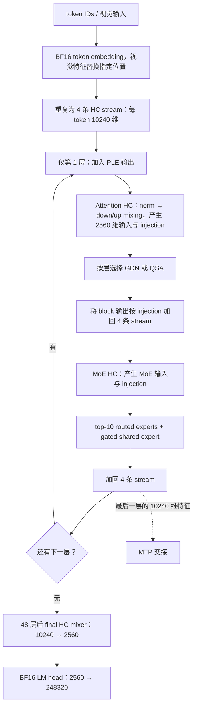

# Qwen3.8-Flash-Next：支持计划与模型权重

更新日期：2026-10-08。**支持计划总入口；Converter 与完整权重已完成，20 项纯 Linear 已完成，模型执行尚未接入。**

Qwen3.8-Flash-Next 是本文的 checkpoint 实例，数学架构为 Qwen4Exp，目标代码模块为
`qwen4_exp`。本计划覆盖 Text、可选 Vision 和原生 MTP；架构、绑定和执行按原生模块
接入。本文拥有选定量化方案、物理矩阵、artifact 与驻留预算，并汇总全部工作的当前状态。

阅读顺序：[约定与分工](#1-设计边界与既定决策) → [架构](#3-模型架构与数学结构) →
[量化](#4-完整量化方案与编码方法)／[矩阵](#5-合并后的物理矩阵与行顺序) →
相关 HC、GDN、QSA、PLE 专题／[Converter 实现方案](qwen3_8-flash-next-converter.md) →
[支持进度与后续工作](#11-支持进度与后续工作)。
实际实现状态只在第 11 节汇总；专题中的 C++ 声明均为待实现合同。

## 1. 设计边界与既定决策

### 1.1 既定选择

1. 主模型 48 层的 routed experts 使用已下载的 NVIDIA NVFP4；导入 codes、block scales
   和校准参数，不从 BF16 再做一轮主 expert 量化。保留 A16 路径，并允许合适的已资格化
   路径使用 A4/NVFP4 Tensor Core。
2. 主模型 GDN 大投影和 QSA Q/gate、O 使用 Q8 G32/FP16 scale，计算许可 A16Only。
3. PLE 表使用 NF4 G16/E4M3FN scale、每原始 shard 一个 FP32 divisor，90 个有效 bytes/row，
   每 4 KiB 放 45 行。持久数据在 v3 容器内原位保留，按需异步取行，不要求整表驻留 RAM/VRAM。
4. Router、shared experts、HC、QSA K/V/indexer、PLE 投影、GDN a/b、conv/norm、token
   embedding、LM head 和整个 Vision 保留 BF16。GDN A_log/dt_bias 离线精确展开为 FP32。
   MTP 独有的非 routed-expert 权重全部 BF16。
5. MTP routed experts 继续采用 NVFP4 容量方案，由本地 BF16 离线量化；初版 A16Only。
   NVIDIA 的 MTP 是另一种 FP8 表示，不能充当这里的 NVFP4/A4 校准来源。
6. 相同输入、相同表示且数值元数据兼容的并行投影，在 converter 中合并存储；
   不合并不同权重类型，不为合并改变精度。输出需要拆分、置换或由后续 epilogue 写入
   独立缓冲不改变物理合并关系；纯 Linear 支持与后续复合 Op 的资格化分别记录。
7. 权重分组、行置换、packing、scale swizzle 均离线完成。GDN 与 PLE conv 均转换为
   channel 连续；PLE 的选择依据与尚缺的性能比较见 §5.4。Loader 不重新量化或重排权重。
8. 采用现有 v3 `.ninfer` 文件集合、Object/Binding/Use 机制；NF4 增加明确的 format/layout，
   不另造一个绕过 v3 的模型文件格式。

### 1.2 文档分工

| 文档 | 唯一维护的内容 | 使用时机 |
|---|---|---|
| 本文 | 实例架构、来源/recipe、合并与行序、持久表示、整模预算、支持进度 | 所有工作先读；converter、binder、planner 从这里取参数 |
| [Converter 实现方案](qwen3_8-flash-next-converter.md) | 代码改动、来源映射、parent/Binding/Use 生成、流式编码与写出顺序 | 实现 converter 与 codec |
| [子工作区任务清单](qwen3_8-flash-next-independent-ops.md) | 两批独立计算任务、文件分工、共享接口与主工作区交接 | 并行推进低影响面的实现 |
| [HC / Gated Residual](qwen3_8-flash-next-hc.md) | 完整数学、Mix/CombineNorm 接口、激活寿命、Main/MTP 末端特征 | 实现 HC、层间残差融合与 MTP 特征交接 |
| [GDN](qwen3_8-flash-next-gdn.md) | 整层计算、投影/卷积/门控调用、recurrent state 与 ReplaySSM 接入 | 实现 Qwen4Exp GDN 层及相应 Op 扩展 |
| [QSA](qwen3_8-flash-next-qsa.md) | Prepare、Indexer、Sparse GQA、tail 提取、选块与 cache 读写 | 实现稀疏 attention、候选记录与恢复 |
| [PLE](qwen3_8-flash-next-ple.md) | hash/lookup、文件绑定与读取流水、Gate/Conv、前缀状态 | 实现 SSD 取行、计算与预取 |
| [共享页组扩展设计](qwen3_8-flash-next-paged-kv.md) | 通用 `tokens_per_row` 字段、页组容量、COW/迁移规则 | 实现 QSA 共享页组扩展 |

[Engine 架构](engine-architecture.md)拥有执行与提交所有权；[容器](artifact-container.md)、
[数值格式](tensor-formats.md)、[布局](storage-layouts.md)拥有通用 artifact 合同；
[Op 开发](op-development.md)与 [Linear 调优](linear-tuning.md)拥有实现和资格化方法。
专题只补充模型特有约束。新 format/layout 或通用存储能力落地时，同步更新对应通用合同；
具体 Op 落地后由生产头文件维护接口，专题保留数学组合、状态关系和跨 Op 寿命。

### 1.3 统一执行约定

| 符号 | 所有专题的共同含义 |
|---|---|
| T、B | 单次调用每序列的物理列数、序列数；T>0，B=1..8 |
| M | 展平列数 T*B，column=t+T*b；HC 和普通 Linear 消费这个轴 |
| n[b] | 当前窗口的有效输入前缀长度，Device `valid_columns[B]`，0≤n[b]≤T |
| F、F0 | 已物化的输入前沿、候选区间的基准前沿，均在原 token 域；Main/Backend 分别维护 |
| R、u[b]、a[b] | 候选记录容量、连续已记录列数、最终采用的输入列数；0≤a≤u≤R |
| S | StateImage 物理槽数；slot、resident lane、batch row、KV table row 是独立身份 |

Tensor 第 0 维连续；权重用逻辑矩阵 `W[N,K]` 表达，存储由各 layout 解释。
连续激活 `[H,T,B] ↔ [H,M]`、`[H,4,T,B] ↔ [H,4,M]` 可以零拷贝 view；packed
projection 的子范围保留 parent strides。既有 Linear API 的参数名 `tokens/T` 在这些调用中
表示 M；MTP fc_hidden 共享作用于四条 stream 时表示 4M。Vision 使用其独立 patch/merger 域。

新增 GPU 声明统一位于 `ninfer::ops`，接收提供 stream 与正物理 SM 数的
`DeviceExecutionView execution`；有全局临时空间的 Op 接收 `WorkspaceArena&` 并提供
区间容量查询。所有 views 为非 owning，Device
metadata 使用 I32；Host I/O 接口的 spans 明确留在 Host。状态提取统一用
`accepted_columns[B]` 表示 a。Op 计算或复制指定内容，Program 决定前沿、槽、寿命与提交。

各状态保存同一次实际执行的表示值。接受长度按输入列计算，不能直接代入已发布输出数；
HC、QSA、PLE 与 GDN 的状态在同一 Program 事务中采用。专题中的“Program worker”均指
调用 Program 的 Engine worker；PLE I/O worker 只处理其 Host 队列，不拥有请求状态。

HC 会计算所有 M 列；QSA/PLE 用 n[b] 屏蔽无效尾列。Program 给前序 Linear/HC 的
无效列提供有限安全值，并将同一有效列信息交给后续有状态 block。Main forward 组批时
排除 n=0 的请求，参与 GDN 调用的行遵守其现有非空前缀域；见
[GDN 执行路径](qwen3_8-flash-next-gdn.md#4-各执行路径)。数值 Op 按独立数学 oracle
资格化；中间表示的消费遵守专题声明的边界，状态搬运精确保留原执行 words。
上游私有 casts 不自动成为合同。

## 2. 来源与可复核事实

### 2.1 本地源数据

| 用途 | 来源 |
|---|---|
| 模型 config、所有非主 routed-expert 权重、tokenizer、processor | `/home/neroued/models/llm/qwen/Qwen3.8-Flash-Next/base-hf-bf16` |
| 主模型 routed experts 的 NVFP4 codes/scales/校准参数 | `/home/neroued/models/llm/qwen/Qwen3.8-Flash-Next/nvidia-nvfp4-experts` |

NVIDIA 来源固定为 `nvidia/Qwen3.8-Flash-Next-NVFP4`，revision
`fc694b54fb0174e0913e6adf86691ef85a4ead47`。本地只下载覆盖主 expert 的 9 个权重分片
及元数据，使用其中的 `experts.safetensors.index.json` 和 `source-manifest.json`。
上游完整 index 还引用未下载的 MTP/PLE 文件，不能据它假定本地是完整 NVIDIA checkpoint。

本地 BF16 的 131 个分片含 1658 个源张量；已逐项核对 header 名称和 shape 与
[历史逐张量清单](../../profiles/bench/flash-next-precision-20260917/recipe.json)一致。
那份 JSON 是 2026-09-17 的研究记录，不是当前 converter 的可执行 recipe；其中的
主 expert A16Only 以及未合并物理组织，由本文替代。

NVIDIA 模型说明确认：主 routed experts 是经权重 MSE 校准的 W4A4 NVFP4；其 MTP
experts、PLE 使用 FP8。我们只取前者，其余按本设计从 BF16 构造。
[NVIDIA 来源说明](https://huggingface.co/nvidia/Qwen3.8-Flash-Next-NVFP4/blob/fc694b54fb0174e0913e6adf86691ef85a4ead47/README.md)

### 2.2 模型实现依据

数学语义主要核对
[Transformers 模型实现](https://github.com/huggingface/transformers/blob/8073e6dcaea9aa4b42acf2d92ec72148786bbaeb/src/transformers/models/qwen4_exp/modeling_qwen4_exp.py)
及其[配置默认值](https://github.com/huggingface/transformers/blob/8073e6dcaea9aa4b42acf2d92ec72148786bbaeb/src/transformers/models/qwen4_exp/configuration_qwen4_exp.py)。
MTP 交接与实现分组参考
[vLLM MTP](https://github.com/vllm-project/vllm/blob/6fddc9b21e763bfc947cc01d3ce815179aac1dc6/vllm/models/qwen4_exp/nvidia/mtp.py)、
[HC](https://github.com/vllm-project/vllm/blob/6fddc9b21e763bfc947cc01d3ce815179aac1dc6/vllm/models/qwen4_exp/nvidia/hyperconnection.py)、
[QSA](https://github.com/vllm-project/vllm/blob/6fddc9b21e763bfc947cc01d3ce815179aac1dc6/vllm/models/qwen4_exp/nvidia/qsa.py)、
[PLE](https://github.com/vllm-project/vllm/blob/6fddc9b21e763bfc947cc01d3ce815179aac1dc6/vllm/models/qwen4_exp/nvidia/ple_layer.py)。
框架中的 TP 分片、专用 padding、kernel packing 和近似优化不是本模型数学的组成部分。

## 3. 模型架构与数学结构

### 3.1 实例几何

| 项 | 本地实例 |
|---|---|
| 源 architecture / model_type | `Qwen4ExpForConditionalGeneration` / `qwen4_exp` |
| 文本 hidden H / vocabulary | 2560 / 248320 |
| 主模型层数与分布 | 48；零基层号 `l%4==3` 为 QSA，共 12 层，其余 36 层 GDN |
| HC stream 数 C / 总特征宽度 / lowrank Rhc | 4 / 10240 / 320 |
| GDN Q/K heads / V heads / head dimension | 16 / 48 / 128；Q/K 每头对应 3 个 V heads |
| GDN QKV / Z 宽度，conv kernel | 10240 / 6144，kernel=4 |
| QSA Q heads / KV heads / head dimension | 24 / 2 / 256 |
| QSA query+output-gate / K / V 宽度 | 12288 / 512 / 512 |
| QSA indexer Q heads / K heads / dimension | 4 / 1 / 128；投影总宽度 640 |
| Indexer compression / budget | 4 tokens/block，512 selected blocks，即 2048 tokens，另加未完成 block 的尾部 |
| Routed experts / top-k / FFN intermediate | 每层 512 / 10 / 640 |
| Shared expert | 每层 1 个，intermediate=640，带独立标量 gate |
| PLE | 仅零基第 1 层，即 config 的 `ple_layer_ids=[2]`；在本层 attention HC 之前加入 |
| PLE n-gram / heads / 每 head 宽度 | 2-gram 和 3-gram，各 8 heads；总计 16×160=2560 |
| PLE 源表 | 128 shards，每 shard `[2500012,160]`；总逻辑行数 320001536 |
| PLE conv | 10240 通道 depthwise，kernel=4，dilation=3，历史长度 9 |
| MTP | 1 个带 HC、QSA、MoE 的额外层，无独立 PLE；复用主 embedding/head |
| Vision | 27 blocks；hidden=1152，16 heads×72，MLP=4304 |
| Vision patch / merger | `[3,2,16,16]` 展平为 1536；2×2 merge，4608→4608→2560 |
| RoPE | theta=10000000，partial factor=0.25；主 Q/K 每头旋转 64 维；MRoPE sections `[11,11,10]`，interleaved |
| 原生 context / norm epsilon | 262144 / `1e-6` |

`full_attention` 是本地旧 config 对 QSA 层的命名；上游新版本使用
`indexed_attention`。Binder 规范化为同一个 QSA 数学结构。
缺省 `norm_topk_prob` 解析为 true，并在产物 config 中写出，不依赖未来库默认值。
Text 的 SiLU 与 GDN output gate 的 sigmoid 分别保留。

### 3.2 主干数据流



图中的 PLE 仅执行一次，其余层直接进入 Attention HC。
HC 的 4 是特征轴，不将 GDN/QSA/MoE 的 hidden、token 数或 KV heads 整体乘四。
本架构 final HC mixer 之后直接接 head，不额外套用 Qwen3.5 的 final RMSNorm 结构。

### 3.3 HyperConnection

每 token 保留四条独立的 2560 维 residual streams。逐 stream 的 offset RMSNorm 后，
低秩 down/up mixer 产生 2560 维 block 输入，以及四个已激活的 FP32 injection 系数。
Block 输出按系数加回各自原 residual；稳态将这次 combine 与下一组 norm 融合。

每层有 attention、MoE 两组 HC；Main/MTP 各有一个无 injection 的 final mixer。
Down/injection 同输入合并，up 保持独立。完整公式、BF16 residual seam、初始化和
MTP 交接由 [HC 设计](qwen3_8-flash-next-hc.md)维护。

### 3.4 Gated DeltaNet

HC 产生的 x 分别进入 QKVZ 与 AB 投影。Q/K/V 经四-tap 因果 depthwise conv 和 SiLU，
Q/K 做 L2 normalization 后参与 gated delta-rule；16 组 Q/K 服务 48 个 V heads，
每 head 的 recurrent state 为 `[128,128]` FP32。

输出先做 128 维 head-wise RMSNorm，再乘 sigmoid(Z)，最后经 `[2560,6144]` 投影交给
HC 回注。GDN output norm 使用直接 gamma，区别于 HC/QSA 的 offset norm。
完整公式、各执行路径、状态/record 与实现要求由 [GDN 专题](qwen3_8-flash-next-gdn.md)维护。

### 3.5 Qwen Sparse Attention

QSA 使用 24 query heads、2 KV heads 的 GQA，Q/K 做对应 RMSNorm 与部分 RoPE。
Attention 输出逐元素乘 sigmoid(output gate)，然后通过 O 投影。
源 `q_proj` 按 head 交错存储 query 与 gate，离线行置换见第 5 节。

Indexer 从同一输入产生 4×128 的 query 和 128 维 raw key；每四个 token 压缩为一个
BF16 index key，每 query 选至多 512 个完整块，另保留至多三个未完成块的可见 token。
Indexer 与 Sparse GQA 直接传逻辑块号。主 K/V 和 index keys 共享页组与 offload 事务；
主 K/V 仍保留完整历史。4:1 compression 只用于 index key。
完整公式、数值表示边界、Prepare/Indexer/Sparse GQA 划分及接口见
[QSA 计算设计](qwen3_8-flash-next-qsa.md#3-完整计算流程)。

### 3.6 MoE

Router 在 BF16 投影后计算 FP32 softmax，选 top-10 并对选中概率重新归一化。
每个 routed expert 的函数为：

```text
expert_e(x) = W_down_e * (SiLU(W_gate_e*x) * (W_up_e*x))
routed(x)   = sum_selected_e(prob_e * expert_e(x))
shared(x)   = sigmoid(W_shared_gate*x) * shared_ffn(x)
moe(x)      = routed(x) + shared(x)
```

Shared FFN 同样是 2560→640→2560 的 SwiGLU，但权重保持 BF16。
Router、shared scalar gate、shared FFN gate/up 都使用同一输入且均为 BF16，
合并存为 1793 行输入 parent，其中前 513 行是控制段、后 1280 行是 shared gate/up。
不同 expert 的输入列集合和校准参数不能通过简单拼成一个稠密大 Linear 来消除。

### 3.7 PLE

以原始 token IDs 构造 2/3-gram，各 8 个 hash head，每 head 查一行 160 维 NF4 向量，
解码并拼成 BF16 2560 维 embedding。合并 K/V 投影、逐 stream 门控及 dilation=3 的
短卷积产生 PLE 残差。Token IDs 已知后可提前读取，不依赖上一层 hidden。

视觉位置仍使用原始 IDs；EOS=248044 的 hash 分段不清空卷积历史。
运行时将卷积与 residual add、下一组 HC norm 组合，
同时保留实际 BF16 residual；计算、表示边界及 state extraction 见
[PLE 完整设计](qwen3_8-flash-next-ple.md#4-完整数学与可观察表示)。

### 3.8 MTP 与视觉

MTP 使用主模型最后一层、final mixer 之前的 10240 维特征。初始化关系为：

```text
e = W_fc_embedding * Norm_2560(token_embedding)      # 每 token 一列
u = Norm_10240(multistream_hidden).reshape(4,2560)
h_init[s] = W_fc_hidden * u[s] + e                  # W_fc_hidden 在四条 stream 间共享
```

`pre_fc_norm_hidden` 在 10240 维上归一化，不等同于 HC 的四组独立 norm。
两个 FC 都是 `[2560,2560]`，输入不同，独立存储；其实际 Linear 列数分别为 M、4M。
额外 QSA/MoE 层之后的多 stream 特征供下一 draft step 使用，final mixer 输出供共享
LM head 使用。多个 draft 是顺序步骤，不是额外复制多个 MTP 参数层。
Main 与 MTP 的 pre-final-mixer 特征均保留完整 10240 维；采样使用 2560 维 final mixer
输出。两者的 buffer、接受前缀选择和恢复约定见
[HC 末端特征设计](qwen3_8-flash-next-hc.md#7-激活寿命与可恢复特征)。

Vision patch Conv3d 的 kernel=stride=`[2,16,16]`，在已分块输入上可表示为
`[1152,1536]` 矩阵项；保留 C/T/H/W 的展开次序。27 个 block 使用非因果 attention、
LayerNorm 和配置中的 `gelu_pytorch_tanh` MLP。Merger 将四个 1152 维 patch 合成
4608 维，经两次 FC 和 `nn.GELU` 输出 2560 维；本实例没有 deepstack 分支。
所有视觉 bias、position embedding、norm 参数均保留 BF16。

上述公式规定架构与数据关系；具体 BF16 舍入边界、mask、状态更新和特殊数值行为仍要在
相应 Op 合同中明确并独立验证。不能用融合实现的偶然舍入顺序替代模型数学。

## 4. 完整量化方案与编码方法

### 4.1 精度与计算许可

| 逻辑部分 | 来源与表示 | 计算许可 / 说明 |
|---|---|---|
| 主模型 routed gate/up/down | NVIDIA `nvfp4`，G16 E4M3FN block scale，每 expert、每合并投影一个 FP32 weight divisor | `AllowA4`；保留对应 activation divisor，允许选 A16 或已资格化的 A4 |
| 主模型 GDN QKV/Z/out | 本地 BF16 → `q8_g32_fp16` | `A16Only` |
| 主模型 QSA Q/gate、O | 本地 BF16 → `q8_g32_fp16` | `A16Only` |
| 主模型/MTP QSA K/V/indexer，所有 HC、PLE 投影 | BF16 原始 words | `A16Only` |
| 所有 router/shared scalar gate、shared FFN | BF16 原始 words | `A16Only` |
| GDN a/b、conv、gated norm | BF16 原始 words | 投影 A16；norm/卷积使用各自数学合同 |
| GDN A_log、dt_bias | BF16 源值离线精确展开为 FP32，各 [48] | 控制 Op 直接消费 FP32，不预计算 exp |
| Token embedding / LM head | 两份独立 BF16 权重 | embedding lookup；head A16，MTP 共享这两份对象 |
| PLE 表 | 本地 BF16 → `nf4_g16_e4m3fn`，第 7 节新 codec/layout | 查表后解码为 BF16，不是 NF4 GEMM |
| MTP routed experts | 本地 BF16 → NVFP4；逐 expert gate/up 合并校准，down 独立校准 | 初版 `A16Only`，没有伪造的 A4 校准辅助值 |
| MTP 其余独有参数 | BF16 原始 words，包括 Q/gate、O、两个 FC、norm | 所有投影 A16，不继承主模型 Q8 |
| 完整 Vision | BF16 原始 words | 投影 A16 |
| PLE hash 控制数组 | 原始 35 个 INT64，无损保存 | 非浮点量化，存储方案见第 7 节 |

KV cache、GDN recurrent state 与 workspace 不是 checkpoint 权重，不混入以上 recipe。
也不预先加入 Q5/Q6“敏感层升级”；需要质量证据时再修改本文的具体层/角色分配。

### 4.2 Q8、直接参数与 norm

Q8 使用现有 `grouped_absmax`：沿 K 分组 32、signed codes `[-127,127]`、FP16 scale，
舍入、全零组和有效范围采用[数值格式合同](tensor-formats.md)。合并矩阵先确定最终行序，
再按行内 K groups 编码；不跨行形成量化组。这里所有 Q8 的 K 都是 128 的倍数。

BF16 复制源 word；矩阵合并、行置换和卷积轴重排不做浮点运算。卷积的持久 shape 与
原生 Tensor view 按第 5.4 节分别定义。GDN A_log/dt_bias 是明确的例外：源 BF16 数值
精确展开为 FP32，36 层共 72 个 [48] 对象，payload 比 BF16 多 6912 B。保留原 A_log
与 dt_bias 含义，不折成 -exp(A_log) 或其他派生参数。现有 control Op 直接消费 FP32；
这里无需新增 BF16 控制向量路线。

Norm 的存储类型、affine 含义与计算精度分别规定：

| 角色 | 持久参数 | affine / 归约轴 |
|---|---|---|
| HC、PLE 的 grouped RMSNorm | 原 BF16 offset [10240] | 计算 1+w；四组各 2560，独立 affine |
| 主模型/MTP QSA Q/K 与 indexer Q/K norm | 原 BF16 offset [256] / [128] | 每 head 归约，权重按角色共享给 heads |
| MTP pre-FC embedding / hidden norm | 原 BF16 offset [2560] / [10240] | 分别对整个 2560 / 10240 维归约 |
| GDN gated RMSNorm | 原 BF16 gamma [128] | 直接 gain，无 unit offset，各 V heads 共用 |
| Vision LayerNorm | 原 BF16 weight/bias [1152] | 直接 affine；merger norm 在 merge 前执行 |

2026-10-08 核对本地源：全部 303 个 norm 参数张量均为 BF16，共 1208832 个元素、
2417664 B。仅展开为 FP32 不增加源权重信息；即使全部展开也只增加约 2.31 MiB，
因此容量不是保留 BF16 的主要理由。当前 NInfer norm 消费 BF16 参数，kernel 中采用
FP32 归约/affine；新 Ops 以此为实现基线，仍按独立数学 oracle 资格化。
公开 BF16 激活边界由各专题规定，不能从参数 dtype 推导出 BF16 累加。

本 recipe 保存原 offset，不将 1+w 重新舍入成 BF16 gain。对全部 HC norm 的检查表明，
这样预折叠会改变 597918/1024000 个 gain；这只说明参数值变化，不是整模质量测量。
FP32 gain 是另一种需要明确参数语义与收益证据的表示，本 recipe 不增加该变体。

### 4.3 NVIDIA NVFP4 的导入与实际核对

源前缀为 `model.language_model.layers.{l}.mlp.experts.{e}.{gate_proj,up_proj,down_proj}`。
每个投影包含 `weight`、`weight_scale`、`weight_scale_2`、`input_scale`：前两者为
packed E2M1 codes 和自然行序的 E4M3FN block scales；后两者为 FP32 multiplier。

```text
source weight = E2M1(code) * E4M3FN(block_scale) * weight_scale_2
d_w = RN_FP32(1 / weight_scale_2)
d_a = RN_FP32(1 / input_scale)
NInfer weight = E2M1(code) * E4M3FN(block_scale) / d_w
```

Codes 的 nibble 顺序和 block-scale words 保持，随后按目标 layout 作位级 packing/swizzle。
不先反量化到 BF16 再量化。Multiplier→divisor 是明确的 FP32 元数据转换；它不承诺
转换前后所有解码值逐位相同。

2026-10-06 对本地固定 revision 的全部 48×512 experts 读取 scalar 后确认：

| 核对项 | 结果 |
|---|---|
| gate/up `weight_scale_2` 的原始 FP32 words 相等 | 24576 / 24576 |
| gate/up `input_scale` 的原始 FP32 words 相等 | 24576 / 24576 |
| 每层 gate、up、down 各自的 input scale 在 512 experts 内的不同值数量 | 全部为 1 |
| 全部 147456 个 global scalar | 有限且严格为正 |
| 按上述 reciprocal 转换后，数学有效 multiplier 的最大相对变化 | 约 `5.148e-8` |

因此 **同一 expert 的 gate/up 可以共用一个 d_w 合并存储**，而不同 expert 的 d_w
仍独立。主模型激活 divisor 存为 FP32 `[48,2]`：列 0 为 gate/up 输入，列 1 为 down
输入；该层所有对应 Uses 引用同一 scalar。该对象按 C-order 存储，元素索引为
`2*l+p`（p=0 gate/up，p=1 down），Use 引用 `[2*l+p,2*l+p+1)`。
不因 down 与 gate/up 都是 NVFP4 就共用两者的 divisor。
Converter 对固定来源检查这些等值关系；若不满足，报告来源不符合此 recipe，不能静默
平均、重标定或丢弃其中一份 scale。

这次核对的是 header/global scalar；完整 codes/block-scale 的有效性在实际导入时验证。
NVIDIA 校准对应它的整套模型表示。我们同时改用 Q8 dense 和 NF4 PLE，组合后的质量仍需
后续功能验证；来源校准支持保留 A4 路径，不代替组合 recipe 的验收。

### 4.4 自量化的 NF4 PLE 与 NVFP4 MTP

采用固定 codebook、固定全对象 divisor 下的 G16 局部重建误差搜索。
PLE 每原始 shard 用完整数据的 `amax`；MTP 每 expert 的合并 gate/up 与 down 分别用
各自完整矩阵的 `amax`，不让 512 experts 共用一个最大值。

```text
PLE: d = RN_FP32(448 / amax)
MTP: d = RN_FP32(6 * 448 / amax)
```

全零对象取 d=1。每 G16 group 枚举 126 个正有限 E4M3FN scale word，选择最近的
codebook 值，按最终存储 scale 下的平方重建误差选最优；全零组使用零 scale 和零值 code。
平方误差判定用独立的高精度 reference 明确复核。NF4 的 code 距离平局取较低索引；
E2M1 平局采用 nearest-even magnitude code。等误差的 scale 取较小 scale word。
更快的 encoder 搜索可以后续实现，但须作为有明确误差证据的方法变更记录，不能沿用
“exhaustive”名称却缩小候选集。

本方法不使用 activation calibration。MTP 选择 NVFP4 权重不自动赋予 A4 许可；未来
若启用 MTP A4，必须有 MTP 本身的激活校准和功能验证，再更新相应 Use。
NF4 的历史独立样本实验支持该格式选择，尚未构成 PLE 或完整模型质量测试。

## 5. 合并后的物理矩阵与行顺序

### 5.1 合并规则

`W[N,K]` 的 N 是输出行、K 是输入特征。并行投影合并为输出行拼接，不改变每个输出
的完整 K 点积。下表定义实际要存储的 parent，行区间均为半开区间 `[begin,end)`。
量化 grouping 与所有 row permutation 都在 converter 内完成。

逻辑投影仍可通过 Binding 引用 parent 的行范围。后续算子可以产生 packed 输出，
也可以直接输出到独立目标；这些执行选择不再反过来拆出重复的持久权重。
纯 Linear 的公开表示是 BF16 `X[K,M] → Y[N,M]`，第 0 维连续。

### 5.2 Text/MTP 的物理投影目录

| Parent 角色 | 数量（主/MTP） | `[N,K]` | 格式 | 行顺序 |
|---|---|---:|---|---|
| GDN QKVZ | 36 / 0 | `[16384,2560]` | Q8 | Q `[0,2048)`；K `[2048,4096)`；V `[4096,10240)`；Z `[10240,16384)` |
| GDN AB | 36 / 0 | `[96,2560]` | BF16 | a `[0,48)`；b `[48,96)` |
| GDN output | 36 / 0 | `[2560,6144]` | Q8 | 原 out_proj 行序 |
| 主 QSA Q/G | 12 / 0 | `[12288,2560]` | Q8 | Q `[0,6144)`；gate `[6144,12288)` |
| 主 QSA KV/index | 12 / 0 | `[1664,2560]` | BF16 | K `[0,512)`；V `[512,1024)`；index-Q `[1024,1536)`；index-K `[1536,1664)` |
| 主 QSA output | 12 / 0 | `[2560,6144]` | Q8 | 原 o_proj 行序 |
| MTP QSA QKGV/index | 0 / 1 | `[13952,2560]` | BF16 | Q `[0,6144)`；K `[6144,6656)`；gate `[6656,12800)`；V `[12800,13312)`；index-Q `[13312,13824)`；index-K `[13824,13952)` |
| MTP QSA output | 0 / 1 | `[2560,6144]` | BF16 | 原 o_proj 行序 |
| Block HC down/inject | 96 / 2 | `[324,10240]` | BF16 | down `[0,320)`；injection `[320,324)` |
| Final HC down | 1 / 1 | `[320,10240]` | BF16 | 只有 down，不增加虚构 injection 行 |
| 所有 HC up | 97 / 3 | `[10240,320]` | BF16 | stream-major：`row=s*2560+d` |
| PLE KV | 1 / 0 | `[12800,2560]` | BF16 | 4-stream key `[0,10240)`；共享 value `[10240,12800)` |
| MoE BF16 input | 48 / 1 | `[1793,2560]` | BF16 | router `[0,512)`；shared scalar gate `[512,513)`；shared FFN gate `[513,1153)`；shared FFN up `[1153,1793)` |
| Shared expert down | 48 / 1 | `[2560,640]` | BF16 | 原 down_proj 行序 |
| Routed expert gate/up | 24576 / 512 | `[1280,2560]` | NVFP4 | 每 expert 独立 parent；gate `[0,640)`；up `[640,1280)` |
| Routed expert down | 24576 / 512 | `[2560,640]` | NVFP4 | 每 expert 独立 parent |
| MTP fc_embedding | 0 / 1 | `[2560,2560]` | BF16 | 原矩阵；M 列 |
| MTP fc_hidden | 0 / 1 | `[2560,2560]` | BF16 | 原矩阵；共享作用于 4 条 stream，4M 列 |
| LM head | 主模型一份，MTP 共享 | `[248320,2560]` | BF16 | 原 vocabulary 顺序 |

主 QSA 的 Q/G 与 KV/index 精度不同，保持两个 parent；GDN QKVZ 与 AB 同理。
两个 MTP FC 输入不同，保持两个独立对象，不能因 shape 相同而共享数值或拼成同输入投影。
Embedding 与 head 的 shape 相同但 `tie_word_embeddings=false`，二者也不合并或别名。

MoE 的 BF16 parent 合并四份同输入权重；控制段 `[513,2560]` 和 shared gate/up 段
`[1280,2560]` 仍能作为零拷贝 row views 独立执行。例如先得到路由、开始 expert 传输，
再计算 shared FFN，不需要另一份持久权重。物理合并不强制所有行在一次调用中完成。

**逻辑 N=324 和 N=1793 都是实际行数。** BF16 parent 使用紧凑存储，不默认补成 336、
1808 或其他整齐尺寸。Kernel 在 tile 内处理尾部；如果以后实测需要新的持久 padding，
须修改明确的 layout/对象方案，不能让 loader 隐式重排。

### 5.3 Q/G 行置换

源 QSA `q_proj.weight` 的第 h 个 head 存储 256 行 Q，紧接 256 行 gate。
主模型和 MTP 都采用下列离线置换，再放到上表指定 parent 范围：

```text
Q[h*256+d, :]    = source_q_proj[h*512+d, :]
Gate[h*256+d, :] = source_q_proj[h*512+256+d, :]
h=0..23, d=0..255
```

源每行恰好使用一次，行内 K 顺序不变。Q8 每行 groups/scales 跟随本行，不重新选择
global scale。Indexer 源 640 行已是 Q 的 512 行在前、K 的 128 行在后。
GDN 源 QKV 顺序、HC stream 顺序、shared/routed gate/up 顺序按上表显式保留。

### 5.4 Vision 与其他非矩阵参数

| 角色 | 数量 | 存储 shape / 行顺序 | 表示 |
|---|---:|---|---|
| Patch projection | 1 | `[1152,1536]`；源 `[1152,3,2,16,16]` 的最后四维 C-order 展平 | BF16 |
| Vision QKV | 27 | `[3456,1152]`；Q/K/V 各连续 1152 行 | BF16 |
| Vision attention output | 27 | `[1152,1152]` | BF16 |
| Vision FC1 / FC2 | 各 27 | `[4304,1152]` / `[1152,4304]` | BF16 |
| Merger FC1 / FC2 | 各 1 | `[4608,4608]` / `[2560,4608]` | BF16 |
| 普通 token embedding | 1 | `[248320,2560]`，MTP 共享 | BF16 |
| Vision position embedding | 1 | `[2304,1152]` | BF16 |
| PLE 表 | 128 | 每个原始 shard `[2500012,160]` | NF4，见第 7 节 |
| GDN conv | 36 | `[4,10240]`，channel 连续，源权重离线转置 | BF16 |
| PLE conv | 1 | `[4,10240]`，channel 连续，源权重离线转置 | BF16 |

Bias、norm 独立保留源 shape 和 BF16 words；GDN A_log/dt_bias 保留 [48] shape，
按 §4.2 精确展开为 FP32。两种卷积独立存储，不并入 projection 矩阵，也不因其持久
对象为 rank-2 而将其作为 Linear。
Norm roles 必须保留 offset/direct 区别；不把 shape 恰为二维的 embedding 当作 Linear。

GDN 与 PLE 卷积在 converter 中将源 `[C,1,4]` 的 tap 连续布局转为 channel 连续，C=10240：

```text
artifact / Binding shape: [4,C]       // contiguous_le_v1，C-order
native Tensor view:      [C,4]       // NInfer 第 0 维连续
stored[j,c] = source[c,0,j]
dst_words[j*C+c] = src_words[c*4+j]   // c=0..C-1，j=0..3
```

这是一一对应的 BF16 word 置换，tap 的时间顺序不变。每个对象仍为 81920 B，无新增
padding 或量化误差。Binder 校验转换后的 `[4,C]`，上传原字节并建立 `[C,4]` view，
供对应卷积 Op 消费；启动和运行时不再转置，也不另存一份源布局。

GDN 对齐已有 Op 的消费布局。PLE 也选择 channel 连续，依据是 activation/history/output
以及后续融合 HC norm 都沿 feature 组织；dilation=3 只改变时间索引。PLE 此布局的性能
留待 Op 实现时核实，当前 converter 按上式生成。其计算接口见
[PLE 布局](qwen3_8-flash-next-ple.md#2-实例几何权重与布局)。

### 5.5 已完成的纯 Linear 支持

第 5.2、5.4 节用于纯 Linear 的非 MoE 投影矩阵，按 `(类型,N,K)` 去重为
**20 项：3 Q8、17 BF16**。
公开 `linear()` 的支持、独立数学资格验证和规定点位调优已完成；主模型使用 10 项，
MTP 新增 3 项，Vision 新增 7 项。实际注册与验证入口为
[Q8 dispatcher](../../src/ops/linear/q8/q8_dispatch.cpp)、
[BF16 dispatcher](../../src/ops/linear/bf16/bf16_dispatch.cpp)、
[Q8 测试](../../tests/ops/linear/test_q8_a16.cpp)和
[BF16 测试](../../tests/ops/linear/test_bf16_a16.cpp)。

所有这些调用均为 BF16 输入/输出、A16Only、无 bias 的完整矩阵乘法。Q8 使用
`row_split_k128_v1`，BF16 使用 `contiguous_le_v1`。Text/MTP 支持任意正物理列数；
Vision patch、QKV、O、MLP 的列数为 patch 数 `Np=4,8,…,131072`，merger 的列数为
`Nv=Np/4=1..32768`。LM head 只计算实际需要 logits 的列；MTP fc_hidden 使用 4M 列。

已完成调优采用 [Linear 方法论](linear-tuning.md)的小列数区间与 512/1024 锚点；
MTP fc_hidden 同 shape 另覆盖 2048/4096，Vision 按 Np/Nv 补点。新的 prefill chunk
或复合 Op 按实际调用范围验证，不把已有纯 Linear 结果当作整个 block 的性能结论。

MoE input `[1793,2560]`、shared down `[2560,640]`、routed gate/up `[1280,2560]`
和 down `[2560,640]` 继续由 MoE 工作负责；其控制段和 shared 子视图也不加入这 20 项。
来源、行序和对象数量只维护在前面的物理矩阵表，不再保留一份阶段性 Linear 任务清单。

## 6. Routed expert 的存储：独立 NVFP4 对象组成 bank

### 6.1 选择与原因

每层每 expert 保存两个普通 rank-2 NVFP4 tensor 对象：gate/up、down。
**不把 512 experts 压成只有一个 weight divisor 的巨型 NVFP4 parent。**
这样直接复用现有 NVFP4 codec/layout，同时保留每 expert 的 d_w 和独立搬运粒度。
Bank 是模型参数的有序对象集合，不是一个新增的数值格式。

主模型 48×512×2=49152 个对象；MTP 512×2=1024 个对象。
对象按 `layer → expert_id → gate_up, down` 相邻放置。执行参数可以预先形成常量
offset/stride/pointer 表；热路径不查 JSON，也不把 bank 重新打包成另一个表示。

### 6.2 每个对象的 layout

使用已有 `nvfp4 / block_scale_k16_m128x4_v1`：codes plane、swizzled E4M3FN scales、
一个 FP32 weight divisor。N 为 128 的倍数，K 为 64 的倍数；两个目标恰好满足。

| 每 expert 的对象 | Codes bytes | Block scales bytes | Weight divisor | 对象 payload |
|---|---:|---:|---:|---:|
| gate/up `[1280,2560]` | 1638400 | 204800 | 4 | 1843204 |
| down `[2560,640]` | 819200 | 102400 | 4 | 921604 |

对象起点 256-byte 对齐；相邻对象间的 padding 不计入对象 bytes。
若按上述顺序连续排布，每 expert 的两个起点跨度合计为 2765312 bytes，实际两个
payload 合计 2764808 bytes，其余为对齐空隙。
Activation divisor 不塞进 weight layout 尾部，而通过 Use 引用第 4.3 节的辅助对象。

逻辑 bank 可以是 `gate[E,640,2560]`、`up[E,640,2560]`、`down[E,2560,640]`。
每个 Binding 的 parts 按 expert ID 顺序引用对应对象的 gate/up 行区间或整个 down。
零拷贝 view 必须保留该 expert parent 的 d_w 和 scale swizzle；不能构造一个丢失 parent
身份的扁平 Weight 指针。

### 6.3 对后续执行的要求

Grouped GEMM/fused MoE 消费上述 expert 对象和路由后的列集合；GPU cache slot 放置
同一编码的原字节，权重数值不变。Scale swizzle、gate/up grouping 和 divisor 在 converter
完成，不能把 repack 的成本留给每次 cache miss。
主模型 gate/up 的 layer-wide activation divisor 允许对同一输入复用对应量化结果；
是否采用、如何排序与分组，由后续完整 MoE Op 实现和测量决定。

本设计没有要求把这些 expert 矩阵纳入普通 Linear 的调优任务，也没有选择逐 token
CPU expert 计算、固定 GPU 常驻层或固定 grouped-GEMM tile。

## 7. PLE 的 NF4 表与整数控制资源

### 7.1 新数值格式 `nf4_g16_e4m3fn`

该 format 已注册，通用定义见[数值格式 §3.5](tensor-formats.md#35-nf4_g16_e4m3fn)。
对 rank-2 `[N,K]` 表，沿 K 每 16 个值一个 E4M3FN scale，整个对象一个正有限 FP32
weight divisor d。每行独立分组，不跨行；本模型 K=160。

```text
W[r,k] = codebook[code[r,k]] * E4M3FN(scale[r,k//16]) / d
```

Codebook 的 16 个 binary32 words 按索引 0..15 固定为：

```text
bf800000 bf3239b1 bf066b30 beca32a0
be91a24d be3d353f bdba7871 00000000
3da2faff 3e24cae3 3e7c04dd 3ead033a
3ee1a4b8 3f1007ab 3f3913b3 3f800000
```

它们对应历史 NF4 实验使用的固定 codebook，端点为 -1/+1，索引 7 为零。
Codebook 是 format 的固定含义，不在每行或每个 artifact 中另存一份。
Scale 只允许正号有限 E4M3FN words，含正零；拒绝负数、负零和 NaN。
数值格式定义上述表示值；layout decoder 恢复 codes/scales/divisor，encoder 的
amax、scale 搜索和平局规则属于 §4.4。PLE lookup 另规定出口为该表示值的 BF16
round-to-nearest-even；CPU LUT 和后续可能的 GPU 路线必须产生相同 words，不以一个
未经验证的 FP32→BF16 双舍入过程替代这项规则。通用 NF4 格式不限制其他消费者的输出 dtype。
结果为零时保留 codebook 值的符号；code 7 产生 +0，负 codebook 值乘正零 scale 产生 -0。

### 7.2 新布局 `row_paged_g16_4k_v1`

该 layout 与上面的 NF4 format 配合，要求正 rank-2 `[N,K]`、K%16=0。
对象起点 4096-byte 对齐。每行的所有 codes 在前、所有 scales 在后；行内有效编码
保持紧凑，将整数个完整行放入一个 4096-byte 数据页：

```text
row_bytes = K/2 + K/16
rows_per_page = floor(4096 / row_bytes)      // 必须 >= 1
page_count = ceil_div(N, rows_per_page)
row_offset(r) = (r / rows_per_page)*4096 + (r % rows_per_page)*row_bytes

row r:
    [0, K/2)             packed codes，低 nibble 对应较小 K 坐标
    [K/2, K/2 + K/16)    按 K group 顺序的 E4M3FN scale bytes

weight_divisor_offset = page_count * 4096
payload_bytes         = weight_divisor_offset + 4
```

要求 row_bytes<=4096。页尾空隙和末页未用行区域写零，不是逻辑 tensor 元素。
逻辑全零组的 canonical encoder 输出为 code=7、scale=0，packed code bytes 为 0x77；
这与不参与解码的零字节页面 padding 分开处理。
本模型每行 80 code bytes + 10 scale bytes = **90 bytes**，每页 45 行、页尾 46 B 空隙。
每 shard 55556 页，最后一页 37 个有效行；payload 为 **227557380 bytes**。
Divisor 为 little-endian FP32，位于所有完整数据页之后。数据页内 padding 计入 payload；
对象之间的 4096-byte 对齐空隙不计入对象 bytes。Host cache slot 的外部对齐不改变
有效 90 bytes 和对应 shard divisor。

保留 128 个源 shard 边界及各自 d，不把它们重新量化成一个 global divisor。
给定全局 table row g：

```text
shard_id = g // 2500012
row      = g % 2500012
row_offset_in_object = (row / 45)*4096 + (row % 45)*90
```

原始 shard 是大表的连续行段，不是“一个 hash head 一个 shard”。一次 token lookup
通常涉及 16 个全局行号；16 行的逻辑编码数据为 1440 bytes，真实磁盘 I/O 还受页面、
读取对齐、合并和 cache 命中影响，不能把 1440 bytes 当作实际设备读流量。
启动时绑定 immutable file backing，读入 128 个 divisors、目录及控制资源并构造 CPU LUT，
不扫描或 materialize **27.126954 GiB** 表。物理读取始终经过 v3 文件区间映射，详见
[PLE 存储与绑定](qwen3_8-flash-next-ple.md#5-ssd-表与启动绑定)。

### 7.3 INT64 控制资源

源中的 `layer_multipliers[3]`、`ngram_heads_vocab_sizes[16]`、
`ngram_heads_offsets[16]` 共 35 个 INT64 必须无损保留。
采用一个 v3 `raw_bytes_v1` Resource，组件角色为 `ple_hash_controls`，固定 280 bytes：

| 字节区间 | 内容 |
|---|---|
| `[0,24)` | 三个 little-endian signed INT64 layer multipliers |
| `[24,152)` | 十六个 little-endian signed INT64 head vocab sizes |
| `[152,280)` | 十六个 little-endian signed INT64 head offsets |

这是 Flash-Next binder 解释的模型控制资源，不由 Frontend 当作模板或 tokenizer 解析。
实现时在对应组件资源合同中登记这个角色；容器字段结构无需改变。
参数值复制源 buffers，不依赖重新运行某个库版本的 seed/prime 生成过程。

Hash 乘法与 XOR 按源 64-bit word 语义实现；C++ 使用无符号运算实现 modulo-2^64
的乘法，再显式解释有符号结果与正模，避免 signed-overflow 未定义行为。
不得截成 INT32，也不得经 FP32/JSON 浮点数往返。Lookup 要覆盖 EOS、序列开头、
跨 chunk 与逐 token decode 的等价行为。

## 8. V3 artifact、Binding 与物理放置

### 8.1 组件和身份

产物保留现有 `text`、`vision`、`mtp` 组件组织，后两者 target=text，按启动选择加载。
Flash-Next 是新增数学架构，不能伪装为 `Qwen3_5MoeForCausalLM` 的一个 recipe。
Text 的目标规范化标识采用上游 `Qwen4ExpForCausalLM`；Vision/MTP 由对应原生实现
显式绑定。具体 config 字段进入架构合同时包含第 3 节的实例参数和 resolved defaults。
这些架构入口目前尚未注册，不改变当前 README 对已实现模型的说明。

配置负责维度、层分布、PLE 位置和模型固定规则；objects 存表示；bindings 存元素对应；
uses 存 activation policy 与辅助值；resources 存 tokenizer、processor、模板及明确的
模型控制资源。来源名称、revision、encoder 方法和校准说明放 provenance。
不引入 checkpoint 名称驱动的执行后端或整模型“能力档位”。

### 8.2 Binding 保留逻辑投影，Object 表达合并存储

逻辑参数由 Flash-Next 模型模块统一拥有，按层、角色组织；待实现的确切参数名、输入名、
源映射和共享引用集中在 [Converter 方案 §4](qwen3_8-flash-next-converter.md#4-逻辑参数目录与源映射)。
本文 §5 维护物理矩阵与行序，两者职责不同。Converter、binder、Op 必须消费同一套角色/shape
合同；生产模型合同落地时迁移参数目录，避免维护两个独立权威。

对 parent `[N,K]` 的完整行 `[a,b)`，Binding 使用逻辑元素范围 `[a*K,b*K)`。
例如 PLE 的两个参数共同引用一个 BF16 parent：

```json
{
  "text/layers/1/ple/key": {
    "parts": [{"object": "w.text.1.ple.kv", "range": [0, 26214400]}]
  },
  "text/layers/1/ple/value": {
    "parts": [{"object": "w.text.1.ple.kv", "range": [26214400, 32768000]}]
  }
}
```

对象的 shape 为 `[12800,2560]`。Range 是逻辑元素数，不是 byte offset，也不含 scales。
Q/G 已在离线变成连续行，Binding 不要求 loader 再执行 head-wise gather。
Expert 的 rank-3 bank Binding 则按第 6 节用每 expert parent 的有序 parts 表达。

主 expert 的 Use 为 `AllowA4`，gate/up 两个数学用途引用相同输入及相同 layer divisor；
down 引用该层另一个 divisor。可以通过 scalar Part 引用 FP32 `[48,2]` 中的单个元素。
MTP expert 初版 Use 是 A16Only，不写一个编造的 `activation_input_divisor=1`。

普通 embedding 和 LM head 是两个对象；MTP 引用主模型的这些对象而非复制。
所有逻辑 Binding 引用同一 parent 时，其持久数据只存一份；是否一次调用多个逻辑输出
由原生参数准备决定，不通过重复保存拆分权重实现。

### 8.3 物理放置顺序与文件集合

采用现有 v3 的入口 `.ninfer` 加必要续卷，默认单文件上限 32,000,000,000 bytes。
对象的 offset 属于统一逻辑 payload 地址空间；续卷边界由 writer 处理，不改变对象、
Binding 或表示值。对象允许跨卷，范围读取必须使用容器映射，不拼接裸文件内容。

本 recipe 的放置顺序为：

1. Frontend/processor/控制资源、辅助 scalars；主模型非 routed-expert、非 PLE 表权重；
   可选 Vision 和 MTP 权重。MTP experts 在这个常驻组件区域，内部仍按 expert 顺序。
2. 主模型 routed experts，按层号、expert ID、gate/up 与 down 相邻放置。
3. PLE 的 128 个 NF4 shard，按原始 shard ID 排列，各对象起点 4096-byte 对齐。

目录明确每个对象的 shape/format/layout/offset/bytes，文件名和分片顺序不承担额外语义。
磁盘不同时保留一份合并权重和一份仅供 fallback 的拆分权重。A16/A4 读取同一份 NVFP4
权重编码，执行路线不同不产生另一套 artifact。

### 8.4 与当前通用格式的关系

BF16 使用 `contiguous_le_v1`；Q8 使用 `row_split_k128_v1`；NVFP4 使用
`block_scale_k16_m128x4_v1`。这些格式/layout 已存在，但其 Flash-Next consumer、几何
支持和 ModelOpt 来源适配仍需实现。

NF4 的新 format/layout 按第 7 节注册进数值 codec、布局、writer/reader 和测试；
不能把整张量化表伪装成一个不透明 raw blob 后在模型代码中另做一套隐含格式。
INT64 控制 Resource 是固定小型控制数据，与量化权重表分开解释。通用格式注册前，本文的
NF4 定义仍是设计；实现时将通用数值/layout 定义迁入其权威参考，本文保留 recipe 选择和
PLE 实例几何。当前 writer/reader 不因这份设计文档而自动获得 NF4 支持。

## 9. 磁盘、RAM、VRAM 与状态的边界

### 9.1 权重驻留基线

| 数据 | 持久位置 | 初始运行设计 |
|---|---|---|
| Text 非 routed-expert、非 PLE 表权重 | v3 tensor objects | GPU 常驻 |
| 启用的 Vision | 同一 artifact 的可选组件 | GPU 常驻；未启用不 materialize |
| 启用的 MTP，包括其 experts | 同一 artifact 的可选组件 | GPU 常驻；共享 embedding/head 不重复 |
| 主模型 routed experts | 按 expert 排列的 NVFP4 objects | RAM 保留一份完整编码 backing，GPU 用有界 expert cache/传输槽 |
| PLE NF4 表 | v3 中的磁盘范围 | 原位异步取行，有界 Host 原始行缓存与 Host/Device E staging |
| PLE hash 控制、divisors、对象/绑定索引 | 小型资源与元数据 | Host 绑定；额外派生 512 KiB CPU 解码 LUT |

选择完整 RAM expert backing，是为了 GPU cache eviction 不必把不可变权重写回 RAM。
这会保留 GPU cache 中权重的 host 副本：其 RAM 预算仍是完整主 expert 的约 63.281 GiB，
不能套用历史“GPU 上的 expert 从 RAM 删除”得到的约 51.4 GiB 数字。
未来若采用互补驻留，须另行说明迁移协议与容量变化；当前磁盘对象组织不依赖这项优化。

Model 持有不可变的权重表示、文件范围与已绑定参数；Program 拥有运行时 expert cache
slot、staging、PLE 取行工作集、CUDA Graph 以及可变 mapping。Cache 改变的是位置与
引用，不修改权重数值。固定常驻权重按现有 materialization 所有权处理。
不能为了满足当前 eager loader 的习惯，把 PLE 或全主 expert 上传 GPU。

PLE 首版使用 O_DIRECT/io_uring、CPU LUT 和提前准备下一 chunk 的流水；起始配置为
64 MiB 原始行缓存、128 个在途读与两个完整 E 窗口槽。参数可在明确预算内调整，
deadline、expert 传输竞争和端到端收益仍需集成测量，接口与生命周期见
[PLE 设计](qwen3_8-flash-next-ple.md)。有界自有缓冲、读完才发布、消费者完成才复用槽，
以及回滚时保持正确 token/状态归属是固定不变量。OS/宿主机缓存的实际占用也纳入内存观测。

### 9.2 权重容量

以下按本 recipe 的实际编码公式重新汇总；包含 weight divisors、NF4 scales、35 个
INT64 控制及新增的 384-byte 主 expert activation-divisor 对象，未含对象间对齐和 JSON。

| 部分 | Payload bytes | GiB |
|---|---:|---:|
| 主模型非 routed-expert、非 PLE 表 | 7418143896 | 6.908685 |
| 主模型 routed experts | 67947921408 | 63.281433 |
| PLE NF4 表 | 29127344640 | 27.126954 |
| Vision | 897862112 | 0.836199 |
| MTP experts | 1415581696 | 1.318363 |
| MTP 其他独有权重 | 181136896 | 0.168697 |
| 全部组件 | **106987990648** | **99.640331** |

Text-only 约 97.317072 GiB；启用 Vision+MTP 后的固定 GPU 权重 payload 约
9.231944 GiB，此外再分配主 expert cache。PLE 磁盘化改变驻留成本，不减少 artifact 大小。
矩阵行拼接不减少参数量，主要消除后续独立投影调用的需要，并确定原生读取组织。

按上述对象划分，共 51390 个数据对象（不含 tokenizer/processor/template 等 Frontend
资源）；包括 50176 个 NVFP4 expert 矩阵、128 个 PLE shard。PLE 对象按 4096-byte，
其余对象按相应 layout（主要为 256-byte）对齐；对象间空隙约 12.6 MiB，另需
JSON/Binding/Use/Frontend 和文件 framing 空间。表中的 NF4 payload 已包含页内 padding。
最终产物由 writer 按实际 encoded size/offset 给出精确总量，不将 payload 当作文件大小。
本机已生成 `out/qwen3_8_flash_next.ninfer` 及 `.part-0001`、`.part-0002`、`.part-0003`，
全部组件共 51396 个对象，文件总长 **107025649668 bytes（99.675404 GiB）**。
A_log/dt_bias 展开使逻辑 payload 增加 6912 B；对象对齐可能吸收该增量，文件长度和
Device arena 容量应分别计算。PLE conv 转置不增加 payload。

2026-10-06 现场读取到 RTX 5090 总显存 32607 MiB、主机 MemTotal 98412636 KiB。
这是机器总量，不是可分配余量。RAM 预算以 63.281 GiB expert backing，加有界 PLE cache、
pinned staging、metadata、进程和系统实际占用计算；GPU 预算以启动时真实可用量计算。
本文件不冻结某个“常驻 9 层”或 cache-slot 数字。

### 9.3 与 context 相关的状态

- GDN：36×48×128×128 个 FP32 recurrent-state 元素，合计 **108 MiB/状态副本**；
  另有 36×10240×3 的 BF16 conv history。Checkpoint/rollback 副本按实际份数另计；
  状态与 record 布局见 [GDN 专题](qwen3_8-flash-next-gdn.md#5-状态记录与生命周期)。
- PLE：同一输入 frontier 的两枚原始 token ID 放在 Host metadata，8 B；kernel=4、
  dilation=3 的 conv history 为 BF16 `[10240,9]`，180 KiB/状态副本。实际 normalized
  records 支持任意接受前缀的精确提取；Hash EOS 分段不重置 conv history。详见
  [PLE 状态设计](qwen3_8-flash-next-ple.md#10-规范状态候选记录与提交)。
- QSA：12 层主 K/V 保留完整已提交历史；每层 indexer 保存每四个 token 一个 128 维
  BF16 key，与主 K/V 共用 64 原-token 逻辑页组，每页含 16 个 index keys。
  StateImage 保存未完成块的 raw keys/块首坐标，候选 raw records 支持任意接受前缀；
  Main 和 MTP 分属各自 pool/前沿。详见 [QSA 状态设计](qwen3_8-flash-next-qsa.md#6-tail-stateimage-与候选记录)。
- HC 没有逐层历史状态。可继续采样的恢复点保存 Main 的 2560 维 BF16 sample hidden；
  启用 MTP 时同一 StateImage 另存 10240 维 BF16 pre-final-mixer conditioning，二者
  来自同一次执行的同一个 token。候选窗口和 MTP working features 由 Program 显式保留；
  详见 [HC 特征状态](qwen3_8-flash-next-hc.md#7-激活寿命与可恢复特征)。

用于容量估算时，主模型 BFloat16 KV profile 加 BF16 compressed indexer 为 25344 bytes/token。
该既有 profile 的 K 为 BF16、V 为 FP16，名称不表示两者都存 BF16；codec 解释以 QSA
引用的 `kv_cache_append` 合同为准。
若采用每 256 元素一个 FP16 scale 的 FP8 K/V，则为 13152 bytes/token；含 MTP 分别
为 27456、14248 bytes/token。FP8 KV 是另一个运行表示的选择，不改变本文件权重量化。
KV 页取整、固定状态、workspace、graphs、传输槽和真正空闲余量均需另计。

### 9.4 跨专题的交接与统一提交

| 上游 → 下游 | 实际交接 | 生命周期 |
|---|---|---|
| HC → GDN/QSA/MoE | BF16 x `[2560,M]`，有状态调用恢复 `[2560,T,B]` | x 到 block 消费完；FP32 j `[4,M]` 保留到 combine |
| 第 0 层 MoE → PLE | `hc_combine` 得到 BF16 h `[2560,4,M]` | PLE 以 `[2560,4,T,B]` 消费，不能跨过 pending combine |
| PLE → 第 1 层 attention HC | `ple_conv_add_norm` 同时产生 h_ple 与下一 HC 的 z | `hc_mix` 用 z；新的 residual 仍为 h_ple |
| QSA Indexer → Sparse GQA | Device I32 IDs `[512,T,B]` 与 counts `[T,B]` | 同 stream 直接消费，末消费者完成后复用 |
| 最后 block → Main/MTP final mixer | BF16 pre-final residual 与对应 final norm 输出 | 启用 MTP 时 Main 保留 10240 维 conditioning；head 使用 2560 维 sample |
| 候选计算 → 提交 | 同一基准 F0、实际 records/末端特征与输入接受长度 a | 外层 PendingBatch 仍可截断时保留基准和全部所需记录 |

同一 Main 输入前沿下，GDN state、QSA KV/index coverage 与 raw tail、PLE conv/raw-token
tail、HC 末端特征必须共同有效。MTP 维护自己的 Backend 前沿和 QSA 状态，由模型 bridge
建立它与 Main 的关系；不能将两个 F 强制视为相同。具体提取索引分别由各专题维护。
SSD/expert 权重缓存不属于请求 checkpoint；读取命中、预取或 GPU cache 更新不推进 F。

## 10. 转换流程与覆盖检查

转换器按以下流程生成同一份规范产物，不在生成时测 kernel 并动态挑选另一种存储：

1. 解析本地 BF16 config 与所有源张量目录；解析指定 revision 的 NVIDIA expert index。
   建立架构逻辑参数、可选组件及共享关系。
2. 应用第 4 节的明确精度分配，确定第 5 节的 parent 分组、行区间与 Q/G 置换。
3. 非 expert 的 BF16 复制/重排，Q8 按目标行序编码；小控制数据无损写出。
   GDN 与 PLE 卷积按第 5.4 节离线转置为 `[4,10240]`；A_log/dt_bias 精确展开为 FP32。
4. NVIDIA expert 按第 4.3 节验证元数据，合并同 expert gate/up，转换 divisor 约定，
   按现有 NVFP4 layout packing；MTP experts 按第 4.4 节从 BF16 编码。
5. PLE 按 shard 获取完整 amax、分块编码 NF4；将 90-byte 行按每 4 KiB 45 行流式写出，
   填零页尾和末页空隙，再写该 shard divisor。
   不把 102.4 GB 的 BF16 表或整个最终 artifact 一次性驻留内存。
6. 写入共享对象、Binding、Use、资源和 provenance，按 v3 writer 完成分片与目录。
7. 验证源元素覆盖、目标数值表示、row mapping、encoded size 和组件完整性。

已完成逻辑参数的形状/元素账目核对；Q/G 置换是 12288 行的双射。该账目与实际读取来源
分别记录：全组件 BF16 index 的 1658 个条目中，96 个主 expert bank 只核对几何、数值由
NVIDIA 替代，其余 1562 个条目实际取值（含三个 INT64 buffers）。NVIDIA 专用 expert
index 的 294912 个字段来自 9 个文件；主 experts 生成 49152 个 rank-2 对象，MTP 的
两个 BF16 bank 自量化生成 1024 个，共 50176 个 expert 对象。三份 INT64 tensor 合成
280-byte 控制 Resource，另生成一个 [48,2] FP32 activation auxiliary。
共享引用不复制参数；amax/编码的多次扫描不算逻辑重复保存。组件未选择、来源被替代和
实际取值在 source coverage 中区分。转换实现与本地命令见
[权重转换](qwen3_8-flash-next-converter.md)。编码数值规则按独立参考核对；整模任务精度
需要在模型执行接入后评估。

Provenance 至少记录源路径/revision、选取范围、每种 encoder 和参数、ModelOpt multiplier
转换约定、合并/置换版本及组件选择。实际数值、矩阵 shape、scale、激活许可不得仅藏在
provenance 中，consumer 应从正式 config/objects/bindings/uses 获取。

## 11. 支持进度与后续工作

### 11.1 当前状态

“设计已定”表示可以按专题实现接口，不表示已有生产 route；“已完成”仅覆盖所列范围。

| 工作 | 当前状态 | 下一完成条件 / 入口 |
|---|---|---|
| 源权重与 recipe | 本地来源具备；完整转换已完成，导入时已检查 NVFP4 scales/scalars | §2、§4；组合精度在模型执行接入后评估 |
| 纯 Linear | **20 项已完成**支持、数学资格与规定点位调优 | §5.5；后续在完整复合 Op 中复用 |
| Artifact/converter | **已完成** Qwen4Exp config/Binding/Use、NVIDIA 导入、MTP NVFP4、NF4 encoder/layout 和完整产物 | [转换说明与命令](qwen3_8-flash-next-converter.md)；PLE conv 布局性能待 Op 阶段比较 |
| Loader/驻留 | 所有权与驻留设计已定，未接入 | 固定 GPU 权重、完整 Host expert backing、长期 disk backing、原生 Parameters |
| HC | [数学与接口已定](qwen3_8-flash-next-hc.md)，未实现 | Mix/CombineNorm 等 Ops、workspace、Main/MTP 末端 pair 与状态搬运 |
| QSA | [数学与接口已定](qwen3_8-flash-next-qsa.md)，未实现 | Prepare、Indexer、Sparse GQA、tail extract；全部声明 codec 逐路线资格化 |
| 共享 KV 页组 | [扩展设计已定](qwen3_8-flash-next-paged-kv.md)，未实现 | s=1/4 geometry、Host/Device layout、COW/迁移、容量与模型 views |
| PLE | [数学、I/O、接口已定](qwen3_8-flash-next-ple.md)；独立加载实验已完成 | 生产 reader/LUT、Gate/Conv/state extract、Graph 交接与统一提交 |
| GDN | [计算与实现要求已定](qwen3_8-flash-next-gdn.md)，待实现 | Qwen4Exp 原生层编排、Op 几何/类型扩展、sigmoid 输出门控、conv/recurrent records 与 36 层 ReplaySSM |
| MoE / expert 流式执行 | NVFP4 bank 与精度已定；执行接口和调度待细化 | 路由/shared、grouped GEMM/fused MoE、A16/A4、cache lease/eviction/搬运重叠 |
| Vision | BF16 矩阵项已完成，组件未接入 | 原生 config/绑定、bias/norm/attention/merger、媒体特征替换与位置数据 |
| 原生 MTP | 权重、HC 特征和 QSA 局部状态已定；整轮流程待细化 | draft/verify/bridge、Main/Backend 前沿关系、接受/拒绝及恢复 |
| Program / Engine 集成 | 未实现 | 原生架构注册、planner/StateImage、各执行路径、checkpoint/offload、eager/Graph |
| 组合质量与整机性能 | 未验证 | A16/A4 recipe 质量、MTP 接受率、内存峰值、TTFT/稳态延迟及真实搬运重叠 |

现有生产入口仍是 Qwen3.5 系列；本架构 converter 已完成，原生模型执行尚未接入。
源码中的其他 Qwen3.8 checkpoint 不代表 Flash-Next 已可运行。

### 11.2 尚需细化的执行合同

以下内容已有数学/权重依据，但当前专题没有替它们定义完整的执行接口：

- **MoE**：固定 per-expert NVFP4 parent，不冻结逐 expert 调用还是 grouped/fused 内核。
  要一起确定路由/shared 输入 parent 的消费、缓存槽寿命、搬运粒度、计算前可用性、
  activation divisor 复用和完整 Op 的资格标准。Expert/shared 不重新下放成纯 Linear 任务。
- **MTP**：HC 规定交接特征，QSA 规定 Backend 状态；整轮仍需定义 bridge 顺序、输入列
  与接受长度的换算、多个未决前缀及 resume。局部状态提取不代替完整后端事务。
- **Program**：组合 Main/Backend StateImage、GDN/PLE 固定状态、QSA 页组、HC 特征及
  各自记录；为每条执行路径确定保存点、Graph 分段、scratch 复用和最终发布条件。

DFlash/DFlash2 的现有实现属于 [Qwen3.5 后端合同](dflash.md)。本计划尚未绑定或验证
Flash-Next 的 draft checkpoint，也未定义其 target conditioning 适配。PLE 中的候选
ID 交接及八路 I/O 测点可供后续使用，不构成该架构的 DFlash 支持声明。

### 11.3 工作依赖

1. Converter/codec、loader backing 与已定 HC/GDN/QSA/PLE Ops 可以分别推进；前者产出规范
   权重，后者按独立输入和数学 oracle 完成资格化。纯 Linear 阶段已经结束。
2. 共享页组扩展与 StateImage 规划先于 QSA 的完整迁移恢复；NF4 codec/cold backing
   先于生产 PLE I/O。MoE 的流式执行需先补齐设计再组合进 Program。
3. 以 Text ordinary/prefill/replay/scoring 贯通原生 binder、驻留、计算和提交，再接入
   Vision 与 MTP 的实际交接；各阶段包含其可恢复状态和取消路径。
4. 在完整 `.ninfer` 和真实 Program 上验收组合质量、显存/内存峰值、SSD/PCIe 与计算
   重叠及端到端性能。只测矩阵乘法或独立取行不能关闭这一阶段。

## 12. 验证标准与仍需实测的事项

### 12.1 文件与数值表示

- 验证合并前后逻辑行对应、source coverage、格式与组件共享，特别是 Q/G interleave、
  GDN AB 行序、router/shared gate 的第 512 行、expert ID 顺序与 gate/up 分界。
- GDN 与 PLE 卷积逐 word 验证 `stored[j,c]=source[c,0,j]`、完整元素覆盖和 tap 顺序，
  核对 artifact/Binding `[4,C]` 与原生 Tensor `[C,4]` 对应同一组字节。
- A_log/dt_bias 验证 BF16→FP32 精确展开；norm 验证源 words 与 offset/direct 角色，
  不把参数存储 dtype 当作归约精度，也不把 BF16 gain 预折叠当作等值转换。
- NVIDIA 导入要求 codes/block-scale words 保留，精确检查 parent/global scalar 关系；
  对 multiplier→divisor 的有限舍入差异单独验证，不用 BF16 往返掩盖来源变化。
- NF4 需要独立解码 oracle：16-entry codebook、nibble、G16 scale、每 shard divisor、
  45 行/4 KiB 寻址、页尾/末页 padding、shard/文件跨界；INT64 控制逐 word 保真。
- Q8/BF16/NVFP4 采用已有格式资格化；新增 parent/row view 必须保留原布局与 scale 含义。
  Loader 不能凭容器合法就宣称具体 Op 支持。

### 12.2 模型与执行

- 为 HC、GDN、QSA/indexer、PLE、MoE 和 MTP 建立与生产 kernel 独立的数学 reference；
  分别覆盖 prefill 分块、逐 token、不同 batch/合法 T 与 replay/rollback；数学计算按
  数值判据验证，接受前缀提取与恢复按同一次执行的原始 words 验证。
- 单独核实 HC norm 的分组、MTP pre-FC norm 的轴、PLE hash/EOS 与 dilation、
  indexer 的 block 起点 RoPE/尾部、MTP 多 stream 交接和共享 head。
- 分别比较选定权重的 A16 与主 expert A4 路径，记录 block 输出误差、路由变化和
  独立语料 NLL/任务结果。权重 MSE 或 NVIDIA 原模型评测不能替代本组合的质量验收。
- 测量真实 CPU/GPU/磁盘驻留峰值、cache miss 的搬运与计算重叠、prefill/decode/MTP
  的端到端延迟；不以 pure Linear 或 grouped GEMM 的峰值代替模型吞吐。

### 12.3 已有证据入口

| 证据 | 范围与使用限制 |
|---|---|
| [精度与容量研究](../../profiles/bench/flash-next-precision-20260917/PLAN.md)、[逐张量清单](../../profiles/bench/flash-next-precision-20260917/recipe.json) | 源参数账目及样本实验；旧 activation policy、未合并布局和互补驻留假设已由本文替代 |
| [PLE 格式比较](../../profiles/bench/ple-quant-20260917/REPORT.md) | NF4 格式选择的样本依据，未测整个 PLE/模型质量 |
| [QKVZ Linear](../../profiles/bench/flash_next_merged_q01_20261006/)、[Q/G Linear](../../profiles/bench/flash_next_q04_20261006/)、[output Linear](../../profiles/bench/flash_next_q03_20261006/) | 三个最终 Q8 几何的资格日志、public eager/Graph 测量及调优记录 |
| BF16 Linear 的 `profiles/bench/flash_next_merged_bNN_日期/` | B01–B12 为 20261006，B13–B17 为 20261007；保留完整调优、失败修正与最终资格记录 |
| [PLE SSD 实测](../../profiles/bench/ple-io-20261007/REPORT.md) | 独立 hash/取行/CPU 解码/H2D，含大 prefill 与八路 verify；未测实际 GPU 计算或 expert H2D 竞争 |

BF16 证据 ID 按角色对应：B01 GDN AB、B02 主 QSA KV/index、B03 block HC down/inject、
B04 final HC down、B05 HC up、B06 PLE KV、B07 head、B08 MTP QSA input、B09 MTP O、
B10 两个 MTP FC；B11–B17 依次是 patch、Vision QKV/O/FC1/FC2、merger FC1/FC2。
例如 [B10](../../profiles/bench/flash_next_merged_b10_20261006/) 与
[B15](../../profiles/bench/flash_next_merged_b15_20261007/)。这些本地实验目录保留证据，
不承担当前接口或调优方法的权威。方案变化先更新拥有该合同的文档，再更新实现与状态表。
