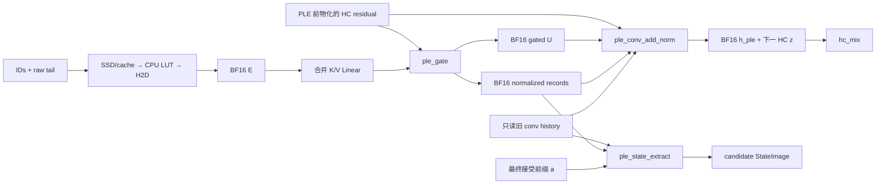

# Qwen3.8-Flash-Next：PLE 计算、SSD 读取与状态设计

更新日期：2026-10-08。**ConvAdd、ConvAddNorm 和 StateExtract 已实现；Gate、读取服务和
Program 接入待完成。** 卷积使用 converter 已生成的 channel 连续布局，并已完成与源布局的
Op 级对照。生产合同见 [ple.h](../../include/ninfer/ops/ple.h)，测试和性能入口分别见
[Tests](../../tests/README.md)、[Benchmarks](../../bench/README.md#ple-convolution-and-state-extraction)。

本文拥有 Qwen4Exp 的 PLE 数学、文件绑定、异步读取、GPU 交接与接受前缀状态。
共同约定见[支持总览 §1.3](qwen3_8-flash-next-model.md#13-统一执行约定)；NF4 表示、
页内布局和整模容量由总览第 7、9 节维护。[SSD 实测](../../profiles/bench/ple-io-20261007/REPORT.md)
仅验证独立加载链路，生产 PLE 与模型集成状态见总览第 11 节。

阅读入口：[数学](#4-完整数学与可观察表示)、[磁盘绑定](#5-ssd-表与启动绑定)、
[读取流水](#6-host-读取服务与-cpu-解码)、[GPU 交接](#7-gpu-交接预取与-graph)、
[GPU 接口](#9-gpu-接口)、[状态](#10-规范状态候选记录与提交)、
[Host 接口](#11-host-准备接口)、[容量与实测](#12-容量与实测给出的调度预算)。

## 1. 既定方案

1. NF4 表保留在 V3 `.ninfer` 文件集合内。启动绑定只读文件区间，不复制成另一个模型文件，
   不将整表 materialize 到 RAM/VRAM，不通过运行时重排获得另一种权重布局。
2. 采用 `nf4_g16_e4m3fn / row_paged_g16_4k_v1`：每行仍为 90 个有效字节，每 4 KiB
   放 45 行；128 个源 shard 和各自 FP32 divisor 保留。详见核心文档 §7。
3. 首版使用一个有界 Host 读取服务：`O_DIRECT + io_uring`、行/页去重、原始行缓存，
   以及 CPU LUT → pinned BF16 embedding。起始预算为 64 MiB 行缓存、128 个在途读，
   两个完整窗口槽；这些是执行资源配置，允许预算内调整，不是模型数学常数。
4. 首版所有窗口使用 CPU LUT 解码；出口固定为 BF16 `[2560,T,B]`。GPU 解码可以在后续
   独立验证后替换准备过程，但不能改变该出口或要求重做持久权重。
5. Prefill/Replay 提前准备下一 chunk；ordinary decode 在输入 ID 可用时发起；推测后端
   在候选 IDs 可供 Host 消费时提前准备 target 的窗口。预取不推进模型状态。
6. GPU 路径为既有合并 Linear → ple_gate → ple_conv_add_norm → hc_mix。
   卷积读取规范旧历史和当前记录；接受长度确定后由 ple_state_extract 提取状态。
7. PLE 规范状态为 9-token BF16 卷积历史，以及 Host metadata 中两枚原始历史 token ID。
   两者与同一 materialized-input frontier 对齐。SSD 行缓存、ticket、staging 不属于 checkpoint。
8. 文件 I/O 不进入 CUDA Graph 或数学 Op。Program worker 拥有 CUDA 提交与状态提交；
   I/O worker 只推进其读取、解码、缓存和完成队列。

## 2. 实例几何、权重与布局

本实例只在零基第 1 层（第二个 decoder layer）入口执行 PLE，位置在该层 attention HC
之前。原生 MTP 没有独立 PLE，但它生成的候选经 Main 验证时仍需要 Main 的 PLE。

| 项目 | 约定 |
|---|---|
| hidden H / HC streams C | 2560 / 4，总通道 D=10240 |
| n-gram | 2-gram、3-gram，各 8 heads |
| 每 head 行宽 | 160，16 行拼成 E[2560] |
| 表 | 128×[2500012,160]，320001536 个逻辑行 |
| 合并 K/V weight | BF16 `[12800,2560]`，A16Only |
| 输出行次序 | K=`[0,10240)`，V=`[10240,12800)` |
| 三组 norm | norm_key、norm_query、norm_conv；每组 10240 个 BF16 offset weights |
| 短卷积 | 10240 通道 depthwise，4 taps，dilation=3，无 bias |
| 历史 | 最近 9 个 normalized gated values，按时间从旧到新 |
| epsilon / gate floor / EOS | RMS epsilon=1e-6；gate floor=1e-6；EOS=248044 |

按共同约定 M=T*B，E 为连续 BF16 `[2560,T,B]`，可 view 为 Linear 的 `[2560,M]`；
投影输出 parent 为 BF16 `[12800,M]`。K/V views 保留 parent 的 token stride，不能把
K 错当成紧密的 `[10240,M]`。S 是状态槽数，R 是候选记录容量。

| 值 | 运行态 view |
|---|---|
| K | BF16 `[2560,4,T,B]`，token stride 为 12800 个 BF16 |
| V | BF16 `[2560,T,B]`，同样继承 parent token stride |
| PLE 前后 HC residual / gated U / 下一 HC 的 z | BF16 `[2560,4,T,B]` |
| norm weights | BF16 `[2560,4]`，d 连续 |
| conv kernel | BF16 `[10240,4]`，channel 连续；`kernel[c,j]=source[c,0,j]` |
| conv history pool | BF16 `[10240,9,S]`，feature 连续 |
| candidate normalized records | BF16 `[10240,R,B]`，feature 连续 |

PLE 卷积按[核心存储约定](qwen3_8-flash-next-model.md#54-vision-与其他非矩阵参数)将源
`[10240,1,4]` 离线转置为 artifact/Binding `[4,10240]`（C-order），原生 Tensor view 为
`[10240,4]`（第 0 维连续）。Word 地址为 `j*10240+c`，不改变 tap 时间次序或 BF16 值。
这块 80 KiB 权重常驻 GPU，启动和运行时不再转置；与磁盘上的 NF4 大表分别组织。

采用 channel 连续的依据是 activation/history/output 与后续融合 HC norm 均沿 feature
组织。Dilation=3 只影响时间索引。Op 对照未显示两种权重布局有一致优劣，保留上述布局；
SSD 实验未包含卷积。
现有 dilation=1 的 `causal_conv1d_silu` 不能直接承担这里的 dilation=3、残差/HC norm
和候选记录合同。

## 3. token 与 hash 的精确语义

输入来自保留下来的原始 token IDs。视觉特征替换普通 embedding 后，PLE 仍使用原始 IDs；
不能从 hidden、视觉 embedding 或输出字符串反推 token ID。

令当前位置 p 的原始 ID 为 x0，前一、前二个原始 ID 为 x1、x2。位置不存在时补 EOS。
若 x1=EOS，则本次 hash 的 x2 也取 EOS；其他情况下 x2 保留，包括它本身为 EOS 的情况。
**当前位置本身为 EOS 时仍使用它之前的历史；分段效果从 EOS 后的位置开始。**

```text
u2 = word64(x0 * multiplier[0]) XOR word64(x1 * multiplier[1])
u3 = u2 XOR word64(x2 * multiplier[2])
g[h] = positive_mod(signed64(h<8 ? u2 : u3), head_vocab_size[h])
       + head_offset[h]                         // h=0..15
```

乘法按 modulo-2^64 word 运算；随后将 word 显式解释为 signed INT64，再取非负余数。
C++ 不依靠 signed overflow，不经 FP32 转换，也不重新用 seed 生成控制数组。
35 个 INT64 控制值按核心文档的 280-byte Resource 无损绑定。

全局行号按 h=0..15 的固定顺序连接成 E，每行占其 160 个 feature。源 shard 是大表的
连续行段，不是一个 head 对应一个 shard。Hash 计算需要完整 64-bit 运算；本实例的
最终 g 小于 320001536，可以用 U32 保存取行索引。

Host sequence metadata 的两枚 tail 保存原始 ID，顺序为 `[F-2,F-1]`，不存在的位置补 EOS。
不提前将 EOS 之前的 raw tail 改写成别的内容。Hash helper 在每个查询处应用上述分段规则。
一次窗口中的后续位置依赖本窗口更早的输入 IDs，不能对每个位置都重复使用窗口起点 tail。

## 4. 完整数学与可观察表示

### 4.1 token 侧可提前计算的分支

对查到的 NF4 表示值按核心文档解码，并取规定的 BF16 舍入，构成 E。之后：

```text
[K[:,0], K[:,1], K[:,2], K[:,3], V] = W_kv * E
```

K/V 是 Linear 的 BF16 输出。E、K/V 和 key norm 的输入不依赖上一层 hidden，均可在
token IDs 确定后准备。首版固定提前 I/O、CPU 解码与 H2D；K/V GEMM 是否也前移，须在
与当前层计算、expert H2D 的竞争中测量，不能仅因另开 stream 就认定会更快。
当前 key norm 包含在 ple_gate 内；若将它拆成提前准备的公共值，需要重新明确对应 Op
和表示边界，不能在模型代码中插入未声明的 Device transformation。

### 4.2 门控与卷积输入

定义 stream 内的 offset RMSNorm：

```text
Norm(v,w)[d] = v[d] / sqrt(sum_i v[i]^2 / H + epsilon) * (1+w[d])

k_s = Norm(K_s, norm_key_s)
q_s = Norm(h_s, norm_query_s)
a_s = sum_d k_s[d] * q_s[d] / sqrt(H)
b_s = sign(a_s) * sqrt(max(abs(a_s), 1e-6))
g_s = sigmoid(b_s)
U_s = BF16 output of g_s * V
N_s = BF16 output of Norm(U_s, norm_conv_s)
```

三个 norm 都是每 stream 独立的 H=2560 归约和独立 affine；不是对 10240 维统一归一化。
`sign(0)=0`，所以零点 gate=0.5。Gate 是每 stream 一个标量，V 在四条 streams 共享。

U 是公开 BF16 输出，NormConv 必须使用与这个输出相同的 BF16 words。N 是实际驱动卷积的
公开 BF16 record。不能用未舍入的 U 生成 N，同时把另一份 BF16 U 交给残差分支。

### 4.3 dilation=3 卷积与 HC 交接

设 n[p,c] 是上面得到的 N，负位置为 +0；c=s*2560+d。以 `w_j[c]` 表示原生
`kernel[c,j]`，其 tap 次序与源权重一致：

```text
v[p,c] = w_0[c]*n[p-9,c] + w_1[c]*n[p-6,c]
       + w_2[c]*n[p-3,c] + w_3[c]*n[p,c]
h_ple[p,c] = BF16 output of h[p,c] + U[p,c] + SiLU(v[p,c])
z_next[p,s,:] = BF16 output of Norm(h_ple[p,s,:], next_hc_norm[s,:])
```

`next_hc_norm` 是本层 attention HC 的 norm weight，区别于 PLE 的三组 norm。
融合产生 z_next 时必须消费实际 BF16 h_ple；h_ple 同时保留为该 HC 的 residual。

EOS 只改变 §3 的 hash 历史取值，**不清空卷积历史**。新请求 F=0 的历史才初始化为零；
padding/inert columns 不成为时间步。这里没有新的 KV page group 或独立 positional cursor。

### 4.4 数值资格化边界

| 边界 | 合同 |
|---|---|
| NF4 lookup → E | 固定 codebook/scale/divisor 表示值的 BF16 round-to-nearest-even，CPU/GPU 路线须逐 word 相同 |
| Linear → K/V | 现有 A16 BF16 Linear 合同 |
| Gate → U | BF16 数值输出，独立验证完整 gate 公式 |
| U → NormConv → N | NormConv 使用实际 U words；N 为 BF16，作为卷积的真实输入与持久历史来源 |
| ConvAdd → h_ple | BF16 数值输出；内部 conv、SiLU、U+conv 不新增公开舍入点 |
| h_ple → 下一 HC norm | 必须从实际 h_ple words 归一化，与 [HC residual seam](qwen3_8-flash-next-hc.md#5-数值表示与资格化含义)一致 |
| N → history/accepted-prefix extract | 原始 BF16 words 精确复制，不重算 gate/norm/conv |

Gate 的 k/q norm、逐元素乘积、dot 和 sigmoid 没有新增的 BF16 公共中间量。上游实现中
为匹配 eager 而插入的 casts 不能自动变成 NInfer 合同。完整数学 oracle 使用 FP64；对明确
公开的 BF16 seam 分阶段验证：先独立资格化 U/h_ple，再以其表示值验证相应 norm，同时检查
完整路径误差。不得只以生产 kernel parity 或模型输出看起来正常作为正确性依据。

## 5. SSD 表与启动绑定

### 5.1 页内布局与容量

原生 reader 按[核心文档 §7](qwen3_8-flash-next-model.md#7-ple-的-nf4-表与整数控制资源)
的全局行号→shard→页内行公式取数。每行 90 B、每页 45 行，divisor 位于数据页之后；
reader 必须经过 V3 文件区间映射，不能把逻辑 object offset 当成实际文件偏移。

该布局使常规分卷中的一行只需读取一个物理页，代价是比紧凑行表多约 312 MiB padding。
完整 PLE payload 为 27.126954 GiB。实测多数点较快，单路 T=1 未见稳定收益；完整结果
与限制保留在 SSD 报告中。

### 5.2 cold backing 的所有权

Materializer 增加 disk placement：验证对象几何、layout、encoded size、文件归属与范围，
绑定 128 个不可变 shard descriptors、divisors 和控制资源。启动只读必要 metadata/标量，
不扫描全表。CPU LUT 属于由这些不可变参数派生的小型 Model 数据。

Model 持有长期存活的只读文件 backing；Program 的 PLE 服务借用这个 backing。不能把
一个即将销毁的 cold Reader 指针放进运行态 Parameters，也不能用虚假的 Host WeightParent
指针代表未 materialize 的 NF4 表。原生 `PleTableBinding` 表达行几何和文件 backing，
GPU 数学 Op 只收到准备好的 E 或 K/V，不收到 fd、文件路径或 artifact 对象 ID。

复用 V3 的逻辑区间映射，在启动时冻结有效的文件区间表。文件保持只读打开，先核对
direct-I/O 支持与对齐要求；不在每次 miss 时打开文件、解析 JSON 或扫描对象目录。
当前通用 Materializer 只有完整 Host/Device placement，这项长期 disk backing 尚需实现。

### 5.3 续卷、对齐与错误

本 recipe 使用当前 writer 的 4 KiB 对齐 payload 起点和非末卷边界，加上 4 KiB 对齐的
PLE 对象起点，因此一个逻辑数据页正常对应一个实际文件页，shard 可以跨续卷而无需重新打包。

通用 V3 也允许其他合法的分卷位置。Cold backing 仍须经区间映射拆成真实 file segments，
将各 segment 扩展到符合 direct I/O 的物理范围，并收集所需字节；不能用“对象不跨文件”的
假设实现。非对齐分卷可能使一次逻辑页读取涉及多个物理页。EOF 短读只在覆盖所有请求的有效
字节时成立，不能用补零掩盖缺失数据。对齐开销计入真实 I/O 统计。

读取范围、短读和 scale words 在消费时检查；非法 scale/divisor 不返回伪造的零 embedding。
读取失败向 Program 返回失败，不发布部分 HostReady。没有静默切换到整表 mmap/materialize
的路径。PLE 是不可变权重读，运行期没有 SSD 写回。

## 6. Host 读取服务与 CPU 解码

### 6.1 有界流水

```text
预留窗口，拷贝两枚 raw tail、owner/epoch/F0
每次提供/追加已知 IDs：
    hash、重复行去重 → 查原始行缓存
    → miss 映射成物理页，合并同页和已有在途读
    → io_uring 批量提交、收集完成
    → 按 head 顺序收集 90-byte 行并 CPU LUT 解码
seal 冻结最终有效长度；全部有效列完成、无效尾列置零后：
    发布不可变 pinned E[2560,T,B] 的 HostReady
```

物理在途读按 `(file, aligned_offset, length)` 合并，完成结果可以服务多个窗口。
缓存按全局 g 索引；同一个已绑定模型内 g 唯一确定 row 及 divisor，不因请求或位置改变。
重用缓存或读完一个错误草稿的行都不改变模型状态。

起始实现保持小块并发读，不为凑顺序大块读取未被请求的远处数据。对真正相邻的必要范围，
后续可以合并，只要计入读放大并重新测量。队列深度、合并阈值、cache associativity 属于
私有路线，不能成为 NF4 表示或数学 Op 的一部分。

64 MiB 是 cache 数据加索引/替换 metadata 的总预算，可显式设为零。读页主要是短期
I/O buffers，长期缓存保存被使用的 90-byte 行，避免每用一行就长期占一个 4 KiB 页。
首版将命中行复制进本窗口的收集区，再解码；不能保留一个会被后续插入逐出的裸 cache 指针。

所有队列、buffer、token/row maps 按启动容量分配。`try_prepare` 无槽时返回不可立即准备，
不推进请求状态；Program 先推进已有完成或让出可选 lookahead。所需窗口优先于远期预取，
可选预取不能占满所有槽而阻止当前执行窗口。这里不增加通用调度优先级产品接口。

窗口可以先只有 anchor 或一段已知 IDs。追加操作只能在同一行已知前缀之后继续，不能改写
已发布的 ID；每次追加即可发起对应行的 I/O，不必等全部草稿产生。seal 后不可追加，最终
有效长度不得超过已知前缀。只有 seal 且全部有效 E 完成后才发布 HostReady；此前没有 H2D。
seal 截去的尾列置零，其晚到读结果不得再写 E。普通已知窗口只需 prepare 后立即 seal。

### 6.2 固定 LUT 与出口

```text
lut[s][scale_word][code] = BF16_RNE(codebook[code] * E4M3FN(scale_word) / d[s])
```

按 128 shards × 128 scale slots × 16 codes × 2 B，共 **512 KiB**。有效 scale words
为 0..126；127 对应非法编码，不能因预留了 LUT slot 就把它当有效数据。
LUT 按独立精确/高精度 reference 构造和验证，不能以先 FP32 再 BF16 的双舍入代替规定结果。
本实例所有有效 lookup 项必须得到有限 BF16 值。

拼接次序为 `[2-gram head0..7, 3-gram head0..7]`，每行 160 个值。无效尾列不读取权重，
E 对应区域写 BF16 +0。一次 batch 的 H2D 发送完整、连续的 BF16 E，避免每行一次小 copy。
表格式仍是 NF4；E 是 lookup 的激活输出，CPU 解码不是持久权重的运行时 repack。

#### 6.2.1 Host LUT 与行解码接口

以下接口在 `src/core/nf4.h` 声明、`src/core/nf4.cpp` 实现，属于通用数值解码。
沿用已有 `kNf4CodebookWords`；LUT 和输出存储由调用者提供。

```cpp
namespace ninfer {

struct Nf4Bf16Lut {
    std::array<std::uint16_t, 128 * 16> words; // index=scale_word*16+code
};

void build_nf4_bf16_lut(float weight_divisor, Nf4Bf16Lut& out);

void decode_nf4_row_bf16(
    std::span<const std::byte> encoded_row,
    const Nf4Bf16Lut& lut,
    std::span<std::uint16_t> out_words);

} // namespace ninfer
```

`build_nf4_bf16_lut` 接收实际存储的 FP32 divisor，按 §6.2 的精确表示值直接舍入为
BF16 words，保留零的符号。Divisor 必须正且有限；有效 LUT 项的 BF16 结果必须有限。
每张 LUT 为 4096 B，构建成功后 0..126 的有效 scale slots 全部可读；slot 127 不参与查表。
Model 在加载阶段为 128 个 shard 构建并持有不可变 LUT，Program 的读取服务只借用它们。

行解码的 K 由 `out_words.size()` 给出，要求 K>0、K%16=0、`K/2+K/16<=4096`，
`encoded_row.size()` 必须恰为 K/2+K/16。输入是已取得的紧凑行：前 K/2 bytes 是
low-even packed codes，后 K/16 bytes 是 scales；非法 scale words 按格式合同报错。
本实例为 90 B → 160 个 BF16 words。输入允许任意字节对齐，输出连续且不与输入/LUT 重叠。
接口只读输入和 LUT、完整写出该行；内部 SIMD 与分块组织由实现选择。

读取服务先由全局行号选择 shard/LUT，取得 90 B 行，再将输出直接指向
`E[(b*T+t)*2560+h*160 : ...+160]`。全局行号、页/文件寻址、原始行缓存和 pinned buffer
寿命属于读取服务；行解码函数不需要这些对象。两种 Host 数值函数均不创建线程、提交 CUDA
或持有跨调用可变状态。

### 6.3 ticket、取消与 buffer 寿命

每个窗口记录每行的稳定 sequence identity、候选 epoch、起始输入 frontier、有效长度和
实际 IDs。物理 slot 与 generation 组成 ticket；lane、compact batch row 和 token position
都不能单独充当 ticket 身份。提交成功即拷贝必要输入，不借用随后可能变化的 caller spans。

```text
Free → Preparing（可追加，随后 seal）→ HostReady → Uploading → DeviceReady → Consumed → Free
                        ↘ Failed / Cancelled → drain → Free
```

Preparing/HostReady 由读取服务管理；Uploading 之后的 CUDA 状态由 Program 管理。
内存可复用条件分别是：

- I/O slab：对应磁盘操作完成、所有所需片段已收集。
- pinned E：H2D 完成；即使 token 已取消，也不能提前覆盖仍被 DMA 读取的源。
- Device E：最后一个消费者完成，通常是 K/V Linear；不是等到采样才必须释放。
- slot generation：旧 I/O、CPU notification、H2D 与消费者引用全部退役后才能复用。

首版整槽 release 同时满足上述条件，不强制把 Host 与 Device 槽拆成两套独立 ownership。
窗口的物理 T/B 和 row identities 在 prepare 时固定，seal 只改变有效长度。若调度改变
compact batch 成员或物理 shape，重新建立 ticket 并复用行缓存/在途读，不能错误 reshape
一个保留原 batch stride 的 E。

取消丢弃未提交任务；在途共享读保留其他消费者，已提交读可以排空后回收。晚到的旧 epoch
完成不能绑定到重用后的 lane/ticket。它可以留下正确的不可变行缓存，但不能发布旧窗口 E。
销毁先停止新工作并 drain I/O/CUDA 引用，再释放 buffers、线程和 Model file backing。

## 7. GPU 交接、预取与 Graph

### 7.1 线程分工与设备交接

I/O worker 不修改 ledger/frontier、StateImage、Program 请求状态，也不提交 CUDA 工作。
它仅写自己获准使用的 Host buffers/cache，并以 release/acquire 的完成通知发布 HostReady。
Program worker 验证 ticket 身份后，在 transfer stream 排入 H2D，随后记录该 slot 的 event。

消费者 stream 的 wait 必须引用**已排入 record 的当前代次**。未 record 的 CUDA event 不代表
未来读取完成，不能先让 GPU 等一个空 event，再期望 SSD 完成后自动补上依赖。
生产交接不必像微测量一样在 Host 等待 H2D 完成；可以在 copy/event 入队后立即排入 GPU wait。

Program 等待当前 GPU unit 完成时仍需推进 HostReady 与 transfer 提交，不能一直阻塞在整个
unit 的 `device.synchronize()` 上，使下一 chunk 的 Host 数据虽然准备好却无法上传。
这可以在 Program 的 unit 等待循环内完成，不改变 Engine 的提交边界或让 I/O 线程发布结果。

### 7.2 首版 Graph 分段

```text
prepare current E
launch Graph A：普通 embedding、第 0 层、PLE 前的 hc_combine
等到当前 HostReady，排入 H2D 和 event record
consumer stream wait(event)
launch Graph B：K/V Linear、ple_gate、ple_conv_add_norm、本次 Main forward 的其余层与末端特征
```

A/B 只拆分 Main forward；推测后端的 draft/verify/bridge 与约束采样 Finish 继续由
Program 按整体 unit 协议组织，不将 Finish 提前到 forward 完成之前。
等待 HostReady 时 Graph A 可以继续执行；如果 E 已提前在 DeviceReady，直接衔接 Graph B。
当前 ticket 失败时不提交依赖它的 Graph B，先排空已经启动的 Graph A 引用，再通过现有
unit 错误路径结算未发布状态；不能拿上一次窗口的 E 继续计算。
Graph 不包含文件读取或 CPU 阻塞 callback。每个物理 Device E 槽具有稳定地址；首版为不同槽
准备固定的 consumer graph 绑定，不能在一个仍执行的 graph 上改输入指针。Graph 数量和
allowance 计入 Program 规划，不能当作零开销。

E 被 K/V Linear 消费后可以记录供 Host 观察的 completion；graph 内需要 Host 中途可见的
记录使用已有 external-record event 机制。早释放 E 不释放本次 PLE records 或 canonical
state。拆图增加提交开销，整条链路资格化和性能测量必须包含它。

### 7.3 各执行路径

| 路径 | 发起时机与可利用窗口 |
|---|---|
| Prefill / Replay | IDs 已知，当前 chunk 计算时准备下一 chunk；从一个 chunk ahead 开始 |
| 首个 prefill chunk | 输入/必要 metadata 就绪后尽早准备，可与视觉、绑定等独立工作重叠；单独测 TTFT |
| Ordinary decode | 输入 ID 可用即发起；主要利用 embedding 和第 0 层；下一未知 token 不可提前假定 |
| MTP target verify | 当前 anchor 已知时先准备；draft ID 逐步可见后准备对应追加输入，可与后续 draft 步骤重叠 |
| DFlash target verify | 最终候选 IDs 发布后成组准备；不可把并行 draft 的 mask 或未确定中间值当最终输入 |
| Forced control / scoring | 使用其真实输入 IDs 和对应 frontier，沿用同一 reader 与 PLE 数学路径 |

MTP/DFlash 的设备候选若一直留在 GPU 到整轮末尾，Host 就没有提前读取的机会。后端需要
明确的小型 pinned IDs handoff 和完成事件，利用既有外部 event 机制；发布策略可以按步或
成组，但不得为每个候选同步整个 GPU。发布的是可用于预取的候选，不是已提交 token。

Prefill 的可选窗口长度不因本次测试停在 4096 就固定为 4096。实际 chunk 大小由 Program
容量与完整模型性能决定。首版起始两个完整窗口槽提供当前/下一窗口，预算足够时可调整；
不预读整个长 prompt 或为每个历史 token 保存永久 E。

PLE H2D 要在消费者之前有明确位置，不能先排入大量无依赖的远期 expert 拷贝再提交紧急 E。
Stream priority 不保证抢占已经在进行的 DMA。两者的传输块大小、排队和 deadline 应在
Program 的实际模型 schedule 中协调；本轮 I/O 实验没有测并发 expert H2D 的竞争。

## 8. GPU Ops 与融合边界

首版数据流为：



PLE 前必须得到完整 HC residual；不能把上一 block 的 pending combine 穿过 PLE。
PLE 后的 conv、SiLU、两项残差相加与下一 HC grouped norm 可以合在同一个闭合 Op，
同时输出 h_ple 和 z。独立 ConvAdd 入口保留给不需要 z 的独立调用/验证，不引入字符串 mode。
连续 h_ple/z 可零拷贝视为 HC 接口的 `[2560,4,M]`，hc_mix 按这些物理列计算；
进入有状态 block 时仍由 Program 提供原 T/B 和有效列 metadata。

ple_gate 融合两组 norm、dot、sign/sqrt/sigmoid、V 广播门控与 NormConv。Gate 需要完成
一个 stream 的归约，然后才能得到该 stream 的 N。N 的后续时间位置会被卷积读取，因此
首版在 Gate 与 Conv 之间保留明确的 kernel/Op 完成边界；不能在不同 CTA 之间假定 N 已写好。
一个 Op 可以包含多个 kernel，不把一次 launch 当作数学合同。

## 9. GPU 接口

公共合同位于 `include/ninfer/ops/ple.h`，使用既有 Tensor 和 DeviceExecutionView。
Linear 直接复用既有 `[12800,2560]` BF16/A16 入口，不在 PLE 中新增一套 GEMM API。

```cpp
namespace ninfer::ops {

struct PleBatchView {
    Tensor valid_columns; // Device I32 [B]，0<=n[b]<=T
};

struct PleProjectionView {
    Tensor key;           // BF16 [2560,4,T,B]，允许 packed parent 的 token/batch stride
    Tensor value;         // BF16 [2560,T,B]，同上
};

struct PleGateParameters {
    Tensor norm_key;      // BF16 [2560,4]，offset gain
    Tensor norm_query;    // BF16 [2560,4]，offset gain
    Tensor norm_conv;     // BF16 [2560,4]，offset gain
    float rms_epsilon = 1e-6F;
};

struct PleConvStateView {
    Tensor history;       // BF16 [10240,9,S]
    Tensor slots;         // Device I32 [B]
};

struct PleConvRecordWindowView {
    Tensor values;        // BF16 [10240,R,B]
    Tensor offsets;       // Device I32 [B]，本次窗口第 0 列在 records 中的列号
};

struct PleConvRecordReadView {
    Tensor values;        // BF16 [10240,R,B]，第 0 列对应 Program 的基准 F0
    Tensor valid_columns; // Device I32 [B]，已记录的连续前缀 u[b]
};

void ple_gate(
    const PleProjectionView& projected,
    const Tensor& residual,             // BF16 [2560,4,T,B]
    const PleGateParameters& parameters,
    const PleBatchView& batch,
    PleConvRecordWindowView records,    // 写有效 N words
    Tensor& gated_value,                // BF16 [2560,4,T,B]
    DeviceExecutionView execution);

void ple_conv_add(
    const Tensor& residual,
    const Tensor& gated_value,
    const Tensor& kernel,               // BF16 [10240,4]，channel 连续
    const PleBatchView& batch,
    const PleConvStateView& before,
    const PleConvRecordWindowView& current, // 本次 N，只读
    Tensor& updated_residual,
    DeviceExecutionView execution);

void ple_conv_add_norm(
    const Tensor& residual,
    const Tensor& gated_value,
    const Tensor& kernel,               // BF16 [10240,4]，同上
    const PleBatchView& batch,
    const PleConvStateView& before,
    const PleConvRecordWindowView& current,
    const Tensor& next_hc_norm_weight,   // BF16 [2560,4]
    float next_hc_epsilon,
    Tensor& updated_residual,
    Tensor& normalized,                 // BF16 [2560,4,T,B]
    DeviceExecutionView execution);

void ple_state_extract(
    const PleConvStateView& before,
    const PleConvRecordReadView& records,
    const Tensor& accepted_columns,     // Device I32 [B]，0<=a[b]<=u[b]
    PleConvStateView after,
    DeviceExecutionView execution);

} // namespace ninfer::ops
```

### 9.1 公共 domain、strides 与 workspace

T/R/S 为正，B=1..8；计算 Ops 支持存储/view 可表达的任意正 T，不以 16 或 4096 作为数学
上限。各参与参数的 T/B 相同。epsilon 正且有限，活跃浮点输入有限；模型实际数值域及
误差标准遵循 [Op 开发](op-development.md)。所有 metadata 是连续 Device I32。
DeviceExecutionView 提供有效 stream 和正的物理 SM 数。

residual、gated、updated、normalized 为连续 Tensor，至少 16-byte 对齐；norm 和 kernel
按上述轴连续。K/V 的 feature/head 连续，保留真实 token/batch strides。History/records
允许 pool 切片形成的 slot/batch 间隙，feature 连续、strides 正且元素不重叠。
Tensor 的只读/可写性质由各函数合同定义，不以 `Tensor::data` 的 C++ 指针类型推断。

这些 PLE Ops 不需要 caller-owned global workspace，不提供容量查询；可用一个或多个同
stream kernel、寄存器/共享存储实现。StateImage、records、U 和 norm 输出是明确的输入/
输出存储，不是隐藏 scratch。它们都由 Program 提前规划。

### 9.2 Gate 的效果

- 有效列写 gated U，同时将 N 写入 `records.values[:,offsets[b]+t,b]`。
- `0<=offsets[b]` 且 `offsets[b]+n[b]<=R`。Records 对应位置已 reserve，未覆盖仍可能
  被外层事务恢复的记录。Gate 不推进 offsets、valid counts 或 frontier。
- 无效列的 gated 输出精确置 +0，不读取其 projection/residual，不写对应 records。
- 保持所有输入不变。gated、records 的写区间互不重叠，也不与任何输入重叠。

### 9.3 ConvAdd/ConvAddNorm 的效果与 alias

每行 before 对应本次输入窗口的起始 frontier F；current.offsets 对应本次 N 的起点。
对有效 t、tap j，局部位置 k=t-9+3*j：k<0 读取旧 history 的第 9+k 列；否则读取
`current.values[:,offsets[b]+k,b]`。这些值都是已完成 Gate 的 BF16 words。

Conv 只读 old history 和 records，不更新规范 state。有效列输出 §4.3 的 h_ple；norm
重载同时从实际 h_ple 表示产生 z。无效列两个输出均置 +0，不读取输入或 state；n=0 的行
不要求可读的 state slot。输入 slot/frontier 对应关系由 Program 保证。

updated_residual 可以与 residual 精确同址，或者完全分离；不允许部分重叠。其他写输出
与仍需读取的 K/V、U、records、history、weights/metadata 均不重叠，normalized 与
updated 不重叠。不同 token 的卷积只读 N，不能通过 in-place 修改 U/N 当作融合捷径。

### 9.4 StateExtract 的效果

每个 before slot 对应该行的基准 F0，records 的连续前缀为 `[F0,F0+u)`。选择 a 后输出
与 F1=F0+a 对齐的规范 9-token 窗口，公式见 §10。此 Op 完全是 BF16 words 索引复制。

提取时所有 source/destination slots 有效，即使 a=0 也需要可复制的旧状态；不活跃请求
可由 Program 排除，不能把 Conv 的 inert-slot 规则套用到状态复制。
Destination slots 互异，不能覆盖任何其他 batch 行的 source。只读 source 可以共享。
同一行 before/after 可 exact-alias；实现先读取该 feature 所需的全部旧 9 words 再写回，
避免小 a 左移时覆盖后续源。其余输入/输出不重叠，不修改 records 或 accepted counts。

## 10. 规范状态、候选记录与提交

### 10.1 唯一 frontier 与初始化

F 表示已经实际 materialize 的 Main 输入前缀长度，不是已输出 token 数，也不是预取
到了多远。F 由 Program 的现有 identity/frontier 管理；不在 PLE 中另建可独立推进的 cursor。

```text
Device/Host StateImage: conv_history[c,j] = N[F-9+j,c], j=0..8
Host model metadata:   raw_token_tail = [id(F-2), id(F-1)]
```

负位置的 conv words 为 BF16 +0，负位置的 token ID 为 EOS。F=0 初始化一次；之后
history 始终是完整 9 列，不另外用 ring head 改变持久含义。内部 kernel 可以使用环形
索引，但 checkpoint/consumer views 仍遵守这个从旧到新的规范顺序。

Token tail 从同一 frontier 的 ledger/已接受输入推导和保存，不拥有另一份接受决策。
Capture、prefix reuse、pause/resume 时它与 conv history 一起绑定该 prefix identity；
不能从 ledger 最后两个已发布输出直接取值，因为其中可能含有尚未执行的下一输入。
Host tail 是可由 ledger 重建的 8-byte metadata，不需要为 hash 把 GPU conv history 拉回 Host。

### 10.2 原始 N 记录与任意接受前缀

每个可能回退的区间保留一个基准 history 和实际 N records。对输出列 j=0..8，令 k=a-9+j：

```text
after[:,j] = k<0 ? before[:,9+k] : records[:,k]
```

a=0 精确保持旧 history；a<9 组合旧尾部和新 records；a>=9 完全取新记录的最后 9 列。
Token tail 用相同的原始输入接受长度 a，从旧两枚 ID 加已接受 IDs 取最后两枚。
整个过程不重算 norm 或卷积，也不重新从 SSD 读表来恢复历史。
这些原始输入 IDs 由 Program 的 ledger/PendingBatch 独立保留到最终接受决定；I/O ticket
中的输入副本只服务取行，不能因为 E 已消费而连同提交所需的唯一 IDs 一起释放。

例：基准 F0=6，history 对应 `[-3,-2,-1,0,1,2,3,4,5]`，前三列为零。验证输入
6..10 后仅接受两列，则 F1=8，history 应为 `[-1,0,1,2,3,4,5,6,7]`。读取过、计算过
甚至留在 cache 中的 8..10 都不能进入提交状态。

### 10.3 生命周期与外围事务

- Ordinary/prefill 已知整段可采用时，提取 a=n 到 candidate StateImage，按统一 unit
  提交协议发布；需要 chunk 内 checkpoint 时，从同一记录选择相应 a。
- Verify 保存基准和 N，接受决定及 Frontend stop/cancel 截断确定后，选择实际被采用的
  **输入前缀**。后端负责将采样/接受数量翻译为这个 a，PLE 不猜测 anchor 的计数规则。
- 外层 PendingBatch 仍可回退时，即使某个内部步骤已经采用 working history，也不能
  释放外层基准和所需 records。跨多个调用追加时 offsets 明确，连续记录不能出现空洞。
- 单个 extract 调用需要从其 before 对应 F0 开始的连续记录 view；Program 可用已保留
  的中间状态锚点和分段记录覆盖更长事务，不能用一份已覆盖的 staging 替代记录。
- 与 GDN、QSA、HC 末端特征及所选后端状态共同提交同一 prefix。PLE 没有独立发布时刻。

Snapshot 的 Host offload 精确保存 184320 B conv words 和 8 B raw-token metadata，
外部 identity/frontier、对齐及通用容器开销另计。Replay 从既有恢复点重新执行实际接受输入。
Row cache 是可丢弃的不可变权重副本，不写入 checkpoint，也不随分支 rollback 清空。

## 11. Host 准备接口

### 11.1 纯 token hash

目标位置为 `src/models/qwen4_exp/ple_hash.h/.cpp`，实现归 `ninfer_model_runtime`。
输入是 Host 数据，函数按 §3 的既定 hash 数学计算一个序列的一段连续已知 IDs：

```cpp
namespace ninfer::models::qwen4_exp {

struct PleHashParameters {
    std::array<std::int64_t, 3> multipliers;
    std::array<std::int64_t, 16> head_vocab_sizes;
    std::array<std::int64_t, 16> head_offsets;
    std::int32_t eos_token_id;
};

void ple_hash_rows(
    const PleHashParameters& parameters,
    std::array<std::int32_t, 2> previous_ids, // 紧邻本段前的 raw [x[-2],x[-1]]
    std::span<const std::int32_t> input_ids,
    std::span<std::uint32_t> row_ids);

} // namespace ninfer::models::qwen4_exp
```

Model 从 280-byte 控制资源逐 word 绑定三个数组，从 config 取得 EOS。输入 ID 属于原始
词表；缺失历史由调用者填 EOS。Head vocab sizes 为正，各 offset 与 size 所确定的行区间
落在已绑定的 320001536 行中。乘法显式使用 unsigned modulo-2^64，再解释 signed64 并取
正模，保留源 INT64 words 的语义。

输出长度恰为 `16*input_ids.size()`，`row_ids[16*t+h]` 是第 t 个输入、第 h 个 head
的全局行号，顺序为 2-gram heads 0..7、3-gram heads 0..7。输入为空时输出也为空。
输入/参数与输出不重叠；函数同步完成、不分配输出存储、不保留或修改历史。

窗口内后续 token 使用本段更早的 raw IDs。当前 token 为 EOS 时仍使用它之前的历史；
上一 token 为 EOS 时，当前查询的更早一项才按 §3 替换。分段调用与一次调用同一串 IDs
应产生相同结果。追加候选时，读取服务提供追加起点之前的两枚 raw IDs；最终接受前缀的
raw tail 由 Program 按实际采用的输入维护。Hash 输出保留完整 head 顺序，去重与页映射
随后由读取服务完成。

### 11.2 读取服务

这是 `src/models/qwen4_exp/program/ple_io.h` 的目标接口，不是公共 Engine API。Model 的
`PleTableBinding` 提供不可变 cold backing；Program 创建和拥有服务及 CUDA 槽。

```cpp
namespace ninfer::models::qwen4_exp {

struct PleTableBinding;

struct PleReadCapacity {
    std::int32_t max_columns = 0; // 最大物理 M=T*B，必须为正
    std::uint32_t window_slots = 2;
    std::uint32_t max_inflight_reads = 128;
    std::size_t row_cache_bytes = 64ULL * 1024 * 1024;
};

struct PleInputRow {
    std::uint64_t sequence_id = 0;
    std::uint64_t epoch = 0;
    std::uint32_t first_position = 0;
    std::array<std::int32_t, 2> previous_ids{}; // raw [F-2,F-1]，缺少位置填 EOS
    std::span<const std::int32_t> input_ids;  // 初始已知前缀，长度 <= width
};

struct PleInputBatch {
    std::int32_t width = 0;                   // 物理 T
    std::span<const PleInputRow> rows;        // B=1..8
};

struct PleReadTicket {
    std::uint32_t slot = 0;
    std::uint64_t generation = 0;
};

struct PleTokenAppend {
    std::int32_t batch_row = 0;
    std::int32_t first_column = 0;           // 必须紧接该行的已知前缀
    std::span<const std::int32_t> input_ids;
};

enum class PleReadIntent { Required, Lookahead };
enum class PleReadStatus { Preparing, HostReady, Failed, Cancelled };

struct PleHostEmbedding {
    const std::uint16_t* words = nullptr; // pinned BF16 [2560,T,B]，borrowed
    std::int32_t width = 0;
    std::int32_t batch = 0;
};

class PleReadService {
public:
    PleReadService(const PleTableBinding&, const PleReadCapacity&);
    ~PleReadService();
    PleReadService(const PleReadService&) = delete;
    PleReadService& operator=(const PleReadService&) = delete;

    std::optional<PleReadTicket> try_prepare(const PleInputBatch&, PleReadIntent);
    void append(PleReadTicket, std::span<const PleTokenAppend>);
    void seal(PleReadTicket, std::span<const std::int32_t> valid_columns);
    PleReadStatus poll(PleReadTicket) const;
    PleHostEmbedding host_embedding(PleReadTicket) const; // 仅 HostReady
    std::string error(PleReadTicket) const;               // Failed 的具体原因
    void cancel(PleReadTicket);
    bool drained(PleReadTicket) const; // 不再有 I/O/CPU writer 引用，不代表 H2D 完成
    void release(PleReadTicket);       // Program 另须证明 H2D/Device consumer 均退役

private:
    struct Impl;
    std::unique_ptr<Impl> impl_;
};

} // namespace ninfer::models::qwen4_exp
```

成功 prepare 拷贝 inputs/tails/identities；返回空表示当前没有可用窗口槽，不是 I/O
失败。append 也在返回前拷贝新 IDs；每次调用的 batch_row 互异，追加区间连续、不超过
固定 width，且只作用于尚未 seal 的 Preparing ticket。seal 接受 B 个最终 n，满足
`0<=n[b]<=known_columns[b]<=T`；被截去的候选只是不用来验证，不表示已接受前缀。
poll 不同步 GPU；失败通过 error 交给 Program 的 unit 错误路径。Borrowed embedding
只在其 ticket lease 内有效。Stale generation 的调用为 caller 错误，不返回新一代的数据。
对同一个 ticket 的所有公共控制调用来自 Program worker，I/O thread 仅维护其私有队列。
Preparing ticket 即使暂时没有在途 I/O，也不等于可消费的窗口；放弃它须先 cancel。
正常 release 要求所有消费者退役；Failed/Cancelled 也须满足 drained 和任何已提交 CUDA
引用结束，才能释放该代次。

## 12. 容量与实测给出的调度预算

令 Mmax=max(计划 prefill chunk、verify width×并发数、ordinary 并发数)。这是当前
Program 调度形状的容量计算，不是 Op 的 T 上限。
当前 prefill 一次处理一条请求；若以后改变调用组合，应按实际最大 T*B 重新规划 Mmax。

| 项目 | 基线容量 |
|---|---:|
| 整张 NF4 表 payload | 27.126954 GiB，磁盘 |
| Divisors / hash controls | 512 B / 280 B，Host metadata |
| CPU LUT | 512 KiB，Model 派生只读数据 |
| 原始行缓存 | 起始 64 MiB，总预算包含 metadata，可配为零 |
| 128 个 4 KiB I/O buffers | 512 KiB，注册的 Host I/O 存储 |
| 两槽 pinned E | 2×5120×Mmax B |
| 两槽 Device E | 2×5120×Mmax B |
| 单个合并 K/V 输出 | 25600×T×B B |
| 单个 gated U | 20480×T×B B |
| N records | 20480×R×B B |
| PLE canonical history / token metadata | 每状态副本 184320 B / 8 B |

Mmax=4096 时两槽 E 分别占 40 MiB pinned Host 和 40 MiB Device。B=1、T=R=4096 时，
单个 K/V parent 为 100 MiB，单个 U 或 N 为 80 MiB。B=8、R=16 的 records 为 2.5 MiB。
尚有最多 16×Mmax 行的收集区、hash/去重/在途引用 metadata、对齐、norm 输出和既有 HC
workspace。实际容量查询须完整计入这些存储，不能只按有效 1440 B/token 预算整个服务。

N 直接写入它将被 Conv 和状态提取消费的 record buffer；不再多留一份同内容 N。记录寿命
可能长于 E/IO ticket：早回收 E 不能覆盖待提交的 N。Prefill 不要求保留整个 prompt 的 N。

2026-10-07 的独立链路测得以下 P50/P95（ms），包括 Host-observed H2D：

| 窗口 | 无行缓存 | 64 MiB 行缓存 |
|---|---:|---:|
| B=1,T=1 | 0.617 / 1.813 | 0.504 / 0.714 |
| B=8,T=5 | 5.181 / 5.544 | 2.301 / 3.411 |
| B=8,T=16 | 14.683 / 15.435 | 5.719 / 8.416 |
| Prefill 1024 | 59.359 / 72.168 | 33.080 / 49.501 |
| Prefill 2048 | 123.151 / 193.621 | 84.912 / 169.567 |
| Prefill 4096 | 203.105 / 239.618 | 136.129 / 201.219 |

这些数据支持跨 chunk 预取，但不固定预取 deadline 为某个常数。不同文本、缓存状态、
WSL 存储栈与 competing transfers 都会改变实际等待。独立链路中还保留了一次约 64 ms
的 Host CUDA 交接异常；它的 SSD/CPU 准备仅 0.512 ms，不应当作 SSD 的 64 ms 读延迟。
完整分布、布局在单路 T=1 的退化和实验边界见实测报告。

## 13. 实现责任与验收

| 层 | 责任 |
|---|---|
| Converter / format-layout | NF4 encoder、页内 packing、padding/divisor、对象对齐及 V3 写出；conv 离线转为 channel 连续；不生成第二份运行副本 |
| Artifact / Model | 校验并持有 immutable cold backing、range mapping、控制值与 LUT；不持有可变请求状态 |
| Core 数值解码 | 构建精确舍入的 NF4→BF16 LUT，解码调用者提供的紧凑行字节 |
| 模型 Host 数学 | 从显式 raw IDs、两枚历史 ID 和控制参数计算有序全局行号 |
| Program / PLE 服务 | 有界队列、取行缓存与 leases、HostReady、CUDA 交接、graph 绑定、预取、取消、整体提交 |
| Central Ops | Gate、dilated ConvAdd/Norm、精确 state extraction；不做文件访问或隐藏 allocation |
| StateImage / context 事务 | history 和同 frontier raw-token metadata 的 capture/clone/offload/restore |

资格化必须覆盖：

- 存储：首/末行、45 行页边界、128 shard 边界、divisor、最后一页 37 行、续卷跨界、
  非常规分卷映射、短读、padding、非法 scales；同一逻辑行映射为同一 NF4 表示。
- Lookup：64-bit overflow/XOR/正模、序列开始、EOS 自身与其后两位置、跨 chunk、
  多请求隔离、视觉 raw IDs、inert columns；LUT 的有效组合逐项对独立 oracle。
- 数学：FP64 norm/gate/dilated conv reference；a=0 与正负近零、四组独立 affine、共享 V、
  tap 顺序、明确 BF16 seams；prefill 与逐 token 路线分别资格化，不能只互相对比。
- 状态：任意 a=0..u、F<9、窗口跨 3/9 边界、a>=9、in-place extract、共享只读 source、
  候选拒绝/外围截断、分段提交、Replay、checkpoint 与 Host round-trip。提取检查 words 精确。
- 异步：miss/命中/全命中、跨 ticket 共享读、队列背压、late completion、取消中 H2D、
  slot generation 重用、预取失败和 shutdown；不能将旧窗口发布给新请求。
- 集成：hc_combine 前置、ConvAddNorm 输出与下一 hc_mix、MTP/DFlash IDs handoff、
  所有状态的统一 accepted-input frontier，以及 CUDA Graph/eager 两条完整路径。
- 性能：真实 NF4 artifact、实际语料、首 chunk/稳态、与 expert H2D 同时运行、真实内存
  压力下的 CPU-ready/GPU-ready/暴露等待和尾延迟；不能以磁盘带宽或 Op microbench 代替。

独立 I/O 实验没有验证实际 PLE 数值质量、全模型性能或 SSD 与 GPU 计算完全重叠；
这些仍是集成验收项。当前进度统一维护在
[支持总览](qwen3_8-flash-next-model.md#11-支持进度与后续工作)。

## 14. 固定来源

- [核心量化与存储设计](qwen3_8-flash-next-model.md)：选定格式、合并 K/V 与参数几何。
- [Transformers Qwen4Exp](https://github.com/huggingface/transformers/blob/8073e6dcaea9aa4b42acf2d92ec72148786bbaeb/src/transformers/models/qwen4_exp/modeling_qwen4_exp.py)：NGramEmbedding、PLELayer、DecoderLayer 的数学和调用位置。
- [vLLM PLE layer](https://github.com/vllm-project/vllm/blob/6fddc9b21e763bfc947cc01d3ce815179aac1dc6/vllm/models/qwen4_exp/nvidia/ple_layer.py)：合并 K/V、gate/conv 分工。
- [vLLM PLE Ops](https://github.com/vllm-project/vllm/blob/6fddc9b21e763bfc947cc01d3ce815179aac1dc6/vllm/models/qwen4_exp/nvidia/ops/ple.py)：hash、dilation 及状态读取的实现参照；其 private casts 不直接作为本合同。
- [vLLM Host embedding](https://github.com/vllm-project/vllm/blob/6fddc9b21e763bfc947cc01d3ce815179aac1dc6/vllm/models/qwen4_exp/common/ngram_embedding.py)：整表 pinned/UVA 方案；本设计使用按需 SSD 取行。
- [PLE SSD 实测](../../profiles/bench/ple-io-20261007/REPORT.md)：本机读取方案的已测范围和限制。
