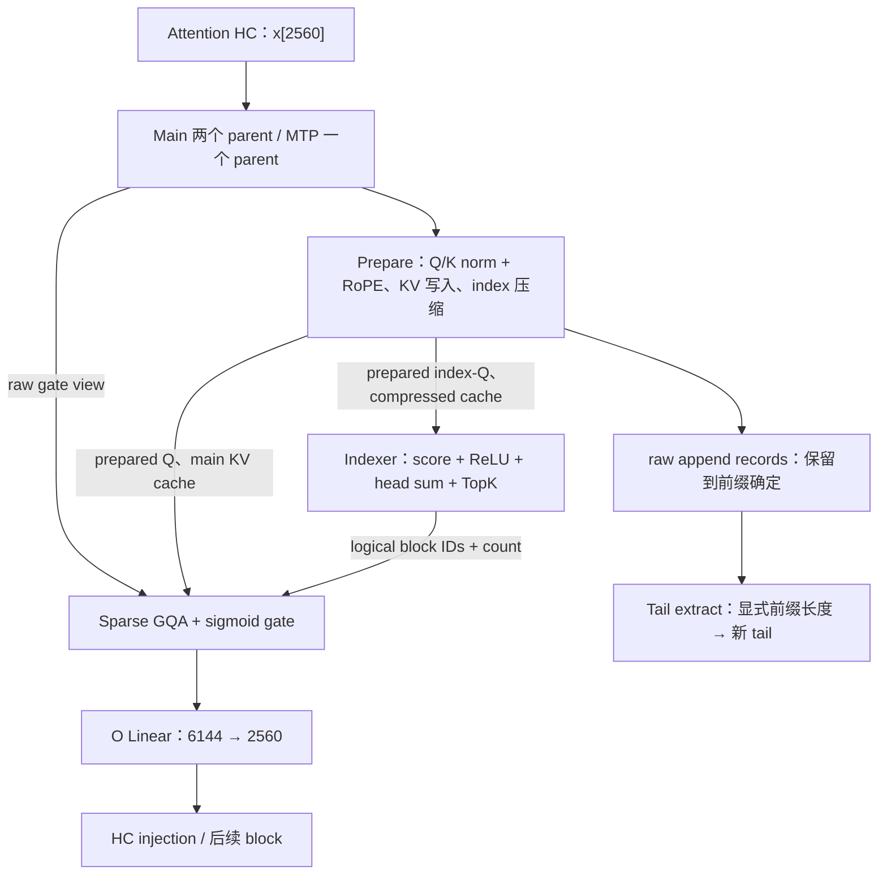

# Qwen3.8-Flash-Next：QSA 计算、接口与状态

更新日期：2026-10-09。**分段输入投影、五种主 KV 编码的 Prepare、Indexer 与 tail extraction 已实现；Sparse GQA 待实现。**

本文拥有 Qwen4Exp Main/MTP 的 QSA 数学、Op 边界、cache 读写与候选状态。
共同约定见[支持总览 §1.3](qwen3_8-flash-next-model.md#13-统一执行约定)；权重和行序由
总览第 5 节维护。已实现存储机制见 [Paged KV](paged-kv-cache.md)，待实现的通用字段和
迁移扩展见[共享页组设计](qwen3_8-flash-next-paged-kv.md)。

阅读入口：[计算流程](#3-完整计算流程)、[共享页组](#5-共享页组与物理存储)、
[状态与回退](#6-tail-stateimage-与候选记录)、[接口声明](#8-op-接口)、
[Program 集成](#9-program-集成与-cuda-graph)、[验收](#11-实现验收)。

## 1. 已定决策与实现边界

1. 主 K/V 和 compressed index keys **共享逻辑页组、block table、引用与 offload 事务**，
   保存在分开的 plane 中。每页覆盖 64 个原 token；主 K/V 为 64 行，index key 为 16 行。
2. 主模型的 12 个 QSA 层进入 Main pool。MTP 的一个 QSA 层进入独立 Backend pool；
   两个 pool 的前沿可以不同，不能因为几何相同而共用页组。
3. Indexer 与 Sparse GQA 是两个独立 Op。前者输出每 query 至多 512 个逻辑四-token
   块号，后者直接消费这些块号及原 KV cache，不物化 expanded token list 或 gathered KV。
4. 采用 Projection → Prepare → Indexer → Sparse GQA＋sigmoid gate → O projection。
   Prepare 完成 norm/RoPE、主 KV 写入、index key 压缩及候选 raw 记录。
5. 未完成块的 raw keys 属于可恢复 StateImage；尚未提交的 raw rows 属于显式候选记录。
   一个闭合的 tail-extract Op 按调用者提供的前缀长度提取状态，不决定接受、提交或回退。
6. Compressed index keys 和 prepared index queries 使用 BF16。主 KV 复用既有
   BFloat16、Int8Group64、Fp8E4M3Row256、Nvfp4Group16、Fp8KeyNvfp4Value 闭合表示。
   这是目标接口覆盖范围；每个新增生产 route 均须独立资格化后才能作为可用能力。
7. 存储、输出与候选记录由 Program/调用者规划；Op 只取得非 owning views。
   一次 Op 可以包含多个 kernel，不冻结 launch 数、tile 或 dense 模板复用方式。

## 2. 符号、几何与位置域

Tensor shape 沿用 NInfer 的第 0 维最连续约定。

| 符号/参数 | 定义 |
|---|---|
| T、B | 调用的物理 token 宽度、序列数；T>0，B=1..8 |
| n[b] | 第 b 行有效前缀长度，0≤n[b]≤T；其他列为 inert |
| p[t,b] | 从 0 开始的原 token cache ordinal |
| F | 与一个已保存状态对应的已执行输入前沿，即有效输入区间 [0,F) |
| ρ[t,b] | 该 token 的实际 1-D 或三轴 RoPE 坐标 |
| H、Dq、Hq、Hkv | 2560、256、24、2；每个 KV head 服务 12 个 query heads |
| Di、Hi | Indexer 维度 128、query heads 4、key heads 1 |
| Cidx、Ksel、Ppage | 压缩比 4、最多选 512 块、页组覆盖 64 个原 token |
| M、R | M=T*B 是展平列数；R 是候选记录容量，单位为原 token |
| S、G | StateImage 槽数、KV 物理页组数；都不等同于 B、lane 或 KV table row |

有效列位置连续：p[t,b]=p[0,b]+t。每个有效位置小于所绑定 context ceiling，当前实例
不超过 262144。T 的合法性不由调优区间或推测窗口决定；padding 可以使 T 大于实际有效数。
普通 prefill、decode、verify、Replay 和 MTP 使用同一数学域，没有额外的 T≤16 Op 限制。

cache ordinal 决定因果性、四-token 分组与页表寻址。RoPE 坐标仅决定旋转，不能拿来
划分压缩块。多模态坐标可能不连续；已在本轮输入之前出现的块首坐标须从 tail 状态恢复。
F 指模型已经物化的输入数量，不能直接使用生成 token 数或 ledger frontier 替代。

## 3. 完整计算流程

### 3.1 输入与离线合并的投影

输入 x 是 Attention HC 已组合好的 BF16 [2560,T,B]，不另加普通 Transformer input norm。
按调用连续列展平为 [2560,M] 后调用 `qsa_input_proj`；inert 列提供有限安全输入。

| 位置 | Parent [N,K] | 权重/许可 | 投影输出行范围 |
|---|---:|---|---|
| Main | [12288,2560] | Q8 G32/FP16 scale，A16Only | Q [0,6144)，gate [6144,12288) |
| Main | [1664,2560] | BF16，A16Only | K [0,512)，V [512,1024)，index-Q [1024,1536)，raw index-K [1536,1664) |
| MTP | [13952,2560] | BF16，A16Only | Q [0,6144)，K [6144,6656)，gate [6656,12800)，V [12800,13312)，index-Q [13312,13824)，raw index-K [13824,13952) |
| Main O | [2560,6144] | Q8，A16Only | 原 o_proj 行序 |
| MTP O | [2560,6144] | BF16，A16Only | 原 o_proj 行序 |

物理矩阵保持[核心方案](qwen3_8-flash-next-model.md#52-textmtp-的物理投影目录)的定义。
源 checkpoint 的 Q/gate head interleave 已离线置换，运行时不重新排权重。
输入投影的三个重载及数学合同见 [`qsa.h`](../../include/ninfer/ops/qsa.h)。每个 parent
仍作一次合并投影，epilogue 直接写出连续 BF16 分段，无 packed activation 中间结果、
split/copy kernel 或 global scratch。各段至少 16-byte 对齐，可位于同一 allocation 的
不重叠区域。Q/gate、K/V、index-Q、raw index-K 分别由 `[6144,M]`、`[512,M]`、
`[512,M]`、`[128,M]` 零拷贝改 view 为后续的 `[256,24,T,B]`、`[256,2,T,B]`、
`[128,4,T,B]`、`[128,T,B]`。



### 3.2 主 Q/K 的 norm、RoPE 与 cache append

对每个 head 的向量 v，offset RMSNorm 的公式为：

```text
N(v,w)[d] = v[d] * (1+w[d]) / sqrt(mean_d(v[d]^2) + epsilon)
epsilon  = 1e-6

q[p,h] = Rope(ρ[p], N(q_raw[p,h], w_q))
k[p,h] = Rope(ρ[p], N(k_raw[p,h], w_k))
```

Norm 覆盖完整 256 维。RoPE 只旋转前 64 维：第 i 个 pair 组合维度 i、i+32，
i=0..31，角度为 ρ[axis(i)]*theta^(-2*i/64)，theta=10000000。
MRoPE sections=[11,11,10] 对应 axis(i)=i%3；纯文本三个轴取相同位置。
V 保持投影输出，gate 保持原始 logits，不做 Q/K norm。

Q 写 BF16 prepared buffer；K 的 norm/RoPE 结果保持 FP32，直接进入主 cache 的变换与
编码，不增加中间 BF16 舍入。BFloat16 cache 仅在最终 K 写入时舍入为 BF16；V 从 BF16
投影值进入所选 codec。新 K/V 在后续 Sparse GQA 中通过已写 cache 读取，包含新行的
路径也必须遵守存储表示。所有有效新 token 都写入 cache，不根据当前选块结果丢弃历史。

### 3.3 Indexer query 与压缩 key

每个 index query head 先做 128 维 offset RMSNorm，再按当前 ρ 旋转前 **64** 维：

```text
iq[p,h] = BF16(Rope(ρ[p], N(iq_raw[p,h], w_iq)))

u[g]  = BF16(mean_FP32(raw_ik[4*g : 4*g+4]))
ik[g] = BF16(Rope(ρ[4*g], N(u[g], w_ik)))
```

raw_ik 为每 token 的 128 维 BF16 投影结果。只有完整四-token 块产生持久 ik。
必须先平均 raw keys，再 norm、再旋转；旋转使用块首 token 的实际坐标。
Index RoPE 采用与主 Q/K 相同的 64 维频率，不根据 Di=128 另算 0.25*Di。
均值后的 BF16 边界是核心模型方案明确保留的数值语义。

若一个块跨调用边界，它的前部来自旧 tail，后部来自本次 raw 投影。完整块完全位于本次
调用内时直接读投影结果。各块有唯一写入者，不先写 ring 再依赖其他 CTA 读取它。
旧 tail 在 Prepare 中只读，因此可以安全并行生成所有完成块及候选记录。

### 3.4 打分、选块与因果尾部

对 query 位置 p：

```text
visible_blocks = floor((p+1)/4)
tail_begin     = 4*visible_blocks
tail_length    = (p+1)%4

score[p,g] = sum_h ReLU(dot(iq[p,h], ik[g])) / sqrt(128)
selected  = top_min(512,visible_blocks)(score[p,0:visible_blocks])
J[p]      = union({4*g,4*g+1,4*g+2,4*g+3} for g in selected)
            union [tail_begin,p+1)
```

四个 index heads 汇总成一份 selection，供全部 24 个主 query heads 使用。ReLU 在
各 head 点积之后、求和之前；这些 score 不加到主 attention logits 中。
BF16 输入以 FP32 累加，不将 score 舍入为 BF16。计算所得 score 相等时优先较小块号；
数学分数及选中/未选中边界独立对照 FP64 检查。结果无需按 score 或块号排序，但不得重复。
公共正缩放可以在只求排名的内部实现中省去，不改变选块数学。

未完整的尾部全部参与 attention，最多 3 token；一个完整块没有额外的强制保留资格。
当 p+1 是 4 的倍数时，刚完成的块参与 TopK，自身所在块也可能未被选中。
当 visible_blocks≤512 时可直接产生全选结果并跳过打分；压缩状态仍照常更新。
全部历史被选择的长度范围实际为 p+1≤2051；到 2052 才出现 513 个完整候选块。

Chunk 可以提前写完其所有完整块，但每个 query 的 visible_blocks 由自己的 p 决定，
不能使用 chunk 终点的块数。Padding 不参与选块，也不产生 tail token。

### 3.5 Sparse GQA、output gate 和 O projection

```text
kvh = floor(h/12)
logit[p,h,j] = dot(q[p,h], K[j,kvh]) / 16, j in J[p]
a[p,h]      = sum_j softmax_j(logit[p,h,j]) * V[j,kvh]
z[p,h,d]    = a[p,h,d] * sigmoid(gate[p,h,d])
y[:,p]      = W_o * flatten(z[p,:,:])
```

QK/softmax/PV 使用所选主 cache 表示对应的数学解释。INT8/FP8 的旋转 K，以及
NVFP4/K8V4 的旋转 K/V，沿用现有 Hadamard、scale 和逆变换合同；gate 必须作用于
恢复到原坐标系后的 attention 输出，不能在 Hadamard 空间逐元素相乘。

Output gate 融合到最终写回；若内部使用 split reduction，先完成全部 split 的正确合并，
再乘 gate。BF16 z 直接以 [6144,M] 视图供 O Linear 消费。
HC injection 保持模型侧既定边界，不纳入本 Sparse GQA Op。
其 CombineNorm、下一组 HC Mix 和末端特征的调用约定见
[Gated Residual 设计](qwen3_8-flash-next-hc.md)。

## 4. Op 划分与数值表示边界

| Op / 调用 | 可观察结果与效果 | 不包含的职责 |
|---|---|---|
| Linear | 各 parent 的 BF16 投影输出 | 状态、页表、前沿 |
| qsa_prepare | BF16 Q/index-Q；指定主 KV 行和完整 index key 行；raw append records | 分配、选块、提交 |
| qsa_indexer | 每 query 的 block IDs 与 count | 主 KV 更新、接受策略 |
| qsa_sparse_gqa | gated BF16 attention 输出 | cache mutation、index 压缩 |
| qsa_tail_extract | 显式前缀对应的规范 tail | 推测验收、frontier 发布 |
| O Linear | BF16 block 输出 | HC injection、请求生命周期 |

一个融合 Op 的连续数学变换用独立高精度 oracle 资格化。norm→RoPE 之间、完整
attention→sigmoid gate 之间没有额外的公开 BF16 中间 tensor；不能仅为复现某个 unfused
kernel 的舍入而固定这些私有 cast。源码框架的 cast 顺序是参考证据，不自动成为新合同。

明确的表示边界是：Linear 的 BF16 输出、raw key 精确记录、压缩均值后的 BF16、
prepared Q/index-Q 的 BF16、主 KV 持久表示、compressed key 的 BF16、
gated attention 的 BF16 输出。主 KV 的 Hadamard 定义、scale/code 生成规则及解码方式沿用
[kv_cache_append](../../include/ninfer/ops/kv_cache_append.h)。QSA 的 K 编码直接消费
norm/RoPE 的 FP32 结果，不继承独立 append 入口的 BF16 输入边界。

Prepare 的 norm/RoPE 数学误差与随后 codec 的表示误差分别解释。数值计算不要求与另一
route 逐 bit 相等；raw record/tail 搬运则必须逐 word 保留对应执行产生的 BF16。
本设计不承诺重新运行较短 Linear 后获得同一次较宽调用的精确 raw rows。

## 5. 共享页组与物理存储

### 5.1 两个 pool 内的 plane inventory

Main pool 包含 12 层主 K/V 的 data/scale planes，以及各层一个 compressed-key plane。
启用 MTP 时，Backend pool 以相同方式包含其一个 QSA 层。层间权重与 key 内容独立。

```text
Main page-group g：原位置 [64*l,64*l+64)，g=main_table[l]
    layer 3 : K data, V data, [K scale], [V scale], index K
    layer 7 : K data, V data, [K scale], [V scale], index K
    ...
    layer 47: K data, V data, [K scale], [V scale], index K

Backend page-group g'：
    MTP layer: K data, V data, [K scale], [V scale], index K
```

一个页组是分配、reservation、引用、COW 和迁移的共同单位。不同 planes 使用独立稳定
slab，不采用 token 结构体交错存储，不要求跨 plane 物理相邻，也不允许单独回收 index
plane。Main 和 Backend 的 physical IDs 属于不同 namespace。

目标 plane schema：

| Plane | dtype/leading extent | Shape | 原 token 跨度/行 |
|---|---|---|---:|
| 主 K/V data | 由既有 codec 决定 | [X,64,2,G] | 1 |
| 主 K/V scale（若有） | 由既有 codec 决定 | [Xs,64,2,G] | 1 |
| Compressed index K | BF16，X=128 | [128,16,1,G] | 4 |

所有 planes 使用 page-major，feature 维连续。Scale 的 K 维 grouping 不改变 token 行跨度。
Compressed key 未使用 Hadamard、附加量化 scale 或 per-token normalization 元数据。

### 5.2 通用 KV 合同扩展

在现有 `KVPlaneGeometry` 中增加 `tokens_per_row`，闭合支持 1、4；
`KVPageGeometry.page_tokens` 继续表示原 token 页跨度 64。完整定义由
[共享页组扩展设计](qwen3_8-flash-next-paged-kv.md)拥有。

不能通过把 head_dim 伪装成 32、给每个 index key 留四倍空位或在 Op 内维护第二张
私有页表来绕过扩展。Host layout、Device layout、plane span、复制分组及容量计算均使用
各 plane 的真实行数。已有 span=1 的布局保持其数学解释。

新 consumer 复用主 KV 的 typed view，另取得 index plane view；两者必须来自同一 pool、
同一 layer、同一 block-table view。该关系由模型构造和 wrapper 的可见 metadata 检查保证，
不能只因为两个 pool 恰好分配了相同整数 ID 就当作共享。

### 5.3 寻址与有效范围

```text
原 token p：
    logical_page = p / 64
    token_row    = p % 64
    g            = table[logical_page]

压缩块 b：
    logical_page = b / 16
    index_row    = b % 16
    g            = 同一张 table[logical_page]
    主 KV 行     = 4*index_row + {0,1,2,3}
```

物理地址使用实际 Tensor strides 和足够宽的地址整数，不能把 physical_id*plane_stride
限制在 I32。块号本身使用 I32，原生 context 内足够。

在前沿 F 下，第 l 个逻辑页的有效原 token 数为：

```text
c = clamp(F - 64*l, 0, 64)
有效主 KV rows   = [0,c)
有效 index rows  = [0,floor(c/4))
```

有效 coverage 只有一份原-token 前沿，index coverage 从它推导，不再维护一个可以独立
推进的 committed index cursor。准备阶段允许写未提交后缀；写过的字节不自动获得 committed
coverage。任何 Op 都不得读取尚未完成或已拒绝的 index row。

### 5.4 Replica、COW 与 offload

- 逻辑页组的 epoch、引用、protected coverage 和 Device/Host replica validity 仍按原
  token 域解释。完成的 index rows 是同一个内容版本的一部分。
- 在可能覆盖受保护内容之前，以本轮全部允许写入的区间准备 COW，不等到接受结果出现。
  分叉 tail StateImage 与分叉 paged history 是同一恢复点的两个组成部分。
- Device↔Host、Device COW 搬运页组的全部 planes，Host packed layout 记录各 plane 的真实
  bytes/offset。保持 payload words，不在 offload 时重新量化、展开或压缩。
- 物理复制可以包含无效后缀字节，但 validity 只能公布源已提交 coverage；垃圾/旧候选值
  即使被复制，也不能变成可读 index key。
- 完整 Snapshot 还必须包含对应 raw tail。页组搬完但 StateImage 未完成时不能发布恢复点。
- 执行期间页表与访问 mappings 稳定；迁移采用现有 source lease、destination reservation、
  完成后 publication 协议。GPU Op 不自行分配页、触发 offload 或在 kernel 中等待缺页。

本设计沿用现有 context offload 所有权。执行前由 Program 兑现读写范围需要的 residency；
不把“可以 offload 历史”解释为 consumer 可以解引用尚未物化的 Device page。

### 5.5 容量

每层每个页组的 index payload 为 128*16*2=4096 B。以下为 raw payload，不含 slab 对齐、
页表、StateImage、候选记录、workspace、Graph 和容量余量：

| 主 KV profile | 每层页组 bytes（含 index） | Main 12 层页组 bytes | Main bytes/原 token |
|---|---:|---:|---:|
| BFloat16 | 135168 | 1622016 | 25344 |
| Int8Group64 | 71680 | 860160 | 13440 |
| Fp8E4M3Row256 | 70144 | 841728 | 13152 |
| Nvfp4Group16 | 40960 | 491520 | 7680 |
| Fp8KeyNvfp4Value | 55552 | 666624 | 10416 |

Backend 每个页组使用“每层”列，物理页数按其自身 provisional lead 规划，不能简单假设与
Main 相同。Program 的 capacity curve、Host reservation、传输 work 和 memory summary
从同一个 expanded plane schema 推导，不在 Engine 复制 QSA 字节公式。

## 6. Tail StateImage 与候选记录

### 6.1 规范状态

每个 QSA 层在前沿 F 保存：

```text
r = F % 4
raw_tail[:,0:r] = raw_ik[4*floor(F/4):F]，按时间顺序，BF16
raw_tail[:,r:3] = BF16 +0
first_rope[0:3] = 块首 token 的三轴 I32 坐标；r=0 时为 0
```

逻辑形状为 raw_tail [128,3]、first_rope [3]，每层 780 B，另有整体 StateImage 对齐。
first_rope 在每层 tail 中保存一份，使单层状态提取有独立输出；12 B 的重复避免多个层
共同写一个可变 metadata 对象。调用输入的 RoPE positions 仍可以共享。

F 由 Program 的对应主/后端状态 metadata 解释，不在每层再保存可独立修改的前沿。
物理 StateImage pool 可按 [128,3,L,S] 与 [3,L,S] 规划；Op 得到选定层的 strided views。
State slot、KV table row、batch row 与 resident lane 分别显式选择，不能互相推导。

规范状态必须参与 Device/Host StateImage 布局、clone、checkpoint、pause/resume 与销毁。
初始化 F=0 时 tail 为零。相同 prefix 下的 raw keys 来自该次实际投影，不从主 K、压缩
key 或已量化 KV 反推，也不只保存一个不可拆分的累加和。

### 6.2 候选记录

对尚未最终提交的区间 [F0,F0+u)，每层保留：

```text
raw_keys      BF16 [128,R,B]    // 第 j 列对应原位置 F0[b]+j
rope_positions I32 [3,R,B]     // 记录三轴，1-D 输入复制到三轴
base_positions I32 [B]        // F0，调用者提供
valid_columns I32 [B]         // u，调用者提供
```

单层每条记录 268 B/token。各层可以是一个 [128,R,L,B] slab 的 strided 切片，
不用产生独立 allocation。记录保存实际 BF16 projection words 与实际位置，不能保存
“稍后可重算”的 tensor 名称或已压缩结果。

Prepare 每次按显式 record offsets 写入有效列；预留的记录容量可以容纳同一个事务内的
多次调用。Program 保证追加区间连续、不会覆盖仍需恢复的记录。元数据的 u 由调度提交给
消费者，Prepare 不自行推进 cursor。

记录的寿命覆盖所有可能读取它的状态提取，包括推测内部接受、Frontend 截断、取消和
最终提交。中间一轮已经在 GPU 采用的工作前沿，不能使外层 PendingBatch 仍需回退的
基准 tail/记录失效。Program 可以用分段记录及稳定状态锚点表达更长事务；调用单次
tail-extract 时必须提供目标前缀所需的连续记录 view。

普通 prefill/Replay 不要求把整个 prompt 的 raw records 保留到结束。每个 chunk 的保留
范围明确后，可提取到尚未发布的 candidate StateImage 并复用记录 buffer；checkpoint 点
需要的 tail 先提取到各自状态槽。推测路径则保留到相关接受决定已最终消费。

### 6.3 从任意接受前缀提取 tail

给定基准 F0、旧 tail 和 [F0,F0+u) 的记录，调用者选择 a，0≤a≤u：

```text
F1 = F0+a
s  = 4*floor(F1/4)
r1 = F1%4
for j in [0,r1):
    p = s+j
    out[j] = p<F0 ? old_tail[p-4*floor(F0/4)] : records[p-F0]
out[r1:3] = +0
out.first_rope = r1==0 ? 0 :
                 (s<F0 ? old.first_rope : records.rope[s-F0])
```

这是 word-preserving 的索引/赋值，不运行 norm、Linear、均值或 RoPE。a=0 得到相同规范
状态；同槽调用保持其字节不变。a 不必让 F1 与 4、64 或投影调用宽度对齐。

同一行的 source/destination 可以是同一 state slot：若新 tail 仍使用旧 raw rows，其
块首不变、索引不发生搬移；否则完全从记录取值。不同 batch 行的 destination 必须互异，
且不得覆盖另一行的 source。只读 source slots 可以共享。

### 6.4 更新、提交和回退

```text
Program reserve / COW / 绑定执行 views
    -> Projection / Prepare：写 candidate KV、index keys、raw records
    -> Indexer / Sparse GQA / 后续层
    -> Program 得到需要保留的输入前缀长度
    -> tail-extract 到 candidate StateImage
    -> 同一次状态事务公布 StateImage 与 paged coverage
    -> 发布输出 / 保留 checkpoint / 释放已无消费者的记录
```

例：F0=6，执行位置 6..9，最终 a=1。新的 F1=7；有效主 KV 是 0..6，有效压缩块只有
0..3 对应的块，tail 为 raw 4、5、6。已经写入的 4..7 压缩块保持不可见，后续用新 token 7
覆盖重算。回退不需要清零整段 KV/index 后缀；必须恢复 coverage 和 tail。

较早 query 的因果范围由其位置决定，与是否提前写入后续 candidate cache 无关。
Main 和 MTP 各自按本身 F0/u/a 结算；Program 处理 bridge 和两者的对齐，Op 不读取
spec backend 类型，也不复用另一个 query 的 selection 来近似当前 query。

## 7. Buffer 寿命与融合边界

| Buffer | 最后消费者 | 是否进入 checkpoint |
|---|---|---|
| 连续 raw Q、index-Q | Prepare；可原地变为 prepared Q、index-Q | 否 |
| 连续 raw K/V、index-K | Prepare（写完 cache/记录） | 否 |
| 连续 gate | Sparse GQA | 否 |
| prepared Q、index-Q | Sparse GQA、Indexer | 否 |
| selected blocks/count | 紧随其后的 Sparse GQA | 否 |
| gated attention | O Linear | 否 |
| score/TopK/attention partial scratch | 本 Op 的已提交 CUDA 工作 | 否 |
| raw append records | 所有待定前缀的 tail-extract | 否；提取后的 tail 才进入 |
| committed/candidate tail | 相应恢复点/工作状态 | 只发布 committed 版本 |
| main KV/index planes | history/replica owner | 按同一 coverage 保留 |

分段投影使各输出按自身消费者管理寿命，gate 不再延长其他投影结果的寿命。
Prepare 的 Q/index-Q 可各自精确 alias 对应 raw 输入；不允许部分重叠。
顺序互斥 Op scratch 可复用；prepared tensors、selection 和记录不能与仍存活的输入重叠。
候选 raw records 不是 Prepare 的调用内临时空间，也不要求将所有其他激活保留到提交。

## 8. Op 接口

已实现的输入投影、五种主 KV 编码的 Prepare、Indexer 与 tail extraction 合同位于
`include/ninfer/ops/qsa.h`；Sparse GQA 入口仍为设计。
使用既有 Tensor、PagedKVBatchLayerView、KvCacheStorage、WorkspaceArena 和
DeviceExecutionView；所有声明位于 `ninfer::ops`。
接口按一个 QSA 层调用；层的选择、权重角色、记录 slab 切片及请求身份留在模型/Program。

### 8.1 公共 views

```cpp
namespace ninfer::ops {

struct QsaBatchView {
    Tensor positions;       // I32 [T,B]，原 token cache ordinal
    Tensor valid_columns;   // I32 [B]，每行有效前缀；始终显式提供
    Tensor table_rows;      // I32 [B]，选择对应 pool 的执行页表行
};

struct QsaIndexCacheView {
    Tensor keys;            // BF16 [128,16,1,G]，page-major
    Tensor block_tables;    // I32 [logical_page_capacity,table_row_count]
};

struct QsaCacheView {
    PagedKVBatchLayerView main;
    QsaIndexCacheView index; // 与 main 使用同一 pool 的同一个 block_tables view
};

struct QsaProjectionView {
    Tensor query;           // BF16 [256,24,T,B]
    Tensor key;             // BF16 [256,2,T,B]
    Tensor value;           // BF16 [256,2,T,B]
    Tensor index_query;     // BF16 [128,4,T,B]
    Tensor index_key;       // BF16 [128,T,B]，raw
};

struct QsaPrepareParameters {
    Tensor query_norm;      // BF16 [256]，offset weight
    Tensor key_norm;        // BF16 [256]
    Tensor index_query_norm; // BF16 [128]
    Tensor index_key_norm;  // BF16 [128]
    float rms_epsilon = 1e-6F;
    float rope_theta = 10000000.0F;
};

struct QsaTailStateView {
    Tensor raw_keys;        // BF16 [128,3,S]，选定层的 state-pool view
    Tensor first_rope;      // I32 [3,S]，同一层
    Tensor slots;           // I32 [B]，独立于 table_rows
};

struct QsaRawRecordWriteView {
    Tensor raw_keys;        // BF16 [128,R,B]，选定层的候选记录
    Tensor rope_positions;  // I32 [3,R,B]
    Tensor offsets;         // I32 [B]，本次调用写入记录的起始列
};

struct QsaRawRecordReadView {
    Tensor raw_keys;        // BF16 [128,R,B]
    Tensor rope_positions;  // I32 [3,R,B]
    Tensor base_positions;  // I32 [B]，记录第 0 列对应的 F0
    Tensor valid_columns;   // I32 [B]，已写且可读的记录数 u
};

struct QsaBlockSelection {
    Tensor block_ids;       // I32 [512,T,B]，第 0 维连续
    Tensor block_counts;    // I32 [T,B]
};

struct QsaIndexerExecutionEnvelope {
    std::uint32_t max_visible_tokens = 0; // 资源上界，单位仍是原 token
};

} // namespace ninfer::ops
```

Batch metadata、slots、offsets、base_positions、record valid_columns 和 selection 连续，
这些整数 Tensor 均为 Device I32。Projection 与 gate 完全连续，基地址至少 16-byte 对齐；
tail/record views 允许层切片造成的 slot/batch 间隙。Strides 为正、元素不重叠并满足各 dtype
对齐。不得把非连续切片强行 contiguous reshape。

Prepared Q/index-Q 和 Sparse GQA 输出完全连续，基地址至少 16-byte 对齐。
Tensor 在现有类型中不携带 C++ const
数据指针；只读/可写性质由下述合同决定。只读输入可以共用 backing；除 Prepare 的
Q/index-Q 精确 alias 特例外，可写区域不得覆盖任何仍被读取的输入。
两个 cache 子 view 使用相同的 block-table 地址、shape 与 strides。

### 8.2 Prepare

`qsa_prepare` 支持 BFloat16、Int8Group64、Fp8E4M3Row256、Nvfp4Group16 和
Fp8KeyNvfp4Value 主 cache，包括 Q/index-Q 独立原地更新、压缩 key 与 raw records
写入，零 global workspace。量化 K 直接使用 norm/RoPE 的 FP32 结果；具体已实现合同见
[`qsa.h`](../../include/ninfer/ops/qsa.h)。

```cpp
namespace ninfer::ops {

void qsa_prepare(
    const QsaProjectionView& projected,
    const QsaPrepareParameters& parameters,
    const QsaBatchView& batch,
    const Tensor& rope_positions,       // I32 [T,A,B]，A=1 或 3
    const QsaTailStateView& before,
    QsaCacheView cache,
    QsaRawRecordWriteView records,
    Tensor& query,                     // BF16 [256,24,T,B]
    Tensor& index_query,               // BF16 [128,4,T,B]
    DeviceExecutionView execution);

} // namespace ninfer::ops
```

**输入与前置条件**

- 各 shape 的 T/B 一致，主 cache Dq=256/Hkv=2，index cache 为本设计的 BF16 plane。
  epsilon、theta 正且有限；Flash-Next 使用声明中的值。
- query/index_query 可各自与 projected 的对应输入精确同址、同 shape/strides；其他
  输出、records、cache 与输入互不重叠。
- 非空行的 before 对应 p[0,b] 的规范 tail；caller 保证该前沿与已绑定历史对应。
  当前写区间已 reserve/materialize，受保护页已经 COW。
- `0≤offsets[b]` 且 `offsets[b]+n[b]≤R`。多次写一份记录时，caller 保证其
  cache positions 与记录 base_positions+offset 对齐，所有未决记录仍可用。
- 有效 projection/norm 值为有限 BF16；RoPE 坐标为非负 I32，不以 cache ordinal 的
  context ceiling 限制各轴坐标。数值路线按 Op 开发规范覆盖实际位置范围及其边界。
  无效行不要求可读 state slot 或 page mapping，kernel 必须先判断 n[b]。

**读写效果**

- 按 §3.2、§3.3 生成 Q/index-Q；inert 输出精确写为 BF16 +0。
- 只写有效位置的主 K/V，以及本次新完成块
  `[floor(p[0,b]/4), floor((p[0,b]+n[b])/4))` 的 index rows。n[b]=0 不写 cache。
- 将有效 raw index-K 逐 word 写入对应 records 区间，并保存该 token 的三轴 RoPE 坐标；
  A=1 时复制同一坐标到三轴。不修改 offsets/valid counts，不写 inert 记录列。
- 除原地更新的 Q/index-Q 外，before、投影、norm、输入位置、页表均不变；不更新
  canonical tail、pool metadata、committed coverage 或 request frontier。
- 可写 Q/index-Q、records、cache planes 彼此不重叠；除上述精确 alias 外，不与输入/旧 tail 重叠。
  不同有效 batch 行的物理写区间不重叠；共享的已提交前缀只读。

Prepare 不需要 caller-owned global scratch；局部 reductions/codec 暂存属于 kernel
内部资源，因此不提供 workspace 或 capacity query。跨块压缩读取原投影与不可变旧 tail，
不用等待其他 CTA 写 records。可以拆成多个同 stream kernel，所有效果在下一消费者前完成。

### 8.3 Indexer

```cpp
namespace ninfer::ops {

[[nodiscard]] std::size_t qsa_indexer_workspace_capacity_bytes(
    std::int32_t min_tokens, std::int32_t max_tokens,
    std::int32_t batch_size,
    QsaIndexerExecutionEnvelope envelope,
    DeviceExecutionView execution);

void qsa_indexer(
    const Tensor& index_query,           // BF16 [128,4,T,B]
    const QsaIndexCacheView& cache,
    const QsaBatchView& batch,
    QsaIndexerExecutionEnvelope envelope,
    WorkspaceArena& workspace,
    QsaBlockSelection& out,
    DeviceExecutionView execution);

} // namespace ninfer::ops
```

只读 query、index planes、页表和 metadata。有效行输出
`block_counts=min(512,floor((p+1)/4))`；前 count 个块号符合 §3.4，剩余列不定义、
消费者不得读取。Inert query 的 count 精确为 0，IDs 不定义。

Block IDs 是原 token 域中四-token 块号，跨物理页重映射保持不变。全选时产生
identity IDs，不读 query、index keys 或页表内容；无完整块及 inert query 输出 count=0。
实现不能将未来已物化的块、重复块或未初始化 padding 纳入结果。

Capacity query 覆盖固定 B 下 [min_tokens,max_tokens] 的全部合法 T；envelope 限制
所有有效 p+1 的上界且不超过绑定 context ceiling。max_visible_tokens=0 仅允许全 inert。
它不是 mask、前沿或第二份状态；exact 可见范围仍由 Device positions/valid_columns 决定。

Workspace 不含 caller 分配的 selection。分数和候选使用分块复用的有界 scratch，不以
物化完整 T×history 矩阵作为语义要求。内部可采用 score→TopK 多阶段或融合实现，但必须
保持完整 TopK：不能用没有正确性保证的局部小候选截断代替全局选择。

当前实现逐窗口执行分页 BF16 Tensor Core 打分、分区 Top512、最终 Top512 合并；
每个分区保留至多 512 项，因此不会丢弃可能属于全局 Top512 的候选。选择使用
FP32 score 与逻辑块号组成的完整次序，radix 细化到可以精确确定 512 项为止。
最大 context 下 workspace 不超过 20 MiB；调用者使用 capacity query 取得实际容量。
Indexer 不创建持久状态，也不依赖主 K/V 的存储编码。

### 8.4 Sparse GQA

```cpp
namespace ninfer::ops {

[[nodiscard]] std::size_t qsa_sparse_gqa_workspace_capacity_bytes(
    KvCacheStorage storage,
    std::int32_t min_tokens, std::int32_t max_tokens,
    std::int32_t batch_size,
    DeviceExecutionView execution);

void qsa_sparse_gqa(
    const Tensor& query,                 // BF16 [256,24,T,B]
    const Tensor& output_gate,           // 连续 BF16 [256,24,T,B]
    const PagedKVBatchLayerView& cache,
    const QsaBatchView& batch,
    const QsaBlockSelection& selected,
    WorkspaceArena& workspace,
    Tensor& out,                         // 连续 BF16 [256,24,T,B]
    DeviceExecutionView execution);

} // namespace ninfer::ops
```

输出为 §3.5 的完整 gated attention；inert 列精确为 +0。所有输入和整个 cache 不变。
新 K/V 已经通过 Prepare 写入，接口不接收另一个新 K/V 旁路，也不重复 append。

函数独立可调用：它不验证输入是否真是某次 Indexer 的 TopK，而把调用者给定的合法块集
作为 attention 的显式可见集合。每个有效 query 满足：
`0≤count≤min(512,floor((p+1)/4))`，IDs 不重复且落在可见完整块域内；
尾部按 p 自动加入。Indexer 正常输出恰好选择允许的最大块数。
独立调用若块集和尾部均为空，输出定义为零，不计算空 softmax。

Kernel 按选中块直接读取原 cache，尾部不通过 expanded ID buffer 传递。不读 count
之后的 IDs，不依赖 IDs 排序，不读未选择的 cache 值来做 masked dense attention。
Loop/workspace 上界来自固定的 512*4+3 个 selected tokens，因此无需主历史长度的
额外 host envelope。块寻址仍需完整的合法页表 view。

Q/output/gate、selection、cache 与有效 workspace 区域不可写读重叠；只读 views 可共享
allocation。内部可用 split reduction 或不分 split，capacity query 使用同一 storage、
T/B 和设备事实规划全部临时空间，不向 Program 暴露私有 partition 参数。

### 8.5 Tail 状态提取

```cpp
namespace ninfer::ops {

void qsa_tail_extract(
    const QsaTailStateView& before,
    const QsaRawRecordReadView& records,
    const Tensor& accepted_columns,         // I32 [B]，a，不是输出 token 数
    QsaTailStateView after,
    DeviceExecutionView execution);

} // namespace ninfer::ops
```

严格执行 §6.3。before 对应 records.base_positions；0≤a≤records.valid_columns≤R。
所有 source/destination slots 有效，包括 a=0 的行；本入口不沿用 Prepare 的 inert-slot
豁免。调用者可在状态提取前排除不参与提交的行。
只读记录 [0,a) 中构造新 tail 所需的列，不读取被拒绝 suffix。after 的三个 raw slots 与
三个 RoPE 坐标完整写成规范形式；before 在非 alias 情况下不变。
允许的同槽 alias 与跨行限制见 §6.3。records、accepted_columns 与输出不得重叠。

此 Op 无 global scratch；它不写 cache、count metadata、前沿或页表。
Program 可以调用它生成本轮末状态、某个 checkpoint 状态或一个接受前缀状态；
这些用途不形成不同 kernel 语义或字符串 mode。

## 9. Program 集成与 CUDA Graph

### 9.1 Planner 与 binding

绑定使用核心模型方案的实际 Parameters，不添加 checkpoint-specific execution 注册。
Planner 从闭合 main codec 展开主 data/scale planes，再给每个 QSA 层附加 span=4 的
index plane。启动时确定完整 Main/Backend pool、StateImage slots、记录容量、输出
buffers、页表、workspace 与 Graph 资源；运行时不补分配隐藏的 QSA cache。

StateImage 的 source/destination selectors 与 KV table row selectors 分开。KV coverage
仍以原 token 计数。资源调度使用扩展后的 Main/Backend 页组 bytes 和 StateImage bytes，
不增加一个独立 index-history 容量池或由 Engine 持有的副账本。

### 9.2 每种执行场景

| 场景 | paged history | tail 与记录 |
|---|---|---|
| 首次 prefill | 从空历史增长；每 query 按自身 p 因果读取 | F=0 零状态；按 chunk 提取/保存 |
| 跨 chunk prefill / Replay | 历史页与当前写区间共同组成可见历史 | 旧 tail 补齐首个跨界块，当前投影生成其余块 |
| 普通 decode | 追加一个 token；每到四-token 边界完成一个 index key | prefix=1，仍服从整体提交/取消协议 |
| Verify | 一次允许写完整候选区间，逐 query mask | 保留 raw rows；根据最终允许的输入前缀提取 |
| 多步 MTP | Backend 自己的地址空间和执行前沿 | 每步完整状态供下一步使用，保留外层事务的恢复依据 |
| 任意前沿 checkpoint / fork | 保护对应原-token coverage；必要时 COW 尾页 | 保存该前沿的精确 tail，不能复用更深状态的最终 tail |
| Host offload / resume | 页组全部 planes 与同版本 metadata 一起迁移 | 同一恢复点的 tail 随 StateImage 搬运 |
| Abort / Frontend 提前终止 | 保留选定前缀，丢弃未提交 coverage | 恢复旧状态或提取明确前缀，不重跑投影替代记录 |

F 主/MTP 的关系、GDN/[PLE 状态](qwen3_8-flash-next-ple.md#10-规范状态候选记录与提交)、
HC 末端交接特征和输出 ledger 一并由模型事务维护；
HC 本身没有逐层历史状态。一个 QSA 层独立完成不构成整个请求可以发布的恢复点。
只完成部分层或部分 planes 的 destination 不可用。

### 9.3 Graph 与无同步消费

正常顺序为 Prepare → Indexer → Sparse GQA，同一 stream 的执行顺序提供依赖，
不把 block counts 或 selected IDs 拷回 CPU。跨 stream 由 Program 显式建立事件依赖。

T/B、buffer addresses、storage profile 和捕获资源上界固定；positions、有效列、state
slots、record offsets、page IDs 和 selected count 是 Device 输入。每次捕获声明的合法
envelope 内，这些值变化不要求改写调用拓扑或 host 同步。Indexer 的每个窗口始终使用
相同打分、分区选择和最终输出阶段；短历史全选、无完成块、全 inert 在这些 kernel 内
跳过对应工作。固定 worker 网格根据 Device metadata 构造任务映射；各 batch 行可同时
处于不同历史长度，且同一行中各 query 也按自己的因果位置决定可见块数。

三种路径的数学必须相同：普通调用、graph replay、分块实现。记录和 prepared buffers
的最后 Device 消费完成前不能复用；host 函数返回本身不是 GPU 使用结束的证明。

## 10. 优化自由度与必须保留的边界

本设计不预先选择重用 dense 模板还是新建 sparse 模板。现有 dense grouped-MMA 将多个
token/head 放入一个 query tile 并共享 KV tile；不同 QSA queries 的 selected 集合不同，
复用时须同时检查 query packing、mask、cache tile loading 和 work partition。

同一 query 的 12 个 heads 可以共享一次选块 KV 加载。四-token 块不跨 64-token 页，
可在 load 阶段展开并复用页表结果。不同 query 的集合合并、排序、页内重组等只在保持
各自精确集合的前提下作为私有策略；不能将 union 当成所有 query 的可见集合。

Indexer 在长上下文仍扫描全部可见 compressed keys。256K 上下文每层 index payload
为 16 MiB，而 BF16 主 KV 中一次满额选块的逻辑 K/V payload 约 4 MiB；这只是数据规模，
不代表实测流量或时间。Prefill 可跨 query 复用 index key tiles，并分块复用分数 scratch。
Shared page 的 index 行每页 16 个，tuning 必须考虑跨多个物理页的读取，不假设连续 IDs。

持久 parent 行序与投影各段的连续输出布局已确定；私有 kernel 组织可调整，
不重新拆分/复制持久权重。缓存 codec、tail 的表示、selected ID 单位与状态寿命
同样属于本合同，不能被 tuning 参数暗中改变。

## 11. 实现验收

### 11.1 独立数学与表示验证

- Prepare：独立计算完整 offset norm/RoPE、raw pooling 和新完成块；验证 Q/index-Q、
  decoded cache 数值、准确写入位置及未触及区域。Norm/旋转统计不能只与另一 kernel 比较。
- 主 cache codec：复用各既有格式的独立精确 encoder/decoder 及误差判据，验证新几何和
  fused append；特别检查 BF16 profile 的 V 实际为 FP16、旋转表示和 scale planes。
- Indexer：由 represented BF16 query/key 计算高精度 scores 和 TopK；验证因果域、
  全选、ReLU/head sum、等分取较小 ID、近 TopK 边界与全零 score。ID 集合的数学正确性
  单独检查，不用一个笼统命中率或最终文本看起来正常代替。
- Sparse GQA：独立解码被选择的 cache 行，用 FP64 dot、stable softmax、PV、必要逆变换
  和 sigmoid gate 作为完整 oracle；不额外复刻 kernel 的概率/partial cast。
- Tail：直接按记录 words 提取每个合法前缀，与该次执行的 raw records 比较，要求位精确。
  不用重新执行较短 projection 或 FP64 norm oracle 替代 exact state-selection 检查。

浮点与离散选择的资格判据在实现测量前按 Op 开发规范固定并报告。近边界导致不同集合时
必须定位分数误差和排序原因，不能事后扩大指标来掩盖。数学公式和 exact ties 不因此改变。

### 11.2 必需边界集合

| 维度 | 必须覆盖的案例 |
|---|---|
| 四-token 边界 | F%4=0/1/2/3；一次无/一/多完整块；首块跨调用；所有 a=0..u |
| 因果选块 | 可见长度 1/3/4/5、2047..2053；未来已写块含极大分数但仍不可选 |
| 页边界 | 63/64/65、255/256/257；index 槽 15→下一页 0；物理 IDs 打乱 |
| Batch/视图 | B=1..8、T=1 与多列、不同 live counts、全 inert、连续投影分段、state/record 层切片、Q/index-Q 精确 alias |
| RoPE | 1-D、不同三轴坐标、块首在旧 tail、非零坐标偏移；logical p 与 ρ 明显不同 |
| Selection | 无完整块、全选、512 块、任意顺序、同分；padding IDs 故意放无效值且不可读 |
| 事务 | F0=6/u=4/a=1 等跨块回退、同槽/异槽提取、共享 source、Frontend 截断与 abort |
| 存储 | 全部声明 codec、tail COW、同页不同 coverage、旧 epoch、Host 往返、StateImage 换槽 |
| 执行 | eager/graph、不同 chunk 切分、Main/MTP 独立前沿、多个未决前缀所需记录不提前回收 |

无效输入的 host 可见 shape/layout 检查与 device metadata 的调用者约束分开；不为了
验证 Device counts 而在正常执行中添加 host 同步。拒绝非法 view 的 wrapper 检查不能
代替正常有效路径的数学和事务验证。

### 11.3 性能证据与交付边界

按已有 benchmark 方法分别测 Prepare、Indexer、Sparse GQA、tail-extract 和完整 QSA
层；记录 short/long context、T/B、codec、workspace、cache residency 与 graph 条件。
同一优化的收益和退化都保留；一个 Op 的结果不能宣称整模型改善。

落地范围包括 Ops、共享页组、planner、全部执行/恢复路径和资格测试。当前进度统一
维护在[支持总览](qwen3_8-flash-next-model.md#11-支持进度与后续工作)。

## 12. 参考实现与既有合同

- [Transformers QSA 数学](https://github.com/huggingface/transformers/blob/8073e6dcaea9aa4b42acf2d92ec72148786bbaeb/src/transformers/models/qwen4_exp/modeling_qwen4_exp.py)：
  norm、RoPE、pooling、选块、tail、gate。框架为参考，不直接复制 dense mask 的执行方式。
- [vLLM QSA owner](https://github.com/vllm-project/vllm/blob/6fddc9b21e763bfc947cc01d3ce815179aac1dc6/vllm/models/qwen4_exp/nvidia/qsa.py)、
  [Prepare](https://github.com/vllm-project/vllm/blob/6fddc9b21e763bfc947cc01d3ce815179aac1dc6/vllm/models/qwen4_exp/nvidia/ops/qsa_prepare.py)、
  [Indexer](https://github.com/vllm-project/vllm/blob/6fddc9b21e763bfc947cc01d3ce815179aac1dc6/vllm/models/qwen4_exp/nvidia/ops/qsa_indexer.py)、
  [Sparse GQA](https://github.com/vllm-project/vllm/blob/6fddc9b21e763bfc947cc01d3ce815179aac1dc6/vllm/models/qwen4_exp/nvidia/ops/qsa.py)：
  作为分阶段实现依据；其 expanded token IDs、ring 和 MTP selection reuse 不构成本设计合同。
- [vLLM side-state](https://github.com/vllm-project/vllm/blob/6fddc9b21e763bfc947cc01d3ce815179aac1dc6/vllm/models/qwen4_exp/common/qsa_cache.py)：
  块首坐标、跨 chunk 压缩及拒绝候选覆盖旧 raw keys 的状态问题。
- [现有 Attention 合同](../../include/ninfer/ops/softmax_attention.h)、
  [KV codec](../../include/ninfer/ops/kv_cache_append.h)、
  [资源与 checkpoint](resource-scheduling-and-context-cache.md)：
  主 KV 数值解释、typed 状态和原有生命周期约定。
